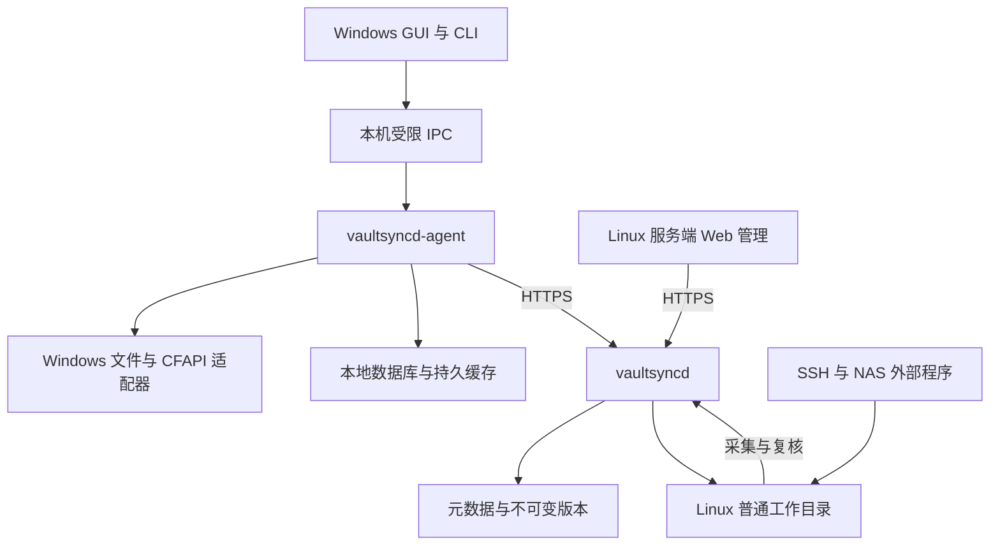

# vaultsyncd：设计与实现文档

**版本：v1.5（服务端强制 btrfs 与 CoW 存储路径）**
**日期：2026-11-05**  
**状态：全部产品选型已确认；首发仅交付 Windows 客户端与 Linux 服务端。实现、性能测量与平台验证尚未执行。**  
**项目名称：vaultsyncd。**  
**项目代号：vaultsyncd。**  
**软件名称与仓库名称：vaultsyncd。**

## 0. 文档使用约定

本文把需求转化为模块职责、数据结构、行为契约、异常恢复和可验收的开发任务。本文不声称软件已经实现、测试已经通过或平台兼容性已经得到实机验证。

采用以下状态标记：

| 标记 | 含义 | 编码时如何处理 |
| --- | --- | --- |
| **C：已确认** | 用户已明确选择的产品决策 | 必须遵守；不得为了实现方便自行降低要求 |
| **D：设计建议** | 本文提出的具体工程实现 | 可按本文细化；变更需记录原因、影响和测试证据 |
| **P0 / P1：阶段** | P0 为首发；P1 为后续 | P1 不进入首发任务依赖或发布门禁 |
| **V：待验证** | 需要目标操作系统、文件系统或真实应用验证的技术能力 | 必须安排实验和退出条件；不能用模拟测试替代 |

本文是独立的产品与工程设计基线。阅读和实施本文不需要取得其他需求文档、调研报告或历史对话；所有必需需求、术语、行为与验收条件均在本文展开。文末官方 API 链接仅供实现时查阅，不代替本文件中的产品要求。

需求冲突按以下规则处理：本文 C 项约束优先于 D 项实现建议；P0/P1 决定交付阶段。当前没有等待用户选择的产品项。新的需求变化或实测发现的规格冲突，应先更新设计决定及影响，再修改代码。工程参数和 V 项仍需验证，不能把“决策已确认”解释为“实现已经通过测试”。

**已冻结的平台边界：首发只有 Windows 客户端与 Linux 服务端。Windows 客户端使用系统原生占位符；Linux 服务端使用完整普通文件，不支持 FUSE 或占位符存储。Linux 客户端及其 FUSE 按需视图属于后续版本，不阻塞首发。服务端不承担客户端视图挂载、hydration 或 dehydration。**

### 0.1 术语

| 术语 | 本文含义 |
| --- | --- |
| Placeholder / 占位符 | 客户端可见的文件元数据；内容可能尚未下载。服务端不使用此存储形式 |
| FUSE | Linux 用户态文件系统机制；仅后续 Linux 客户端用它呈现按需目录，首发服务端不使用 |
| Hydration / materialize | 将远端版本内容下载并变为客户端实际可读取的文件内容 |
| Dehydration / evict | 经用户触发和安全检查后释放客户端内容，保留目录项；不删除服务器文件 |
| Vault / Binding | Vault 是服务端管理的共享目录（旧称 Root）；Binding 是某设备到该 Vault 的本地映射 |
| CAS | Compare-and-swap；仅当服务端当前版本满足请求的基线前提时提交，否则保留冲突或重新规划 |
| Tombstone / 墓碑 | 记录“条目已被删除”的同步事实，区别于从未出现或暂时不可访问 |
| Reflink / 快照 | 文件系统提供的克隆或一致性视图能力；可减少初始复制成本，后续修改仍消耗空间，必须验证历史不可变性 |
| P0 / P1 | P0 为首发必需；P1 为后续交付 |
| ADR | Architecture Decision Record，记录一项工程决定及其影响与验证依据 |

## 1. 产品决策基线

### 1.1 已确认需求及实现落点

| 编号 | 已确认内容 | 工程落点 |
| --- | --- | --- |
| C01 | 面向开发者和技术爱好者，自托管 | 单机可部署；数据和配置可导出 |
| C02 | 服务器是权威文件库 | 服务器确认版本、命名空间和提交结果；客户端持有副本与待提交操作 |
| C03 | 客户端提供按需文件体验 | P0：Windows CFAPI 原生占位；P1：Linux 客户端 FUSE 挂载视图 |
| C04 | 多个独立同步目录 | 服务端 Vault 与客户端 Binding 分离 |
| C05 | 删除意味着全局删除 | 显式 Delete 操作、墓碑和回收站；释放缓存不是删除 |
| C06 | 冲突保留两个版本，生成副本 | 基于版本前提判断，不以最后修改时间覆盖 |
| C07 | 回收站及文件历史保留 30 天 | 历史对象、恢复 API、垃圾回收保护条件 |
| C08 | Android 采用移动端云盘体验 | 后续做浏览、按需下载与离线缓存，不承诺任意目录后台镜像 |
| C09 | 每个同步目录独立选择模式 | Binding 存储模式；具体模式集合见 C34 |
| C10 | 首要对象是普通文档和个人文件 | 不把活动数据库、虚拟机磁盘当作首发一致性承诺 |
| C11 | MVP 单用户，未来必须支持多用户与共享目录 | 首发一个所有者账号，表结构和授权边界保留 owner/vault scope |
| C12 | 尽可能即时，通常 1—3 秒 | 小文件稳态目标；明确网络、文件大小与测量起止点 |
| C13 | 类似 `.gitignore` 的排除规则，默认排除常见缓存和临时文件 | 显式规则集与规则解释接口；排除不生成删除事件 |
| C14 | 服务端仅支持 Linux 部署 | server 仅构建 Linux 目标；Windows/macOS 不提供服务端 |
| C15 | 服务端存储目录不支持 FUSE 或 Placeholder | 工作目录、内容对象、历史、暂存与状态目录均为普通存储；不通过用户态云挂载回源 |
| C16 | 首发仅 Windows 客户端与 Linux 服务端；Linux/macOS/Android 客户端后续 | P0 含 Windows GUI/CLI、Linux 服务端管理命令与基础 Web；不交付 Linux 同步客户端 |
| C17 | 已下载文件一直保留，只有用户手动释放 | 禁止 LRU、定时回收和低磁盘自动清理完整文件 |
| C18 | 离线打开未下载文件应立即明确失败 | 原生 I/O 错误加可见状态；不返回假空文件 |
| C19 | 文件使用中保护本地内容，必要时生成冲突副本 | 写入保护、延迟应用、受控替换；见平台限制 |
| C20 | MVP 基础状态；深度右键、队列和日志界面后续 | 基础 GUI/CLI；手动释放必须有首发入口 |
| C21 | 重要故障主动通知并自动恢复；普通断网静默重试 | 统一错误分类、退避和通知去重 |
| C22 | 首次同步合并；同名不同内容保留两份 | 无基线时不推导删除；导入清单与内容校验 |
| C23 | 识别重命名和移动，占位文件只更新路径 | 稳定 EntryId；路径不作为身份 |
| C24 | 服务器文件允许外部修改并自动同步 | 外部变更采集器和周期校验；一致性边界见 C33 |
| C25 | 映射多个现有服务器目录，保留原结构 | 普通工作目录加独立内部状态目录 |
| C26 | 完全禁止同步目录重叠 | 路径与文件系统身份校验，拒绝父子、别名和隐藏重叠 |
| C27 | 账号密码登录，不强制审批、配对码或 MFA | 密码散列、会话、设备标识；不增加登录审批流程 |
| C28 | 可公网访问，网络入口由用户配置 | HTTPS 地址、代理适配；不内置穿透、中继、UPnP |
| C29 | 只要求安全传输；服务器文件普通可读写 | TLS；不加入应用层文件加密或 E2EE |
| C30 | 提供备份恢复接口，不自动备份 | 一致性导出、恢复检查、第三方备份契约 |

### 1.2 系统边界与技术约束

1. **后续 Linux 客户端的 FUSE 与首发 Linux 服务端的存储是不同模块。** P1 客户端通过 FUSE 提供按需文件视图；服务端使用普通文件 I/O 与变更监视，不链接 FUSE 适配器。inotify 负责通知变化，不能单独实现按需读取。[R1][R3]
2. **不能承诺离线时“第三方应用一定不会启动”。** 应用可能先启动再读取文件。可承诺：不伪造成功读取，尽快给出可识别的错误，并提供用户可见解释。
3. **不能给任意大小的文件承诺 30 秒内打开。** 小文件变更传播与大文件内容下载分别度量。通常 1—3 秒的目标适用于明确条件下的小文件同步，不适用于任意大小文件的完整下载。
4. **普通文件系统与 SQLite 不是一个跨资源事务。** 必须有操作日志、幂等恢复和实际字节校验，不能把数据库事务成功等同于工作目录更新成功。
5. **未保存的编辑器内存和任意外部写入不能被同步软件完全观察。** 本文只对已交付文件系统、能够稳定读取或受协调保护的数据给出持久化保证。

## 2. 已冻结的产品选型

以下决定均已确认，具有与第 1 节 C 项相同的约束力。本文直接给出最终行为，不保留需要再次选择的方案列表。

| 编号 | 决策主题 | 已确认内容 |
| --- | --- | --- |
| C31 | P2P 交付阶段 | 首发只通过服务器同步；P2P 内容加速后置，服务器始终确认版本与最终持久化 |
| C32 | 技术栈 | Rust 共享核心及服务端；Tauri 2 Windows 桌面界面；React/TypeScript 桌面展示与 Web 管理 |
| C33 | 外部直接写入的保证等级 | 自动采集最终稳定的变化，保全已采集版本；不保证保留未被观察到的瞬态覆盖版本，不要求外部程序加入写入协调协议 |
| C34 | 每目录同步模式 | 首发 Windows 客户端支持 `full` 完整双向同步和 `on_demand` 按需双向同步；不包含单向上传或单向下载模式 |
| C35 | 首发平台验证范围 | Windows 11 x86_64 客户端；Linux x86_64 服务端，NixOS 为主要开发与同机服务验证环境，Ubuntu 24.04 LTS 为发布兼容验证环境。Linux 客户端及其架构验证后置 |
| C36 | 验收规模 | 10 万文件、1 TiB 总数据、单文件 50 GiB、5 台 Windows 客户端设备；这是验收目标，不是硬编码产品上限 |
| C37 | 历史保护与空间代价 | 接受服务端额外接近一份当前数据 + 30 天历史的基线占用，并预留暂存空间；默认使用经过验证的 reflink；跨卷等受限路径按 §11.5 完整复制，数据正确性不依赖共享 extent |
| C38 | 首发传输优化 | 完整版本传输 + 分块断点续传；固定块增量、内容定义分块增量均后置 |
| C39 | 服务端存储后端 | 首发强制本机块设备上的 btrfs（工作目录、SQLite、对象、历史、暂存与备份准备目录），允许实际后端合规的普通 bind mount；不支持远程 SMB/NFS 存储目录，不支持 FUSE、占位符和按需回源目录 |

### 2.1 平台与交付边界

| 组件 | P0 首发 | P1 后续 |
| --- | --- | --- |
| Windows 客户端 | Windows 11 x86_64，GUI、CLI、后台同步进程、CFAPI | 其他 Windows 版本/架构按新需求评估 |
| Linux 服务端 | x86_64；普通存储、账号、同步 API、基础 Web 管理与管理 CLI | 扩大发行版或普通文件系统支持范围 |
| Linux 客户端 | 不交付；不进入首发安装包、构建目标和发布门禁 | 完整同步与 FUSE 按需视图、GUI/CLI、离线缓存与导入 |
| macOS 客户端 | 不交付 | File Provider 原生按需访问 |
| Android 客户端 | 不交付 | 移动云盘浏览、下载、上传和离线缓存 |

首发多设备同步使用多台 Windows 客户端验证。Linux 服务端管理 CLI、服务端 Web 管理和在 Linux 上运行的核心库测试，均不构成 Linux 同步客户端。

### 2.2 实现约束

- 服务端工作目录、对象、历史、暂存及状态目录均使用已支持的普通存储；数据库位于可靠本地文件系统。
- 首发强制 btrfs，默认使用 reflink 固定内容副本，备份准备使用只读子卷快照；准入与回退边界见 §11.5，备份一致性见 §19.1。ZFS、ext4/XFS、overlay 和网络挂载均不属于支持后端。
- 客户端经 SMB 对 NAS 上的普通目录进行外部修改，与“服务端自身将 SMB/NFS 挂载作为存储后端”不同：前者按外部变化采集，后者不在首发范围。
- 已确认验收规模需要实际测试，不因首发客户端平台减少而缩小。性能参数、并发和超时仍可依据实测调整。
- P1 只保留清晰的模块边界与后续设计，不为了预留扩展在 P0 填充假实现、空占位适配器或未启用的大量依赖。

## 3. 首发范围与交付物

### 3.1 首发功能矩阵

| 能力 | Windows 客户端 P0 | Linux 服务端 P0 |
| --- | --- | --- |
| 完整双向同步 | 普通目录完整同步 | 权威目录与版本提交 |
| 按需访问 | CFAPI/NTFS 原生占位 | 不使用占位存储；从完整普通文件提供固定版本下载 |
| 离线编辑已下载内容 | 支持；恢复后按版本基线提交 | 冲突检测与副本保留 |
| 基础状态与通知 | Windows GUI/CLI，Explorer 集成按实测交付 | 基础 Web 健康状态与错误记录 |
| 手动下载、释放空间 | GUI/CLI 首发入口 | 释放本地缓存不产生服务器删除 |
| 多目录、首次合并、移动、冲突 | 支持 | 支持 |
| 历史版本、回收站 | 基础查看和恢复入口 | 保留 30 天与恢复接口 |
| 外部目录变化 | Windows 文件监视与扫描 | Linux 普通目录的外部扫描与版本化 |
| 账号密码、HTTPS | 支持 | 单账号首发，授权检查全覆盖 |
| 手动备份与恢复 | 配置及未上传数据救援 | 完整导出/恢复契约与管理命令 |

### 3.2 后续能力

Linux 客户端（包含完整同步及 FUSE 按需访问）、macOS File Provider、Android 云盘体验、多用户与共享目录、P2P 内容加速属于后续交付。完整 Web 文件管理、系统右键深度集成、可视化传输队列也可后置；内部任务队列、结构化日志和故障恢复仍是首发必需。

首发不包含在线文档协同、自动文本合并、端到端加密、自动备份调度、服务器集群、对象存储后端、自动穿透或块级增量传输。后续增加须有单独需求、兼容性设计及验收。

## 4. 技术栈与总体架构

### 4.1 已确认技术栈与配套实现建议

| 层 | 建议 | 理由和边界 |
| --- | --- | --- |
| 共享核心 | Rust workspace | 复用身份、同步计划、协议与校验逻辑；平台代码独立 |
| 异步与服务端 | Tokio、Axum、Serde | HTTP/JSON 控制面和流式内容传输；不自行实现网络协议栈 |
| 桌面界面 | Tauri 2 + React/TypeScript | 仅管理与展示；同步不依赖窗口是否打开 |
| Web 管理 | React/TypeScript，复用展示组件 | 浏览器只访问服务端管理 API；不能读取客户端磁盘 |
| 元数据 | SQLite，SQLx migrations | 首发单机部署；数据库放可靠本地盘，WAL 不放 SMB/NFS [R6] |
| Windows | `windows` crate 封装 CFAPI、WinRT 注册与受控文件操作 | 仅适配器可直接调用这些 API |
| Linux 客户端（P1） | FUSE3 语义，候选 Rust `fuser` 适配层 | 后续 Linux agent 专用；首发不引入该依赖 |
| Linux 服务端 | 普通文件 I/O、inotify、周期扫描 | 不依赖 libfuse、`fuser` 或客户端占位适配器；不需要 `/dev/fuse` |
| 文件监视 | `notify` 候选 + 周期扫描 | 监视器用于及时发现，扫描用于修复遗漏 |
| 排除匹配 | 经验证的 gitignore 风格匹配库 | 不自行拼写 glob 正则；规则差异需要测试 |
| 内容校验 | SHA-256 | 统一文件及传输块校验；内容哈希不是访问凭据 |
| 日志 | `tracing` 结构化事件 | request_id、op_id、vault_id 贯穿日志；不记录令牌或文件内容 |

Rust、Tauri 2、React/TypeScript 的主技术栈已经确认；其余配套依赖是工程建议，不是当前最新版声明。首次编码时创建 `rust-toolchain.toml`、`Cargo.lock`、前端 lockfile，记录实测版本、MSRV、许可证和平台要求。不要在长文档中虚构“最新版本号”。

### 4.2 运行进程



- `vaultsyncd`：只在 Linux 运行，单实例持有数据库写入权，管理多个普通存储 Vault；不对同一状态目录启动多个副本，不挂载 FUSE 视图，不提供 Windows/macOS 服务端构建。
- `vaultsyncd-agent`：首发只在 Windows 用户会话运行，管理本机多个 Binding；GUI 关闭后继续运行，CFAPI 回调生命周期归它或受监管的适配器进程。Linux agent 及 FUSE 生命周期管理属于 P1。
- `vaultsyncd-cli`：首发作为 Windows 客户端命令行入口，调用同一应用服务接口，不另写同步算法。Linux 服务端另提供 `vaultsyncd-admin` 管理 CLI，只处理配置、诊断、备份和恢复，不创建客户端 Binding。
- `vaultsyncd-desktop`：Tauri 壳与界面。Tauri Core 与 WebView 的区分不等于独立同步守护进程；需要单独实现 agent 生命周期。[R8]
- 首发 Windows 客户端 IPC 使用 named pipe，限制为当前用户；Linux 服务端本机管理可用受限 Unix domain socket。后续 Linux 客户端另使用其用户级 socket，不向任意网页暴露无鉴权 localhost 管理端口。

### 4.3 模块依赖与职责

| 模块 | 输入/输出 | 负责 | 禁止 |
| --- | --- | --- | --- |
| `domain` | 不可变事实、决策、命令 | ID、版本、状态机、不变量 | 文件 I/O、网络、系统 API |
| `planner` | Base/Local/Remote → Plan | 首次合并、冲突、操作顺序 | 直接覆盖或删除文件 |
| `protocol` | DTO、错误码、兼容能力 | 序列化契约 | 业务分支各自重复定义 |
| `client-store` / `server-store` | 两端各自的元数据事务 | 独立数据库与迁移、持久任务、幂等记录 | 混用 schema；假装跨文件系统事务 |
| `transfer` | ImmutableVersion ↔ byte stream | 分块、校验、续传、带宽调度 | 修改远端版本头 |
| `client-fs-platform` | 客户端文件事实、平台能力 | P0：Windows 安全读写、占位与监视；P1：Linux FUSE | 自行选择冲突胜者；被 server 依赖 |
| `server-fs-linux` | 普通 Linux 目录与完整字节 | 存储类型检查、安全文件 I/O、挂载身份校验、监视 | FUSE 挂载、占位、hydration/dehydration |
| `agent` | Plan → 可恢复执行 | 队列、调度、重试、状态汇总 | 在 UI 线程运行核心任务 |
| `server` | 已授权 Command → CommitResult | 提交排序、命名空间、事件、恢复 | 接受客户端任意绝对路径 |
| `server-observer` | 工作目录变化 → ExternalProposal | 稳定读取、重命名识别、扫描 | 用 mtime 直接决定获胜版本 |
| `ui` | Command/StatusView | 展示、用户操作 | 读取令牌、直接修改数据库 |

## 5. vaultsyncd 仓库组织与编码边界

### 5.1 推荐组织方式与命名
| 对象 | 路径 | Cargo / npm package | 产物或用途 |
| --- | --- | --- | --- |
| Linux 服务端 | `apps/server/` | `vaultsyncd-server` | 二进制 `vaultsyncd` |
| Linux 管理命令 | `apps/server-admin/` | `vaultsyncd-admin` | 二进制 `vaultsyncd-admin` |
| Windows 后台同步进程 | `apps/agent/` | `vaultsyncd-agent` | `vaultsyncd-agent.exe` |
| Windows 客户端 CLI | `apps/cli/` | `vaultsyncd-cli` | `vaultsyncd-cli.exe` |
| Windows 桌面界面 | `apps/desktop/` | `@vaultsyncd/desktop`；Rust 壳为 `vaultsyncd-desktop` | `vaultsyncd-desktop.exe`，窗口显示名为 `vaultsyncd` |
| 服务端 Web 管理 | `apps/web/` | `@vaultsyncd/web` | 静态前端资源，由服务端发布 |
| Rust 公共库 | `crates/<module>/` | `vaultsyncd-<module>` | Rust 引用名使用下划线，例如 `vaultsyncd_domain` |
| TypeScript 公共包 | `packages/<module>/` | `@vaultsyncd/<module>` | 内部 workspace 包；不代表已注册或发布到 npm |

### 5.1.1 双工作区的职责与共同边界
| 边界 | Rust 工作区 | Web / 前端工作区 |
| --- | --- | --- |
| 根配置与锁文件 | `Cargo.toml`、`Cargo.lock` | `package.json`、`pnpm-workspace.yaml`、`pnpm-lock.yaml` |
| 成员范围 | Rust 应用入口、`crates/`、Tauri Rust 壳、xtask 与 Rust 测试包 | `apps/desktop/`、`apps/web/`、`packages/` |
| 主要职责 | 同步、存储、网络服务、平台适配、IPC 和原生桌面壳 | 桌面页面、Web 管理页面、共享组件与生成的 TS 客户端 |
| 独立验证 | 纯核心测试、目标平台构建与原生集成测试 | 类型检查、页面/组件测试、静态资源构建 |
| 共同输入 | `api/` 中的协议及兼容样本 | 同一份 `api/` 中的协议及兼容样本 |
| 共同交付 | Linux 服务端、Windows 原生组件 | Linux 管理页面、Windows 桌面页面 |

### 5.2 顶层目录
| 路径 | 职责 | 维护约束 |
| --- | --- | --- |
| `apps/` | 进程入口与前端应用 | Rust 入口尽量薄，负责配置、依赖组装和生命周期 |
| `crates/` | Rust 可复用核心、存储和平台适配 | 每个 crate 有清楚职责；不创建大杂烩 `utils`/`common` |
| `packages/` | TypeScript 公共组件、生成客户端与 IPC 类型 | 不放 Rust 业务实现，不共享访问密钥 |
| `api/` | 对外 HTTP 与本机 IPC 的机器可读契约 | 协议格式的唯一编辑源，生成内容不手改 |
| `tests/` | 跨模块、平台与端到端测试 | 按运行平台分组；必须有真实测试入口 |
| `fixtures/` | 小型、确定性的路径/内容/故障样本 | 不提交用户文件、令牌或巨大性能数据集 |
| `docs/` | 产品设计、架构、ADR、操作文档 | 长期技术资料；不放逐卡执行记录 |
| `agent/` | 实施计划、进度、任务交接、按需上下文索引 | 只链接设计，不复制规格；根 AGENTS.md 为入口 |
| `packaging/` | 安装包资源、systemd、容器镜像构建 | 不包含真实部署密码或运行数据库 |
| `deploy/` | 可复制的示例部署配置 | 与安装包生产逻辑分开；只含示例值 |
| `tools/xtask/` | Rust 编写的构建、生成、检查与发布编排工具 | 平台分支集中，避免 Shell/PowerShell 各复制一套业务逻辑 |
| `scripts/` | 必需的薄平台启动脚本 | 仅委托 xtask 或执行少量平台命令，不藏同步算法 |
| 文件 | 用途 |
| --- | --- |
| `README.md` | 产品范围、开发环境、当前可运行状态和入口命令 |
| `AGENTS.md` | 编码模型必须遵守的边界、任务入口、验证方式与禁止行为 |
| `Cargo.toml` | 虚拟 workspace、成员、公共依赖版本和 lint 配置 |
| `Cargo.lock` | 整个 Rust workspace 的统一依赖锁文件 |
| `rust-toolchain.toml` | 经实际验证的 Rust 工具链；不使用漂移的“最新”占位值 |
| `.cargo/config.toml` | 必要的 Cargo alias 与目标构建设置 |
| `package.json` | 前端公共脚本、实际锁定的包管理器版本 |
| `pnpm-workspace.yaml` | 前端 workspace 成员 |
| `pnpm-lock.yaml` | 前端统一依赖锁文件 |
| `rustfmt.toml`、`.editorconfig`、`.gitignore` | 格式与生成物排除规则 |

### 5.3 应用层：apps
| 路径 | 推荐内容 | 不应承担 |
| --- | --- | --- |
| `apps/server/src/main.rs` | Linux 服务启动、信号与配置加载 | 大段同步业务逻辑 |
| `apps/server/src/bootstrap.rs` | 组装 server-core、server-store、Linux 文件接口与 HTTP 路由 | 重新实现冲突规则或内容提交算法 |
| `apps/server-admin/src/main.rs` | 管理参数解析、调用管理 API/本机管理 socket、输出结果 | 绕过服务端事务直接修改运行中的 SQLite |
| `apps/agent/src/main.rs`、`bootstrap.rs` | Windows 用户会话 agent、单实例、恢复后启动同步与 CFAPI | UI 页面、WebView |
| `apps/cli/src/main.rs` | 调用 Windows agent 的 named pipe 接口 | 另起一套同步引擎、直接修改客户端数据库 |
| `apps/desktop/src/` | React 界面入口、路由、页面与状态展示 | 数据库写入和同步决策 |
| `apps/desktop/src/features/` | `connections/`、`bindings/`、`problems/`、`history/` 等按用户任务组织的页面 | 把 `components/` 变成全项目业务仓库 |
| `apps/desktop/src/services/agent.ts` | 通过 Tauri command 调用 agent 的前端封装 | 直接访问数据库或保存长期令牌 |
| `apps/desktop/src-tauri/src/` | Tauri 壳、托盘、窗口、最小 command、IPC 桥接 | 取代独立 agent 运行同步引擎 |
| `apps/desktop/src-tauri/capabilities/` | 窗口能力权限 | 授予任意文件访问或任意命令执行 |
| `apps/desktop/src-tauri/tauri.conf.json` | Tauri 配置、标识、构建与打包设置 | 真实账号、密码或长期令牌 |
| `apps/desktop/src-tauri/icons/` | 桌面图标与安装资源 | 用户文件或运行时截图 |
| `apps/web/src/` | Linux 服务端管理页面、认证状态、Vault/历史/回收站/备份操作 | Windows agent 的本机路径控制 |

### 5.4 Rust 模块：crates
| 目录 | 职责 | 内部文件/模块示例 |
| --- | --- | --- |
| `crates/domain/` | ID、条目、版本、操作、错误与业务不变量；不做 I/O | `ids.rs`、`entry.rs`、`version.rs`、`operation.rs`、`error.rs` |
| `crates/planner/` | Base/Local/Remote 三方比较和确定性同步计划 | `reconcile.rs`、`first_sync.rs`、`conflict.rs`、`delete.rs`、`rename.rs` |
| `crates/protocol/` | 远端 wire DTO、能力协商、协议版本与错误映射 | `generated/`、`capabilities.rs`、`versioning.rs` |
| `crates/local-ipc/` | Windows agent 命令/状态 DTO、消息帧与协议版本 | `generated/`、`framing.rs`、`version.rs`；不包含 CFAPI |
| `crates/http-client/` | 共用 HTTPS 客户端、认证刷新、事件拉取及固定版本内容接口 | `auth.rs`、`vaults.rs`、`changes.rs`、`uploads.rs`、`content.rs` |
| `crates/release-client/` | S162独立公开GitHub发行查询及包流校验；无业务API、凭据、数据库或同步状态依赖 | `lib.rs` |
| `crates/transfer/` | 内容哈希、固定块、续传状态与传输端口抽象 | `hash.rs`、`chunk.rs`、`resume.rs`、`manifest.rs`、`ports.rs` |
| `crates/fs-common/` | 路径规则、跨平台名称校验、文件事实类型、忽略规则 | `path.rs`、`name.rs`、`fingerprint.rs`、`ignore.rs`；系统调用放平台层 |
| `crates/client-store/` | 客户端 SQLite、baseline、dirty generation、队列、事件、恢复意图 | `db.rs`、`entries.rs`、`queue.rs`、`intents.rs`、`migrations/` |
| `crates/server-store/` | 服务端 SQLite、版本目录、对象引用、幂等操作、事件、历史及备份元数据 | `db.rs`、`entries.rs`、`versions.rs`、`operations.rs`、`changes.rs`、`migrations/` |
| `crates/platform-windows/` | CFAPI、WinRT 注册、Windows 安全文件 I/O、监视、named pipe | `cfapi/`、`shell/`、`files/`、`watcher/`、`ipc/` |
| `crates/platform-linux-server/` | 服务端普通文件操作、挂载准入、文件身份、inotify、受限管理 socket | `files/`、`mounts/`、`watcher/`、`ipc/`；无 FUSE |
| `crates/agent-core/` | 客户端应用服务、计划执行、下载优先级、持久队列、使用保护与状态汇总 | `engine/`、`bindings/`、`executor/`、`recovery/`、`status/`、`ports/` |
| `crates/server-core/` | 服务端用例、HTTP 处理、提交协调、外部采集、版本对象、GC 与恢复编排 | `api/`、`auth/`、`commit/`、`objects/`、`observer/`、`history/`、`backup/`、`gc/`、`ports/` |
- `crates/client-store/migrations/0001_initial.sql`
- `crates/server-store/migrations/0001_initial.sql`

### 5.5 依赖方向与组装边界
| 消费方 | 允许依赖 | 禁止依赖 |
| --- | --- | --- |
| `domain` | 必要的轻量基础库 | Tokio、HTTP、SQL、UI、平台 API |
| `planner` | `domain` 与纯规则函数 | 文件系统、网络、数据库 |
| `protocol`、`local-ipc` | 序列化与生成的 wire 类型 | server-core、agent-core、平台实现；不得借序列化泄露内部绝对路径 |
| `agent-core` | domain/planner/protocol/local-ipc/transfer/client-store 等与端口接口 | server-core、server-store、Tauri |
| `server-core` | domain/protocol/transfer/server-store 与服务端端口接口 | agent-core、client-store、CFAPI、FUSE、Tauri |
| `apps/agent` | agent-core + Windows 适配器 + HTTP 客户端，负责依赖组装 | Linux 服务端适配器 |
| `apps/server` | server-core + Linux 服务端适配器，负责依赖组装 | Windows 适配器、客户端 GUI |
| `apps/desktop/src-tauri`、`apps/cli` | local-ipc 与 Windows named pipe 客户端 | 同步规划器、数据库写入、直接内容提交 |
| `packages/ui` | React 与共享展示组件 | Tauri 插件、浏览器认证实现、Rust IPC |

### 5.6 前端公共包与协议来源
| 路径 | 内容 | 使用者 |
| --- | --- | --- |
| `packages/ui/src/` | Button、Dialog、Table、状态徽章、布局与设计变量 | desktop、web |
| `packages/api-client/src/generated/` | 按 OpenAPI 生成的 HTTP 类型与调用代码 | web；桌面若有确需直接调用的管理入口需单独评审 |
| `packages/api-client/src/index.ts` | 手写的稳定导出与浏览器调用包装 | web |
| `packages/local-ipc-types/src/generated/` | agent 命令/结果的 TypeScript 类型 | desktop |
| `apps/desktop/src/services/` | Tauri invoke 与 agent IPC 的应用封装 | 仅 desktop |
| `apps/web/src/services/` | Web 会话、HTTP 和 SSE 的应用封装 | 仅 web |
| `api/openapi.yaml` | 远端 HTTP API 唯一编辑源 | Rust protocol 与 TS API 客户端生成器 |
| `api/local-ipc.schema.json` | 客户端本机 IPC 唯一编辑源 | Rust local-ipc 与 TS local-ipc-types 生成器 |
| `api/examples/` | 合法请求/响应样本、错误样本与兼容 fixture | 契约测试 |
| `api/generation.toml` | 生成器及版本、映射、输出路径 | xtask |

### 5.7 Workspace 与构建边界
| 环境 | 命令/入口示例 | 验证目的 |
| --- | --- | --- |
| Windows 与 Linux | `cargo test --locked` | 运行便携 default-members 测试 |
| Linux | `cargo build --locked --release -p vaultsyncd-server -p vaultsyncd-admin` | Linux 服务端与管理命令 |
| NixOS 宿主 → Windows x64 | S009 验证并固定的交叉编译入口，显式选择目标与 agent/CLI 包 | Windows 后台进程与 CLI；产物在 Windows 原生运行验证 |
| NixOS 宿主构建；Windows 客体验证 | 桌面前端与 Tauri 壳交叉构建入口由对应任务实测记录 | Tauri 安装包在打包卡验证宿主支持与所需步骤；客体执行安装、升级与运行验收 |
| 前端构建环境 | `pnpm --filter @vaultsyncd/web build` | Web 静态管理资源 |
| Linux / Windows 对应任务 | Linux 执行 `cargo test --locked -p vaultsyncd-server-tests`；Windows 测试程序在宿主交叉编译、传入客体执行 | 原生平台集成测试；Windows 测试运行证据必须来自客体或实机 |

### 5.7.1 独立开发与联合发布

### 5.8 测试与本地检查布局

检查由 `cargo xtask check` 与 `cargo xtask ci <job>` 在本地执行，安装及原生能力由受控实验室验收（ADR-025）。不要求远端执行平台；平台、同源构建安装、Windows 原生证据和性能容量目标保持。

| 路径 | 入口与样本 | 执行环境 |
| --- | --- | --- |
| `crates/*/src/` 中的测试模块 | 纯逻辑单元测试，必要时该 crate 的 `tests/` 放集成测试 | 按 crate 所需平台 |
| `tests/contract/` | Cargo package `vaultsyncd-contract-tests`；`tests/remote.rs`、`tests/local_ipc.rs` | Windows/Linux，可移植 |
| `tests/server-integration/` | Cargo package `vaultsyncd-server-tests`；`tests/commit.rs`、`recovery.rs`、`backup.rs` | Linux x86_64 |
| `tests/windows-integration/` | Cargo package `vaultsyncd-windows-tests`；`tests/cfapi.rs`、`busy_file.rs`、`restart.rs` | Windows 11/NTFS 实机或合适 VM |
| `tests/e2e/` | Cargo package `vaultsyncd-e2e`，`src/main.rs` 为跨进程场景编排器；通过实际网络/IPC 驱动产品 | Windows 客户端 + Linux 服务端组合环境 |
| `tests/scenarios/` | 首次合并、断网、并发编辑、删除、历史恢复等数据驱动描述 | 由明确的 contract/integration/e2e runner 加载 |
| `tests/faults/` | 故障注入点说明、固定种子与最小失败轨迹 | 对应平台 runner 加载 |
| `tests/platform/` | 原生实验操作说明与环境要求；不当作无入口的 Rust 测试目录 | 对应平台实验 |
| `fixtures/paths/`、`fixtures/content/`、`fixtures/protocol/` | 保留名、大小写冲突、小文件、协议样本 | 所有相关测试 |
| `apps/desktop/tests/`、`apps/web/tests/` | 页面行为与连接错误展示 | 前端测试框架 |
| `packages/ui/tests/` | 共享组件行为 | 前端测试框架 |
| 变更范围 | 至少触发的检查 |
| --- | --- |
| 仅前端页面、组件 | 受影响前端包及其消费者的类型检查、测试与构建 |
| Rust 核心、存储或平台实现 | 受影响 Rust 包和消费者测试；相应目标平台构建与集成测试 |
| `api/` 或生成器配置 | 重新生成 Rust / TypeScript 代码并检查差异；两侧编译、契约和兼容测试 |
| `apps/desktop/src-tauri/` 或本机 IPC | Windows 壳与 agent/CLI 检查、桌面调用链集成验证；IPC 变更同时验证 TS 消费者 |
| 根 workspace 配置、锁文件、工具链或共享构建工具 | 对应工作区受影响包；无法可靠推导影响范围时运行该工作区完整适用检查 |
| 安装、发布或部署配置 | 对应产品组装与安装/升级冒烟测试 |
| 正式发布候选 | 两工作区适用检查与 Windows 客户端 + Linux 服务端联合验收 |

### 5.9 部署、安装与工程文档
| 路径 | 具体内容 |
| --- | --- |
| `packaging/linux/systemd/vaultsyncd.service` | Linux 服务进程定义与正常停止行为 |
| `packaging/linux/container/Dockerfile` | 服务端容器构建，只安装所需运行资源 |
| `packaging/windows/installer/` | Windows 安装、启动入口、升级与卸载辅助资源；Tauri 配置仍在 src-tauri |
| `packaging/windows/agent/` | 用户会话后台进程注册、恢复与卸载的专用资源 |
| `packaging/windows/zip/` | Windows 免安装 ZIP 的启动、停止与说明资源；状态仍留当前用户本机 |
| `deploy/compose/compose.yaml` | 普通 bind mount 和持久状态目录示例，不挂载 `/dev/fuse` |
| `deploy/reverse-proxy/` | HTTPS 入口与受限本机服务连接示例 |
| `deploy/examples/vaultsyncd.toml` | 服务端最小配置示例，只含示例目录与变量 |
| `docs/design.md` | 本文的仓库内版本，保持自包含 |
| `docs/architecture/repository.md` | 从本节抽取的目录索引；索引引用 design 的具体章节，避免重复维护产品规则 |
| `docs/adr/` | IPC、版本提交、对象历史、平台边界、命名等设计决定 |
| `agent/tasks/`、`agent/progress.md` | DEV/FUT 任务、实际完成状态与测试证据 |
| `docs/operations/` | 部署、备份、恢复、升级、排错 |
| `docs/known-limitations.md` | 已验证的限制，区别于未测试事项 |
| `docs/future/` | Linux/FUSE、macOS、Android、多用户/P2P/增量传输的后续设计 |

### 5.10 源代码、构建产物与运行数据分离
| 类别 | 推荐位置 | 是否进入 Git |
| --- | --- | --- |
| Rust 编译结果 | 仓库 `target/` | 否 |
| 前端中间资源 | 各应用 `dist/`、包构建输出 | 否 |
| 安装包暂存/验收报告 | 仓库 `artifacts/`，按任务和平台分目录 | 否；发布时通过制品机制保存 |
| 第三方 JS 依赖 | `node_modules/` | 否 |
| Linux 服务端配置 | 示例为 `/etc/vaultsyncd/vaultsyncd.toml`，容器可映射其他位置 | 真实配置不进入 Git |
| Linux 服务端状态 | 示例为 `/var/lib/vaultsyncd/`，包含 server.sqlite、objects、staging、intents | 否；整体纳入备份/恢复契约 |
| 用户实际服务器目录 | 用户配置的普通 btrfs 路径，例如 `/srv/documents/` | 否；与内部状态目录分开 |
| Windows 客户端状态 | OS 定位的 LocalAppData 下 `vaultsyncd/`，包含 client.sqlite、cache、staging、logs | 否；长期凭据优先凭据库 |
| Windows 用户同步目录 | 用户选择的 NTFS 目录 | 否；不存放在源码仓库或内部缓存中 |
| 性能测试大数据集 | 用户指定的测试卷/临时目录 | 否；fixtures 中只保存生成规则与种子 |

### 5.11 初始建仓顺序与后续平台

### 5.12 编码任务与目录的对应关系
| 任务类型 | 主要修改位置 | 一起检查的位置 |
| --- | --- | --- |
| 首次合并、移动和冲突规则 | `crates/planner/` | domain 不变量、`tests/scenarios/` |
| 服务端提交与崩溃恢复 | `crates/server-core/src/commit/`、`crates/server-store/` | Linux 文件端口、server-integration、故障轨迹 |
| Windows 占位和使用保护 | `crates/platform-windows/src/cfapi/`、`crates/agent-core/src/executor/` | windows-integration、generation/intent 恢复 |
| 上传/下载续传 | `crates/transfer/`、`crates/http-client/` | server-core API、固定版本内容校验 |
| 服务端外部修改 | `crates/platform-linux-server/src/watcher/`、`crates/server-core/src/observer/` | 挂载身份校验、版本化与删除保护 |
| HTTP 或 IPC 字段调整 | `api/` 的对应契约 | 重新生成 Rust/TS 类型、contract 测试和兼容性说明 |
| 客户端 SQLite 变更 | `crates/client-store/migrations/` | agent 启动升级和旧数据库 fixture |
| 服务端 SQLite 变更 | `crates/server-store/migrations/` | server 升级、备份恢复与旧数据库 fixture |
| 同步状态页面 | `apps/desktop/src/features/` | `packages/ui/`、local-ipc 类型，不能改写同步状态事实 |

工程约束：单 monorepo、根 Cargo/pnpm 双工作区；按应用/职责组织，不设顶层 rust/web 双项目。Tauri 的 src-tauri 属于根 Cargo workspace；仅保留根 Cargo.lock/pnpm-lock.yaml，成员随真实包创建加入。Rust 纯核心/服务端编译不依赖前端工具链；产品打包才装配 Web 资源。Linux 默认检查不全量构建 Windows 包；Windows 客户端通过显式目标与包选择在 NixOS 宿主交叉编译，default-members 只选可移植核心，平台依赖另用目标条件隔离。

协议以 api/ 为唯一编辑源，生成代码提交并在本地检查中重生成校验；domain 显式映射到 wire DTO。纯核心不依赖 I/O，应用入口组装平台与存储；用本地 newtype 实现核心端口，避免循环依赖/孤儿规则。GUI/CLI 仅经 IPC 控制 agent；GUI 退出不停止同步。Web 静态资源随服务端交付，生产无需 Node.js。

Rust/前端各自验证，协议变更同时验证双方与消费者。发布统一产品版本与提交，协议/schema 独立版本；记录工具链/目标/hash，禁止混用旧产物。使用 --locked / --frozen-lockfile；平台运行证明不能由交叉编译替代。普通 Rust module 优先于继续拆 crate；P1 不创建空实现。生成/检查/打包编排集中在 xtask。

服务端对象元数据由 server-store 管理，实际字节由 server-core 的 objects 通过 Linux 文件端口发布；两端数据库迁移分别归属各自 store。根 tests 下 Rust 文件必须有对应 Cargo 测试包或 runner，不会自动发现。源码、运行数据、故障测试卷互相隔离。

开发基线：NixOS 同机开发和服务，项目 flake 固定开发依赖；Windows 客户端在本 NixOS 开发环境交叉编译，前端在宿主构建，以节省 VM 资源。Windows 11 x64 原生测试优先使用 Quickemu/QEMU-KVM 客体及其 NTFS 卷，客体不默认安装完整编译工具链。原有合规 Windows VM/实机可复用。镜像、虚拟磁盘、TPM/EFI 状态存源码仓库外；宿主服务使用独立 btrfs 测试目录。Quickemu 创建、远程 SPICE、基线备份、构建产物交付与客体运行时的操作说明统一见实施手册 §2.6。Ubuntu 24.04 x86_64 另做发布兼容验证。

## 6. 全系统不变量

以下 I 编号必须出现在关键测试或评审记录中。

1. **I01 服务端成功的含义**：只有完整内容可校验、持久化元数据已提交、工作目录发布已完成或外部同内容已确认，才返回 `committed`。异步处理中返回 `pending`，不能提前显示已同步。
2. **I02 本地修改保护**：未被服务器确认的本地数据、冲突数据、仍被写入的数据不可被释放缓存或远端替换清理。
3. **I03 身份稳定**：路径改变不改变 EntryId；删除后原路径新建是新 EntryId。
4. **I04 冲突不静默覆盖**：任何过期基线提交必须重新规划或保留副本；时间戳只用于展示与检测候选变化。
5. **I05 不完整内容不可见为完整版本**：分块或下载失败不能把半个文件标记为 hydrated/已同步。
6. **I06 重试幂等**：同一 `op_id` 与同一规范化请求只产生一个业务结果；同 ID 不同请求拒绝。
7. **I07 首次合并不推导删除**：缺少共同基线时，另一端不存在不代表用户执行删除。
8. **I08 故障不等于删除**：挂载丢失、权限拒绝、扫描中断、目录尚未枚举完均不能生成批量删除。
9. **I09 游标可恢复**：事件与逻辑状态提交一致；客户端仅在事件已持久化到本地工作队列后推进接收游标，另记已应用进度。
10. **I10 路径不可逃逸**：所有访问均在授权 Vault 内；拒绝路径穿越、符号链接跳转及竞争替换导致的越界。
11. **I11 完整缓存不自动驱逐**：允许清理可重建临时下载片段；不允许自动驱逐已完成下载文件、已下载旧内容或脏数据。
12. **I12 历史不可变**：已提交 VersionId 对应字节不再改变；恢复历史创建新当前版本，而非改写旧版本。
13. **I13 磁盘与 DB 可恢复**：任何步骤崩溃后均可判断重做、停止或保留冲突；不靠猜测“上次应该成功了”。
14. **I14 服务端变更被观察**：外部变更和客户端提交进入同一个版本及事件流程，避免两套规则。
15. **I15 权限每次检查**：所有元数据、版本、下载块、快照、恢复与备份接口验证当前账号对 Vault 的权限。

## 7. 核心数据模型

### 7.1 身份、版本与时间

- `ServerId`：安装实例身份；备份恢复沿用该身份，但更换 `ServerEpoch`。
- `VaultId`：一个被管理的服务器目录，不等于本地路径文本。
- `BindingId`：某设备某目录与 Vault 的绑定，持有独立同步模式和排除规则。
- `EntryId`：服务器命名空间条目身份，文件或目录均有；根目录也有合成 EntryId。
- `Revision`：服务器对条目元数据/内容/位置变化分配的递增修订；无共同基线的本地新文件用临时 ID，提交时返回映射。
- `VersionId`：某个不可变文件内容版本；目录没有文件内容 VersionId。
- `ContentHash`：内容 SHA-256；相同内容可复用物理对象，但不能因此复用权限或条目身份。
- `VaultSeq`：Vault 事务事件序号，严格递增，只有服务器分配；外部采集也使用该序列。
- `DeviceId`、`OpId`：设备与逻辑操作的随机不透明标识；不承担身份认证。
- 所有计数器必须避免 JavaScript 53 位精度问题：API 中长整数以十进制字符串传输。SQLite INTEGER 使用有符号 64 位范围，Rust 在边界做检查。
- 存储 UTC 时间，显示时转本地时间。保留期以服务端时间计量，不以客户端 mtime 决定。

### 7.2 服务端表

| 表 | 关键字段 | 必要约束 |
| --- | --- | --- |
| `users` | id、login、password_hash、status | 首发仅一位 owner，但 API 不省略授权 |
| `sessions` | id、user_id、device_id、token_digest、expires_at、revoked_at | 令牌摘要存储；到期/失效必检 |
| `vaults` | id、owner_id、absolute_path、volume_identity、vault_file_identity、health、seq、epoch | 路径不重叠；身份不匹配停止同步 |
| `entries` | id、vault_id、parent_id、name、name_key、kind、revision、content_version_id、deleted_at、modified_at | 活跃同父目录名称唯一；父子必须同 Vault；不允许目录环；`modified_at` 是服务端接受改动的时刻，不是文件系统 mtime |
| `versions` | id、vault_id、entry_id、object_hash、size、created_seq、superseded_at、origin | 引用已持久化内容；历史只读 |
| `objects` | vault_id、hash、size、storage_path、verified_at、gc_state | 内容地址对象；不通过哈希全局泄露存在性 |
| `changes` | vault_id、seq、tx_id、events_json、created_at | `(vault_id,seq)` 唯一；一条记录是一个不可拆分事务批次 |
| `operations` | vault_id、device_id、op_id、request_digest、state、result_json、intent_path | 幂等键唯一；保留紧凑结果直到相应设备代际失效 |
| `uploads` | id、vault_id、session_id、expected_size、hash、expires_at、state | 绑定用户、Vault 和不可变内容意图 |
| `upload_parts` | upload_id、part_index、length、hash、path | 索引唯一；重复内容匹配才幂等 |
| `conflicts` | id、vault_id、source_entry_id、sibling_entry_id、reason、resolved_at | 一个 OpId 的冲突结果稳定 |
| `trash` | delete_id、vault_id、entry_id、deleted_seq、expires_at、manifest_ref | 保存路径与目录子树恢复信息 |
| `fs_intents` | intent_id、vault_id、expected_before、desired_after、phase | 支持工作目录发布的崩溃恢复 |
| `backup_leases` | id、snapshot_seq_map、expires_at、manifest_ref | 被备份引用的对象不可被 GC |

`name_key` 使用统一、版本化的跨平台可表示性检查。原始名称保留；不自动小写、不偷偷规范化重命名。确切 Windows 名称等价规则通过平台适配器校验，不能用简单 Unicode lowercase 代替所有文件系统比较。

### 7.3 客户端表

| 表 | 作用 |
| --- | --- |
| `bindings` | Vault、设备本地路径/挂载点、缓存位置、模式、规则版本、服务器 epoch |
| `baseline_entries` | 最近已确认的共同基线：EntryId、Revision、VersionId、位置、删除标记 |
| `remote_entries` | 最新收到但可能尚未落盘的远端状态；与 baseline 分开 |
| `local_entries` | 当前指纹、generation、dirty 标志、驻留信息、平台 file identity |
| `pending_ops` | 本地操作、基线、依赖、固定内容版本、重试次数与结果 |
| `received_changes` | 已持久收到的事件批次及应用结果，避免推进游标后丢任务 |
| `transfers` | 固定 VersionId、块位图、校验结果、临时路径与取消状态 |
| `local_intents` | 替换、移动、释放、导入等可恢复动作 |
| `notifications` | 需要关注的问题、去重键、已读状态 |

### 7.4 元数据约束

外键启用；写事务短小，哈希计算和网络下载不得持有数据库事务。目录删除检查整个子树，目录移动检查环与目标冲突。文件和目录同名视为冲突，不自动用文件替换目录。数据库迁移要有旧版本 fixture，失败后不能启动同步写入。

## 8. 本地状态与可见状态

### 8.1 不使用一个枚举表达所有文件状态

同一文件可能“已下载、存在本地修改、远端又有更新”。因此内部状态拆成正交维度：

| 维度 | 状态示例 |
| --- | --- |
| 驻留 `residency` | metadata_only、partial、materialized |
| 本地变更 `dirty` | clean、dirty、snapshotting、awaiting_commit |
| 远端应用 `remote_apply` | current、pending、blocked_by_local、conflicted |
| 任务 `transfer` | idle、queued、running、retry_wait、failed |
| 使用保护 `usage` | idle、read_handles、write_handles、unknown |
| 可用性 `availability` | online、offline、mount_failed、vault_unavailable |

`partial` 是内部下载状态，不代表完整离线可用。目录“已同步”必须按子任务、失败和冲突汇总，不可只看目录自身元数据。

### 8.2 界面投影优先级

严重失败/不可用 > 未处理冲突 > 待上传本地修改 > 正在同步 > 已下载 > 仅云端。状态详情可以同时显示多个事实，例如“已下载 · 本地修改待上传 · 当前离线”。

`已同步` 定义为该条目的本地基线与服务器已确认版本一致且无待处理本地操作；它不等于“另有独立备份”。只收到上传字节或拿到 `202 pending` 不能显示已同步。

### 8.3 主要转换

| 初始事实 | 事件 | 动作 | 完成条件 |
| --- | --- | --- | --- |
| metadata_only | 用户读取 | 固定 VersionId，排队下载 | 完整校验并受控安装后 materialized |
| materialized/clean | 用户写入 | 增加 local_generation，记录 dirty | 本地保存成功与远端提交分别确认 |
| dirty | 上传完成 | 请求带基线的提交 | 服务器 committed 且 generation 未变化才转 clean |
| dirty | 上传期间再次写入 | 保留旧快照提交、新 generation 排后续操作 | 旧 ACK 不得把新内容标 clean |
| clean | 远端修改 | 按模式更新元数据或下载新内容 | 确认可安全替换后推进 baseline |
| dirty | 远端修改 | 规划冲突，固定本地快照 | 双方版本持久化且副本身份确定 |
| materialized/clean | 用户释放 | 校验已提交、无写入、可恢复性 | 内容释放成功后才标 metadata_only |
| 任意 | 取消任务 | 停止当前工作并记录可恢复状态 | 不自动撤销已经 committed 的服务端操作 |

### 8.4 客户端持久化与重启

后续 Linux 客户端的 FUSE 可控写入路径应先建立持久写入意图，再接收修改；成功的本地 fsync 必须覆盖内容和重建脏状态所需的信息。普通目录上的外部应用写入无法由监视器提前记日志，因此客户端数据库中的 clean 标记仅是上次观察，不是文件当前未变的证明。

agent 重启后先恢复 local_intents、核对文件身份和实际内容，再允许远端覆盖、删除或释放。非正常退出时，对尚不能证明未变化的完整缓存/普通文件重新校验内容；扫描尚未完成的条目置为 unknown 并禁止破坏性动作。不能只恢复数据库里的 clean 状态就开始覆盖磁盘。

本地发布采用暂存内容、校验、持久意图、受控替换、更新 baseline 的顺序；在文件已换但数据库未更新时，通过意图中的哈希辨认结果。发送到服务器的内容快照至少保留到 committed 且本地基线记录完成。冲突 ACK 还要保存原条目与副本 EntryId 的映射，避免下一轮再次上传同一冲突。

释放操作首先确认目标完整内容对应仍可读取的服务器版本，或已确认的等价当前版本；若本地保存的是已经过期且服务器不再保留的旧内容，不能直接丢弃。随后取得使用保护并重新核对 generation，再执行平台释放和状态更新。跨越 30 天历史到期窗口的下载、恢复和释放检查通过短期内容租约或等价机制保护其版本，避免检查之后对象被 GC。

## 9. 同步算法与事件协议

### 9.1 基本原则：三方比较

规划器输入为共同基线 B、本地状态 L、最新远端状态 R。比较内容、名称/父目录、类型、删除事实，不能只比较一个 `mtime`。

- L=B、R≠B：应用远端变化，先检查本地使用保护与路径条件。
- L≠B、R=B：生成本地提交，附带 B 的 Revision。
- L≠B、R≠B：若已证明同一结果则归并；否则执行第 10 节冲突规则。
- L=B、R=B：无操作。
- B 不存在：进入首次合并规则，不推导删除。

本地快照带 `local_generation`。哈希前后核对文件身份、大小、时间及 generation；读取过程中变化则重新排队。即使两次 stat 相同也不是任意外部写入下的原子快照，强一致要求见第 12 节。

### 9.2 首次同步已有内容

1. 验证 Vault 健康、目录无重叠、当前目录类型及名称可表示。
2. 获取服务器一致性元数据快照，记录 `snapshot_id + epoch + high_water_seq`。
3. 扫描本地目录并保留导入清单，先元数据后必要的内容哈希。
4. 同一规范路径、类型和内容相同：绑定服务器 EntryId，无需重复上传内容。
5. 仅本地存在：上传为新条目；仅服务器存在：按 Binding 模式创建占位或下载。
6. 同名不同内容/类型：服务器现有条目保留名称，本地内容生成新冲突条目；双方仍按固定版本校验。
7. 目录按名称合并；文件—目录同名不能递归覆盖，需另名保留并告知用户。
8. 快照期间的后续事件从 `high_water_seq` 接续；上传前照常执行 CAS，避免以旧快照覆盖新变化。

首次合并是可恢复任务，断开后继续。它与“曾同步设备游标过期后的重建”不同，后者必须使用旧基线防止复活历史删除。

### 9.3 事件传输

采用 **HTTPS JSON 命令 + 持久事件拉取 + SSE 唤醒提示**（D）。SSE 仅减少等待，不是唯一事件来源；断线后可轮询恢复。

`GET /v1/vaults/{vault_id}/changes?after={seq}&limit={n}` 返回有序事务批次。每批含 VaultSeq、TxId、相关条目变化和冲突关联。目录级事务不能被分页拆成一半。通知重复、丢失、乱序都由拉取与去重修复。

快照分页必须固定同一 `snapshot_id`，不能每页直接读取不断变化的 live 表。建议服务端生成短期只读快照清单；过期后重启快照。下载某文件内容仍须引用 VersionId，而不是“当前路径”。

客户端在一个数据库事务内写入 received_changes、remote_entries、应用任务以及 received_cursor。文件落盘完成后另更新 applied_cursor/条目 baseline；某文件失败不阻止接收其他事件，但相关依赖不得越过。

### 9.4 游标失效、离线太久和服务端恢复

- 事件保留期是协议参数，与 30 天内容历史不是同一个概念。建议首发事件保留 90 天，属于 D，可调整；过旧游标返回 `CURSOR_EXPIRED`，不得静默返回空列表。
- 重建时保留旧 baseline、未上传队列及本地数据。旧基线中存在、服务器当前不存在、且本地未修改的文件，不当作新增重新上传。
- 旧基线文件本地有修改而远端已删除：保留为恢复/冲突候选；不能未经处理复活原 EntryId。
- 无法证明来源的本地文件进入“重建待核对”清单，先保留，不能整目录自动上传或删除。
- 恢复备份后更换 ServerEpoch。旧 epoch 的待提交操作不自动重放；保全本地内容，重新拉取快照并报告服务器回退。相同 seq 在新 epoch 下不是旧事件。
- 幂等操作记录的回收必须与设备代际失效绑定；过旧设备需要重建会话/同步基线，不能因 `op_id` 记录过期把旧 Delete 当作新命令执行。

### 9.5 重命名识别

平台稳定文件身份和配对的 rename 事件为优先证据，内容哈希只作辅助。多个同内容文件并存时不能凭哈希猜测唯一移动关系。

同 Vault 内文件/目录移动保持 EntryId。移动目录只修改父目录关系，不给所有子文件重新传输内容。跨 Vault 移动在首发作为“目标创建成功后再源删除”的可恢复任务，不假装是一个跨 Vault 原子 rename；无法确定来源时按独立新增/删除处理，并保留历史。

## 10. 冲突、删除与目录规则

### 10.1 确定性冲突矩阵（D，落实 C06/C19）

服务端已提交 head 默认保留主路径；迟到的不同本地内容创建冲突条目。先后顺序以服务器提交序为准，不比较设备时钟。

| 并发情况 | 处理规则 |
| --- | --- |
| 两端修改内容且字节不同 | 保留服务器 head；本地快照提交为新冲突 EntryId，向所有设备传播 |
| 两端得到同样内容及同样位置 | 校验哈希与大小后归并，不额外造副本 |
| 一端移动、另一端修改 | 首发保守保留两种候选：已经提交的位置/内容继续作为主条目；迟到分支保留其内容和原意图位置，必要时加冲突后缀 |
| 两端移动到不同位置 | 已提交路径为主；迟到目标生成有稳定 ID 的冲突副本或目录冲突记录，不反复来回移动 |
| 两端移动到相同位置、内容相同 | 幂等归并 |
| 一端删除、另一端修改 | 删除已提交时，修改内容创建恢复冲突条目；修改已提交时，旧 Delete 返回需要冲突处理，不删除新内容 |
| 一端删除、另一端仅移动 | 不用移动意图复活已删除身份；保留能恢复的内容/子树并报告冲突 |
| 两端删除同一 Revision | 幂等成功，不再次清理 |
| 两端新增同名不同文件 | 先提交保留名称，另一方改冲突名 |
| 文件与目录同名 | 保留双方类型；给迟到一方新名称；不覆盖目录内容 |
| 父目录删除期间另一端新增子项 | Delete 的子树前提失效，返回 `SUBTREE_CHANGED`；重新规划或保留冲突目录，禁止把新增文件一起吞掉 |
| 目标路径已存在，或目标祖先已删除 | 不覆盖目标；重新规划另名/恢复目录并向用户展示原因 |
| 相同旧 OpId 再次提交 | 返回原结果和同一个冲突副本 ID，不再生成第二份 |

移动+修改采用上表的保守双副本规则。若后续增加自动组合“新路径+新内容”，另开 ADR，并用稳定 EntryId 和基线证明不会丢失任一独立编辑。

### 10.2 冲突名称

建议形式：`报告（冲突-设备短标识-20261105T083000Z-op短标识）.docx`。扩展名保留；时间来自服务器；短标识碰撞时扩展长度，名字长度按目标文件系统预算截断。真正的幂等依据是 OpId/ConflictId，不是文件名。

冲突副本是普通可同步条目，带来源元数据。用户删除副本属于普通全局删除。仅“关闭冲突提醒”不删除文件。首发不自动合并文本或 Office 内容。

### 10.3 删除与恢复

- 删除要求目标 Revision；目录删除还携带服务端生成的子树 token（由该子树任一变更更新），防止并发新增被遗漏。
- 大目录删除使用可恢复任务：冻结逻辑子树、生成清单、检查并发，完成后原子公布逻辑删除批次。执行期间该子树其他写入返回明确忙状态。
- 工作目录移除失败时操作保持 pending/failed，不能只更新 DB 后声称所有设备已删除。
- 30 天内可恢复文件和目录路径清单。恢复到原位置若冲突，默认另名恢复并返回实际位置，不能覆盖现在的新文件。
- 普通历史版本从被新版本替代时起保留 30 天；删除条目的可恢复内容从删除时起至少保留 30 天。当前活跃版本不因年龄清理。
- 回收站过期后允许删除内容，但协议必须另行处理旧设备基线和墓碑压缩，不能因为内容过期而把旧客户端当首次加入。

### 10.4 排除、取消绑定和模式切换

排除规则表示“不参与此绑定的同步”，不是全局 Delete。新增排除规则后停止该路径的新传输，保留已下载本地内容和服务器内容；对已经跟踪的条目记录 excluded 状态。取消排除时重新协调，不能直接上传过时文件。包含排除子项的父目录，客户端不能据本地缺项推断整个远端目录应删除。

`.syncignore` 建议支持注释、空行、`!`、`*`、`**`、根锚定与目录规则，并提供“为什么被排除”的查询。其语义以 Git 官方规则为参照，尤其排除父目录后对子文件重新包含的限制需明确测试。[R10] 默认规则清单可编辑；不要默认排除整个 `.git` 或任意隐藏文件。配置文件本身应通过配置接口分发或明确作为普通文件同步，不能形成“排除规则被自己排除而永久无法更新”的循环；首发建议绑定级配置接口。

2026-11-11（S196，用户明确要求，ADR-035）：所有绑定自动加载内置默认排除清单（含 Office `~$*` 临时/锁文件），桌面「额外排除规则」及绑定配置接口只编辑附加文本。有效规则为内置清单在前、附加规则在后；清空只移除附加规则，不关闭默认排除。仍支持后置 `!` 重新包含默认排除项及 Git 的父目录限制。规则解释、首次发现、上传/下载、目录操作与完整模式补齐须使用同一有效规则；已有绑定升级后同样适用，保留两端内容及未确认状态，取消排除必须先三方重协调。重新包含时，远端从未跟踪的条目按固定版本受控恢复（按需绑定只建占位），目录按父先子后恢复；被跟踪文件若在排除期间被本地删除，保持协调围栏并等待显式恢复，既不自动重下也不推导删除。已被排除而停放的上传/下载任务保留字节、基线与队列位置，但不得阻塞其他文件的完整模式补齐，也不得以删除队列冒充成功。

解除绑定默认停止管理并保留本地数据、缓存和服务器文件，不发送 Delete。清理占位符或缓存是独立显式操作。`full → on_demand` 保留所有已下载内容；`on_demand → full` 排队补齐所有未排除内容，完成前不能标为完整离线可用。full 模式下请求释放返回 `MODE_REQUIRES_LOCAL_COPY`，引导先切换模式。

## 11. 服务端内容存储、提交与崩溃恢复

### 11.1 普通工作目录与不可变内容对象

服务器已有目录继续保存普通文件，SSH/NAS 可以访问。内部状态目录位于同步根之外，保存 SQLite、不可变对象、上传片段、操作日志、历史清单和备份清单。

**C37：每个已确认当前版本必须有不可变内容副本。** 只在收到删除通知后才去备份旧文件，已经来不及恢复被外部程序覆盖或删除的内容。首发默认用 btrfs reflink 创建独立 inode 的内容副本；同文件系统内共享数据 extent，后续写入通过 CoW 隔离。[R19] 不能使用与可变工作文件共享同一 inode 的硬链接冒充不可变版本。对象只由服务管理，不向外部写入者开放写权限。

reflink 可减少工作文件与当前对象的重复物理数据，但不保证所有历史版本增量存储：客户端整文件上传仍可能写入一整份新数据，不新增块级去重或差量传输。容量仍按最坏情况估算，该设计可能额外占用接近一份当前数据及 30 天历史空间；该空间代价已按 C37 接受，验收规模固定见 C36。内部对象是实现历史、固定版本下载和恢复的依据，不改变用户可见目录结构。首次扫描完成前，未成功采集的既有文件不显示为“已有历史保护”。

### 11.2 一次内容修改的提交步骤

1. **鉴权与幂等检查**：校验账号、Vault、OpId、request_digest、会话与 epoch。已完成则返回原结果。
2. **内容接收**：上传到内部暂存区；验证每块与总文件 SHA-256、长度，完成持久化。不得直接写当前文件。
3. **固定内容对象**：对象落盘、校验及必要 fsync 完成；内容对象随后只读。尚未被引用的对象可以成为孤儿，不能导致损坏。
4. **基线与现场复核**：持有 Vault 提交调度锁，比较 Entry Revision、父目录/目标名称、删除前提和工作目录已观察指纹。现场已变化则先采集或返回 `RECONCILE_REQUIRED`。
5. **准备意图**：持久写入 `fs_intent`，包含 expected_before、desired_after、前后内容引用及恢复所需路径。内部锁只能序列化本服务操作，不能锁住所有外部应用。
6. **发布工作文件**：从不可变对象 reflink 到目标所在子卷内的 staging 文件（跨文件系统走校验复制），刷盘后使用平台受控替换，保留旧内容的不可变引用。跨文件系统不能依赖一次 rename 完成。检测到外部写入/使用冲突时停止替换并保留候选版本。
7. **元数据完成事务**：写 entries、versions、changes、冲突信息及 operations 结果；变更事件与最终逻辑状态同一数据库事务提交。事务前的工作目录状态不可通过 API 暴露为一个假完整新版本。
8. **确认与通知**：记录 committed 后响应，SSE 提示仅作为唤醒。失败或超时通过 OpId 查询结果，不重造操作。

对纯移动、创建目录和删除同样使用意图日志；不需上传内容不代表可以跳过恢复协议。API 查询遇到涉及进行中意图的条目应返回旧已确认视图或明确 pending，不提供半完成逻辑视图。

### 11.3 恢复矩阵

| 崩溃位置 | 启动后的证据与处理 |
| --- | --- |
| 上传片段未齐 | 校验已存片段，允许续传；不发布新版本 |
| 对象落盘，意图未创建 | 对象无引用；宽限期后可 GC |
| 意图已写，工作文件未变 | 核对 expected_before，满足前提则重做；否则进入协调 |
| 工作文件已发布，DB 未完成 | 校验目标与 desired_after 一致后完成同一操作；若已经又被外部修改，保留两个可读版本并重新协调，不能盲目覆盖 |
| DB 已 committed，响应丢失 | 同 OpId 返回原结果，不创建重复副本 |
| 意图与工作目录均无法解释 | Vault 标记 `NEEDS_RECOVERY`，暂停破坏性写入；输出恢复报告与候选版本 |
| 数据库或对象损坏 | 停止相关 Vault 写入，报告具体损坏；不以“全量重扫”覆盖唯一元数据证据 |

启动先恢复未完成意图，再开放写入和事件游标。只重放可证明的操作，不依赖最后一条普通日志推测事实。

### 11.4 Linux 服务端存储接口与准入检查

服务端只使用 `ServerStorage` 一类普通文件存储接口，职责为：检查目录与挂载、取得受限根句柄、读取完整版本、写入普通暂存文件、持久化/发布工作文件、保留历史和扫描变更。它不包含 `mount_fuse`、`create_placeholder`、`hydrate`、`dehydrate`、`pin` 等客户端操作，也不以客户端适配器作为后端实现。

| 检查位置 | 必须执行的规则 |
| --- | --- |
| Vault 注册 | 确认目录在允许基目录内，非重叠，底层后端符合 C39；拒绝 FUSE、客户端挂载视图及已知占位/按需回源目录 |
| 内部目录初始化 | SQLite、对象、历史、暂存和备份准备目录均要求合规 btrfs；核对 CoW/校验、权限和子卷布局 |
| 子目录遍历 | 检查跨挂载边界；拒绝 Vault 内嵌套子卷及子挂载，不能以根是 btrfs 绕过限制 |
| 内容版本确认 | 必须能从普通存储取得并验证完整字节，不能把仅存在元数据、第三方 stub 或还需云服务回源的文件认定为已持久保存 |
| 每次启动与挂载变化 | 重新核对挂载类型、卷与目录身份；普通目录被替换为不支持后端时暂停 Vault，不推导删除 |
| 容器部署 | 在服务进程实际 mount namespace 中检查卷与 bind mount；容器内部路径不是后端类型证明 |

实现建议：结合已打开目录句柄上的 `fstatfs` 类型与 `/proc/self/mountinfo` 的挂载记录核对实际后端；区分挂载 ID、设备身份和目录身份，不只看路径前缀。[R13][R14] FUSE 和 FUSE 子类型明确拒绝；普通 bind mount 只有在实际后端合规且无重叠时接受。

Linux 第三方文件占位格式不存在本项目可依赖的统一判定方式。存储准入以允许的后端、已知标记和部署契约共同约束；不能声称仅凭“普通文件类型”就识别了所有云占位。普通稀疏文件不自动等于占位文件，不能仅因磁盘分配块数小于逻辑大小就判为云文件。

配置阶段拒绝返回 `UNSUPPORTED_STORAGE_BACKEND` 或 `SERVER_PLACEHOLDER_UNSUPPORTED`；运行阶段发现变化返回 `VAULT_UNAVAILABLE` 并保留完整错误原因。服务端不尝试把不支持目录自动转换、下载填充或清空。

客户端可连接部署于 NAS Linux 环境中的服务端。NAS 使用普通本地文件系统提供工作目录，与客户端通过 SMB 操作这些目录不是同一件事：前者由 C39 决定支持范围，后者作为普通外部写入进入第 12 节流程。

### 11.5 btrfs 布局、能力与失败边界（D；落实 C39）

- 部署默认把内部状态和各 Vault 放在同一 btrfs 文件系统的互不重叠目录/子卷，便于 reflink；每个 Vault 内拒绝嵌套子卷及子挂载，避免遍历、快照遗漏和跨子卷 rename。允许 Vault 位于另一块合规 btrfs 卷，但显式记录复制成本；服务二进制、源码及第三方备份最终目的地不受此数据存储约束。
- `ServerStorage` 增加平台内部的克隆候选能力：用已验证的句柄创建私有目标，成功后验证长度/哈希并 fsync，发布后刷目录。优先 FICLONE；跨文件系统或经分类的能力不支持可退回完整复制并暴露原因，复制期间核对源身份/变化。EIO、ENOSPC、权限错误不能伪装成能力不支持或成功；清理未发布目标，保留可恢复内容。正常同卷 CoW 样本必须通过 reflink 原生验收，不能用回退掩盖原型失败。
- 准入核对 btrfs 类型、FSID、子卷 ID、mount ID 和目录身份；inode 只在所属子卷内解释。别名/重叠检测不能只比路径或 inode。启动及挂载变化重验；卷/子卷被替换或回滚时暂停 Vault，走恢复与 ServerEpoch 流程，不把旧内容解释为新删除。
- 首发要求数据 CoW 和数据校验，拒绝相关目录/文件的 NOCOW（`+C`）及 `nodatacow`/`nodatasum` 配置；扫描后新增的不合规文件标问题且不确认版本。SQLite 也保留 CoW，先基准测试再决定调优，不能套用数据库目录 `chattr +C` 的通用建议。压缩可选，默认不由服务修改挂载参数；实际效果由 S106/S107 测量。[R20]
- S136/ADR-020：物理对象新写入须按 Vault 隔离内容地址；不能仅改变登记字符串、仍共享可被另一 Vault GC 删除的物理对象。旧对象按已登记路径和 Vault 归属兼容读取/重试；GC、备份/恢复与启动重放使用同一规范路径核验，格式变化设置旧二进制拒写围栏，细节见接口文档。
- 快照、压缩、校验和均不替代 SHA-256、SQLite 事务、fs_intent、fsync、CAS 或 GC 引用。首发不依赖 qgroup、自动去重或 send/receive；后者可作为未来外部备份传输优化，不改变现有协议。
- 容量监控覆盖数据和元数据余量，处理 CoW 新分配的 ENOSPC；子卷不构成独立满盘故障域。历史/快照可能持续持有 extent，删对象不保证立即释放物理空间。不得按逻辑文件大小承诺节省比例，也不自动 defrag（可能破坏共享 extent）。校验错误停止相关写入并报告；文件系统校验不能保证无冗余时修复，独立备份仍必要。[R20][R21]

## 12. 服务器外部修改与一致性边界

### 12.1 自动采集流程

文件系统事件 → 合并同路径事件 → 检查 Vault 与挂载身份 → 等待短暂稳定窗口 → 安全打开并 reflink 到私有候选文件、对候选做哈希/长度校验 → 生成 ExternalProposal → 与客户端同一提交流程 → 事件传播。

同文件系统的整文件 FICLONE 为采集提供相对并发写原子的字节副本；哈希读取固定候选，采集前后仍核对路径/文件身份并在变化时重排队。跨文件系统按 §11.5 校验复制。克隆可能捕获应用多次写入之间的状态，不能证明应用已保存完成，也不提供多文件事务。[R19]

外部 rename 优先依据文件身份和配对事件；外部删除可使用已保留的当前不可变版本进入回收站。外部导入首次生成 VersionId。写入尚不稳定时显示“正在等待文件写入完成”，不反复传播每个部分片段。

事件可能丢失、合并或不递归；溢出必须触发局部/全量补扫。[R3] 首发按 C39 不支持服务器网络挂载存储。若未来增加该后端，需另行设计轮询、故障恢复与延迟目标，不沿用本地后端的 1—3 秒承诺。

### 12.2 无协调外部写入不能获得绝对原子保证（C33）

“连续 N 秒没变化”和“前后两次 stat 相同”只能降低读到中间状态的概率，不能证明外部程序不再写。`flock` 等协作锁也不能约束不遵守锁协议的程序。两次采样之间创建又删除的短命文件可能从未被成功读取；服务停止期间连续覆盖的中间版本也无法补回。

本稿建议的产品承诺是：

- 完整采集并确认的不可变版本可在保留期内恢复。
- 持续可见、最终稳定的外部变更会自动发现并同步。
- 检测到重叠写入时保留候选版本、暂停覆盖并报告冲突。
- **不保证任意非协作外部程序的每一次瞬态写入都被保留，也不宣称检查后替换消除了所有竞态。**

首发已选择上述自动采集保证等级，不要求外部写入者加入协调协议，也不加入服务端 FUSE 或占位能力。未来若新增严格协调写入需求，须单独设计应用层协调与恢复流程；非协作写入始终受上述可观察性限制，不能用“更长防抖时间”冒充解决方案。

### 12.3 挂载丢失与异常批量删除

每次扫描先核对 Vault 的卷身份、根目录身份、访问权限和健康状态。挂载卸载后路径下出现空目录时，视为 Vault 不可用，不能认为用户删除了所有文件。

扫描结果必须区分 `complete`、`permission_denied`、`io_error`、`mount_changed`。只有完整且健康扫描中的缺失才成为删除候选；大批量突变先进入保护队列，附上原基线、目录身份和计数供复核。该保护不是改变全局删除语义，而是防止把环境故障伪装成用户删除。

扫描与自身写入的去重使用 OpId、文件身份及 expected_after，不以“忽略接下来 2 秒全部事件”处理，否则会吞掉真正的外部修改。

## 13. 传输、续传与调度

### 13.1 首发传输契约（C38；块大小等参数为 D）

首发采用完整版本语义与固定块可续传，建议块大小 4 MiB。一个上传会话绑定不可变本地快照、总大小、总 SHA-256；块包含 index、length、SHA-256。相同 index 重传若哈希不同返回错误，不能混合两个本地 generation。

这提供断点续传，**不等同于块级增量同步**。C38 已确认将增量传输后置；首发只保留必要的 Manifest/ContentSource 扩展边界，不实现跨版本块复用、内容定义分块或增量专用 GC。

下载请求固定 `entry_id + version_id`。服务端从不可变对象供给，而不是边读取边被外部修改的当前路径。Range 请求必须与该版本绑定；416、哈希错误和对象缺失均显式报错。空文件合法，其零字节内容也有已知哈希和版本。

### 13.2 下载与上传流程

| 操作 | 必需步骤 |
| --- | --- |
| 下载 | 固定版本 → 检查空间 → 下载临时块 → 校验各块及整文件 → 本地发布意图 → 受控安装 → 更新状态 |
| 上传 | 固定本地快照 → 申请会话 → 查询已收块 → 上传缺块 → finalize 校验 → 条目提交 CAS → 等待 committed |
| 续传 | 重新鉴权 → 校验会话仍有效且快照未变 → 复核已有片段 → 继续 |
| 上传时文件再次保存 | 原快照继续对应原 OpId；新 generation 排到后续操作，不改变原上传内容 |
| 校验失败 | 不安装、不提交；有限次重新下载/上传，持续失败升为重要故障 |
| 取消 | 标记任务取消，保留 dirty 内容；清理仅可重建的临时部分，不能删除唯一数据 |

### 13.3 调度与重试

用户主动打开文件优先于后台补齐；小元数据任务不被大文件阻塞。每个文件按依赖串行，不同文件有界并发。建议总内容任务并发 4、哈希任务 2，属于可调参数，不是产品硬上限。

普通网络故障指数退避并加随机抖动，建议 1 秒起、60 秒封顶；服务器 `Retry-After` 优先。401 尝试一次受控刷新，失败进入重新登录状态；403 不盲目重试；磁盘满/权限错误仍允许周期复查，但立即通知。重试不改变 OpId。

## 14. 客户端平台适配器契约

### 14.1 能力抽象

本节仅定义客户端视图适配器；第 14.2 节 Windows 为 P0，第 14.3/14.5 节的其他客户端为 P1。服务端普通存储接口见第 11.4 节，不实现本节的占位与 FUSE 能力。各客户端平台向核心报告实际能力，而不是用同一函数名假定能力一致。至少包含：按需读取、脱水、写入使用保护、稳定文件身份、原子替换、字节范围读取、挂载生命周期、名称约束。

下列 Rust 风格接口是**概念契约**，不是可直接编译的完整实现；实现阶段应补齐 DTO、生命周期和错误类型，不得把 `todo!()` 当成功路径。

```rust
trait LocalView {
    fn capabilities(&self) -> Capabilities;
    async fn inspect(&self, entry: EntryId) -> Result<LocalFacts>;
    async fn materialize(&self, req: MaterializeRequest) -> Result<ApplyReceipt>;
    async fn move_entry(&self, req: MoveRequest) -> Result<ApplyReceipt>;
    async fn apply_delete(&self, req: DeleteRequest) -> Result<ApplyReceipt>;
    async fn evict(&self, req: EvictRequest) -> Result<ApplyReceipt>;
    async fn recover_intents(&self) -> Result<RecoveryReport>;
}

trait ContentSource {
    async fn read_range(&self, req: VersionRangeRequest) -> Result<ByteStream>;
}
```

每次 ApplyRequest 必须包含 BindingId、EntryId、预期 local_generation、预期远端 VersionId/Revision、OpId 和取消令牌。返回的 ApplyReceipt 带实际文件身份、generation 和阶段。条件不匹配返回 `LOCAL_CHANGED`，不可强行继续。

平台回调转为 `ReadDemand`、`WriteObserved`、`RenameObserved`、`UsageChanged`、`VaultUnavailable` 等事件。回调不能阻塞主线程等待整个网络请求；通过有界队列、后台任务和操作完成机制衔接。

### 14.2 Windows：CFAPI

Windows 客户端采用 Cloud Files API 创建/管理占位符，WinRT 注册同步根并集成 Explorer。官方文档说明其依赖 NTFS；API 最低版本不等于本项目承诺测试所有旧 Windows。[R1][R2]

实现职责包括：注册/连接 Vault，创建占位，处理内容请求及取消，向系统返回内容/错误，更新 FileIdentity 与同步状态，执行用户请求的释放。`FileIdentity` 编码 schema_version、VaultId、EntryId 和版本提示，不装入密码、访问令牌或服务器绝对路径。

- 使用 CFAPI 认可的流程修改占位与状态，不直接手改 reparse point，不以截断文件伪造脱水。
- 只在实际条件满足后标记 in-sync；系统的 in-sync 标记不能替代业务数据库基线。
- 内容下载首发按完整文件校验后提供，实际回调可要求范围；取消、超时、重复请求和 OS 重试必须实测。若大文件表现无法接受，再评估范围校验后按需供给，不能直接暴露未经验证片段。
- 保存已下载文件的用户保留意图，避免产品主动自动脱水；系统或第三方工具行为的控制能力需实测，不能承诺可约束任意系统管理员操作。
- 适配器采用操作系统可用的受控句柄/使用保护能力，失败时延迟应用。文件在应用内打开但没有可观察锁的情形，仍需保留旧基线与迟到写入冲突机制。[R2]
- 不支持的卷直接说明按需模式不可用，可让用户主动选择完整同步；不得默默把失败注册当作成功。

### 14.3 Linux 客户端：FUSE（P1，后续设计）

本节不属于首发开发或验收范围，仅为后续 Linux 客户端保留完整设计。Linux 客户端的 FUSE 挂载点是用户看到的目录；实际内容和元数据保存在独立持久缓存。挂载服务必须在线运行才能访问该视图，网络离线不等于挂载服务停止。完整已下载缓存可在网络断开时继续读取。[R4]

**已有目录导入：** 不在非空目录上直接 mount 隐藏用户文件。选择空挂载点和独立缓存目录，记录导入清单，复制/导入原文件，校验后再接入视图；原目录在导入验证完成前保留。若用户要求原路径体验，需单独可恢复的目录迁移步骤与明确说明，不能自行移动或删除原文件。

**读写约定：**

- `lookup/readdir/getattr` 使用本地元数据，不因列目录或 stat 下载全部内容。
- 读缺失内容时，先请求固定版本；网络已知离线则立即返回明确错误并产生通知事件。不能用稀疏文件中的零填充区域冒充远端字节。
- Linux 客户端首次交付时，完整下载后允许读取；部分文件不标记完整可离线。
- 已完整下载文件的写入落到持久缓存，增加 generation，记录脏状态。`fsync` 表示本地数据与恢复所需元数据持久化，不表示云端同步完成。
- 对未下载文件的局部写入，需要先取得原内容；离线时拒绝不能正确完成的读改写。显式全量截断重写可作为新内容意图，但要单独验证 `O_TRUNC`、应用原子保存和失败恢复。
- Linux 客户端首次交付时不启用未经验证的 writeback cache；`flush`、`release`、`fsync` 语义不同，不能只在 release 中同步而忽略 fsync。[R5]
- 为打开的可写句柄保留 generation 与内容版本；远端更新不覆盖其后端文件。对 mmap、rename-over、unlink-open、append、目录 fsync 建立独立测试。
- 进程退出或挂载故障时保留缓存与数据库，提供只读救援导出；不把空挂载点的目录扫描结果上传为删除。
- 缓存目录在全部同步根之外，默认仅当前用户可访问，不启用未经需要的 `allow_other`。

### 14.4 文件使用保护的实际边界

FUSE 可以掌握经过本挂载的句柄；普通目录模式的跨平台“任何应用是否正在编辑”没有统一可靠判定。Windows 锁/共享标志只是证据的一部分。未保存到文件系统的编辑器内存不能由同步器备份。

因此实现组合保护：已知写句柄/系统使用保护、dirty generation、稳定内容快照、替换前复核、历史版本与迟到写入冲突。无法证明安全替换时返回 busy 并延后；不能为了清空队列强制覆盖。对首发支持的常见应用保存方式必须实测，发现无法满足 C19 的用例要明确列为限制并评审。

### 14.5 macOS 与 Android 扩展点（P1）

macOS 后续使用 Swift 编写 `NSFileProviderReplicatedExtension`，Rust 复用协议与确定性逻辑；OS 扩展和 daemon 分进程，不能假定共享同一个内存对象。Domain、ItemIdentifier、同步锚点和内容获取分别映射 Vault、EntryId、事件游标和版本接口。[R9]

Android 后续先实现云盘浏览、下载、上传与离线缓存，遵守系统后台任务限制；不承诺后台永久实时同步任意外部目录。两者均需重新验证“永久保留”与系统管理存储之间的实际能力。

## 15. API 与本机 IPC 契约

### 15.1 API 总则

以下 `/v1` 是首发协议草案，编码阶段先输出 OpenAPI，再实现处理器。所有远端接口使用 HTTPS；除健康探测和版本能力信息外均需身份认证。JSON 使用 snake_case，未知枚举不当作默认成功。

请求带 request_id；修改操作带持久 OpId。超时不等于失败，客户端查询操作结果。所有清单分页有上限；文件名按数据处理，不拼接进 shell。除受限 Vault 配置操作外，网络接口使用 ID 和相对名称，不接受任意服务器绝对路径。

### 15.2 核心端点

| 方法与路径 | 输入/输出概要 | 关键语义 |
| --- | --- | --- |
| `GET /v1/capabilities` | protocol major/minor、server_id、epoch、features、limits | 功能显式协商；不泄露目录路径 |
| `POST /v1/auth/login` | 用户名、密码、device_label → 会话 | 限流，错误不暴露账号是否存在 |
| `POST /v1/auth/refresh` | refresh credential → 新会话凭据 | 轮换与重复刷新处理需原子化 |
| `POST /v1/auth/logout` | 当前会话 | 失效当前凭据；不清理本地文件 |
| `GET /v1/vaults` | 授权 Vault 清单 | 普通客户端不获得服务器绝对路径 |
| `POST /v1/admin/vaults` | 预配置允许基目录下的路径 | 仅 owner 管理；重叠、卷身份、权限检查 |
| `POST /v1/vaults/{vault}/snapshots` | 创建只读元数据快照 | 返回 snapshot_id、epoch、high_water_seq |
| `GET /v1/vaults/{vault}/snapshots/{id}/entries` | page_token → entries | 页必须属于同一快照 |
| `GET /v1/vaults/{vault}/changes` | after、limit → 事务批次 | 有序、可去重；过旧返回 410 |
| `GET /v1/events` | SSE 唤醒 | 只通知哪些 Vault 有新 seq，不替代持久日志 |
| `POST /v1/vaults/{vault}/uploads` | size、hash、chunk_size → upload_id | 容量与权限检查；允许服务端选择块大小 |
| `GET /v1/vaults/{vault}/uploads/{id}` | 上传状态与已收块 | 续传依据，不能只相信客户端位图 |
| `PUT /v1/vaults/{vault}/uploads/{id}/parts/{index}` | 二进制块、块哈希 | 长度/位置验证，重复写入需字节一致 |
| `POST /v1/vaults/{vault}/uploads/{id}/finalize` | 完成内容校验 | 只生成可提交内容引用，不修改条目 head |
| `POST /v1/vaults/{vault}/operations` | Put/Create/Move/Delete/Restore 命令 | 校验基线、幂等、可能 202 pending |
| `GET /v1/vaults/{vault}/operations/{op}` | 操作结果 | 用于响应丢失与重启恢复 |
| `GET /v1/vaults/{vault}/entries/{entry}/versions` | 历史版本清单 | 权限检查覆盖已删除条目 |
| `GET /v1/vaults/{vault}/entries/{entry}/versions/{version}/content` | 可带 Range | 固定版本、校验信息；不得按全局哈希越权获取 |
| `GET /v1/vaults/{vault}/trash` | 回收站清单 | 列出到期时间与恢复限制 |
| `GET /v1/vaults/{vault}/conflicts` | 冲突清单 | 与具体副本、原因关联 |
| `POST /v1/admin/backup-snapshots` | 创建导出快照 | 见第 19 节；不创建自动调度 |
| `GET /v1/admin/backup-snapshots/{id}/manifest` | 一致性清单 | 仅管理员，可交给第三方备份 |

管理导出包和对象读取端点应按备份清单授权，不能复用“任意服务器文件下载”接口。正式 OpenAPI 必须补上每端点的请求/响应 schema、状态码、认证、分页和最大载荷。

### 15.3 修改提交示例

下面 ID 为示例字符串，实际实现使用不透明随机 ID；计数器以字符串表示。

```json
{
  "op_id": "op_example_001",
  "server_epoch": "epoch_example",
  "kind": "put_content",
  "entry_id": "entry_example",
  "base_revision": "17",
  "base_version_id": "version_old",
  "upload_id": "upload_complete_example",
  "local_generation": "8",
  "conflict_policy": "preserve_both"
}
```

服务端不能相信 `local_generation` 证明客户端真的没有后续修改；它是返回 ACK 时供客户端核对的关联值。创建命令另外提供 parent_id、name 和 `expected_absent=true`；移动命令提供目标父目录/名称及源 revision；删除目录另带 subtree_token。

```json
{
  "op_id": "op_example_001",
  "status": "committed",
  "vault_seq": "42",
  "entry_id": "entry_example",
  "revision": "18",
  "version_id": "version_new",
  "conflict": null,
  "echo_local_generation": "8"
}
```

过期修改在 `preserve_both` 下可得到 committed 与非空 conflict，指出原 EntryId、新副本 EntryId 和原因。目录前提冲突等无法自动解决情况返回 409；不得把“所有冲突都 HTTP 200”写成统一规则。

### 15.4 错误契约

```json
{
  "error": {
    "code": "VAULT_UNAVAILABLE",
    "message": "服务器目录当前不可用，已暂停该目录同步。",
    "retryable": true,
    "request_id": "req_example",
    "vault_id": "vault_example",
    "details": {"reason": "mount_identity_changed"}
  }
}
```

| HTTP / 错误码 | 客户端处理 |
| --- | --- |
| 401 `AUTH_EXPIRED` | 刷新一次，失败提示重新登录 |
| 403 `ACCESS_DENIED` | 停止相关操作；保留本地内容 |
| 409 `BASE_MISMATCH` / `SUBTREE_CHANGED` | 拉取最新事实并重新规划 |
| 409 `OP_ID_REUSED` | 停止；同 ID 不同请求是协议错误 |
| 409 `RECONCILE_REQUIRED` | 等服务端采集外部变化；不强制重试覆盖 |
| 410 `CURSOR_EXPIRED` / `EPOCH_CHANGED` | 进入保留基线的重建流程 |
| 410 `VERSION_GONE` | 解释历史已过期，不下载同路径的新内容冒充旧版本 |
| 422 `INVALID_NAME` / `UNSUPPORTED_ENTRY` | 标记问题条目，不拖垮整个 Vault |
| 422 `HASH_MISMATCH` | 不发布内容；重新传输或报告损坏 |
| 422 `UNSUPPORTED_STORAGE_BACKEND` / `SERVER_PLACEHOLDER_UNSUPPORTED` | 拒绝配置该服务器目录；解释只接受已支持的普通存储，不尝试回源或转换 |
| 429 `RATE_LIMITED` | 尊重重试时间 |
| 503 `VAULT_UNAVAILABLE` / `NEEDS_RECOVERY` | 暂停该 Vault，通知并保留队列 |
| 507 `INSUFFICIENT_STORAGE` | 立即通知；保留脏数据；低频复查 |

首发 Windows 本机错误另包含 `LOCAL_CHANGED`、`FILE_BUSY`、`MODE_REQUIRES_LOCAL_COPY`、`PLACEHOLDER_OFFLINE`；`MOUNT_FAILED` 由后续 Linux 客户端使用。内部原始 OS 错误可写诊断字段，但界面必须给出可理解原因。

### 15.5 本机 IPC

最小命令：`GetStatus`、`ListBindings`、`CreateBinding`、`PauseBinding`、`ResumeBinding`、`DownloadEntry`、`ReleaseEntry`、`ListProblems`、`RetryProblem`、`DetachBinding`、`ExportRecovery`。GUI 和 CLI 调用同一命令处理器。

创建 Binding 只能管理用户选定路径；IPC 校验本机用户身份。Web 服务器管理页不直接控制某台客户端的本地路径。状态推送携带版本号，UI 可通过全量快照恢复丢失消息。

## 16. 路径、文件系统与跨平台边界

### 16.1 路径安全与重叠

注册时检查规范路径、父子关系、卷身份、目录身份，以及符号链接、junction、bind mount 等别名关系。运行时依然以根句柄为边界逐层安全访问；注册时的 `canonicalize` 不能消除之后的 TOCTOU。

内部数据库、缓存、备份暂存区与上传区必须位于所有受管根之外。对同一个 vault 的多个客户端 Binding 是合法的；同一设备重复映射相同 vault 到重叠本地目录不合法。

解绑后的持久 Binding 是恢复记录，不再永久占用原同步根。新 Binding 可接管同一物理根，但不能与活动绑定重叠、不能嵌套旧同步根，且状态和所有保留缓存仍互相隔离。解绑成功前先停止旧 CFAPI 连接并排空回调，再提交 detached；接管在新 Binding 落库前核对旧注册/占位身份，仅对已完整落盘内容做校验身份与哈希的无损普通文件转换、注销旧注册。部分占位、外来身份或未知扫描明确拒绝，保留旧内容/缓存/恢复记录；不复用旧 BindingId、旧缓存或旧发布日志，旧恢复写命令不得重新提交（S195 / ADR-034）。

路径字符串不能使用 `starts_with` 判断父子关系，例如 `/data/a` 不是 `/data/abc` 的父目录。网络传输名称不接受 `.`、`..`、NUL、分隔符混用、Windows 设备路径等逃逸形式。符号链接与 reparse point 默认不跟随。

### 16.2 文件类型与跨平台处理边界（D）

| 对象或特性 | 首发处理 |
| --- | --- |
| 普通文件、目录、空文件、空目录 | 支持；空目录也有 EntryId |
| Unicode 名称 | 保留原名；先校验跨平台可表示性 |
| Windows 保留名、非法字符、末尾点/空格 | 明确问题，禁止静默改名；由用户选择兼容名称 |
| Linux 同目录 `a.txt` 与 `A.txt` | 作为跨平台名称冲突报告，不能在 Windows 上覆盖其中一个 |
| 超长路径/单组件长度 | 按平台能力检查；保留服务器数据并报告无法落盘项 |
| 非 UTF-8 Linux 文件名 | 首发不支持跨平台传输，明确列出；不做有损解码 |
| 符号链接、junction、未知 reparse point | 首发不跟随、不上传目标内容；列为不支持对象 |
| 硬链接 | 首发不承诺保持链接拓扑；发现多链接可变文件标问题，避免覆盖语义不一致 |
| FIFO、socket、设备文件 | 排除并记录原因，不打开读取 |
| ACL、UID/GID、扩展属性、ADS | 不承诺完整跨系统复制；权限由各端安全默认值决定，额外流必须检测或记录限制 |
| 可执行位与 mtime | 可保留为元数据；不作为冲突最终依据；不覆盖安全权限策略 |
| 稀疏文件 | 若支持则只承诺逻辑内容一致；物理空洞保留属于后续优化 |
| 活动数据库、VM 镜像 | 可作为静止普通文件同步；不承诺运行中应用一致性 |

能力不足时局部报错、完整保留源数据，不得为了“绿色已同步”忽略未处理项。具体排除清单要显示给用户，不能把不支持对象自动当垃圾删除。

## 17. 身份认证与安全设计

### 17.1 单用户首发并保留未来授权边界

首发通过本机管理命令初始化 owner 密码，禁止内置默认密码和公开注册。每个 Vault 都有 owner_id；即使只有一个用户，数据访问也走统一授权接口，不能写死“登录成功即可访问磁盘任意路径”。后续共享目录增加成员权限表，不改变 Vault/Entry 身份。

密码使用经过维护的密码散列库，建议 Argon2id，随机独立盐；参数参考 RFC 9106 并结合目标服务器实测后写入 ADR，不自行设计密码学。[R12] 访问凭据短期、刷新凭据可轮换，服务端只保存必要摘要。设备 ID 不是秘密。

GUI 不保存长期凭据到前端 localStorage；优先 OS 凭据库，headless 环境使用权限受限的专用凭据文件并明确路径权限。登录失败限流、会话到期、登出和管理员重置密码后的失效机制属于基础认证完整性；不因此额外添加用户未要求的设备审批。

### 17.2 Linux 服务端部署与 TLS 入口

客户端验证证书链及主机名。允许导入用户 CA；不把 `--insecure` 作为常规连接方案，不自动信任首次遇到的任意证书。

服务端仅在 Linux 上部署。可提供原生二进制/systemd 与 OCI 容器打包；二者都映射普通存储目录，不以容器或 NAS 包装绕过底层存储约束。服务端不要求 FUSE 设备或特权容器。部署可选择应用直接终止 TLS，或同机反向代理以 HTTPS 对外、通过受限 Unix socket 连接服务。若代理到服务跨主机，内部链路也须加密。明文公共 HTTP 不符合 C29；任何仅供开发的例外必须显式限制在测试环境。

代理地址、头部与路径前缀由明确配置控制；不盲目信任任意 `X-Forwarded-*`。URL 更改后核对 ServerId，防止把另一个服务器当作旧副本继续提交。

### 17.3 客户端与内容边界

Tauri 只授予必要 capability；同步目录文件内容、文件名、Markdown、HTML 都是不可信数据，不作为 WebView 脚本或系统命令执行。文件预览后置；基础列表按文本转义。[R7]

服务端对象下载不接受裸 hash 作为权限证明。上传限大小、并发和暂存寿命，检查 Vault 授权与剩余空间；解包备份防路径穿越。日志不含密码、令牌、完整文件内容；详细文件路径只在受控本地诊断中使用。

## 18. 状态界面、通知与可观测性

### 18.1 最小界面

2026-11-11（S202，用户明确要求）：网页和桌面「同步与传输记录」自动读取最新记录，无需手动刷新。页面可见时每次读取结束后约 2 秒刷新当前筛选和当前页，隐藏暂停，重新可见或聚焦时立即刷新；手动刷新仍回第一页。后台读取保留表格及详情，不跳页、不闪空；失败显示真实错误并保留上次成功结果，恢复后自动清错。切换 Vault、绑定、方向、服务器或认证上下文及离开页面后，旧响应不得回写；不改变服务端观察事实和授权语义。

2026-11-11（S201，用户明确要求）：Windows 客户端和网页的 Vault 及其本地绑定选择控件在列表就绪后默认选中首个可用项，保留已有有效选择；没有授权项或读取失败时保留真实空/错误与禁用条件。桌面初次读取不要求先打开下拉框；仍按服务器隔离授权清单。

2026-11-11（S200，用户明确要求）：桌面提供独立「程序配置」页面。关闭主窗口默认最小化到托盘，可改为完全退出；完全退出时可选择自动关闭 agent，默认开启。托盘的「退出程序」同样遵循自动关闭 agent 设置。配置按本机用户持久保存、与服务器连接及 agent 在线状态无关。有序停止复用认证维护流程，不强杀进程；失败时保留界面并显示原因。停止会暂停同步目录，重启后需显式恢复，界面提示此影响；自动更新仍由既有受控事务管理退出。

2026-11-11（S198，用户明确要求）：通用界面图标统一使用 Lucide React，继续保留现有 FileIcon 的文件/目录图标与调用入口。上传/下载操作及传输方向使用图标，保留中文可访问名称、悬停提示、键盘操作与原禁用条件。导航和主题切换共用同一图标库。

2026-11-11（S197，用户明确要求）：同步与传输记录中的客户端显示运行客户端的主机名；操作系统、IP为客户端属性，在详情中展示。主机名/系统由客户端登录时声明，IP为服务端观测的首次登录来源；刷新保留快照，旧数据或浏览器未提供主机名时显示未知主机，不以应用名称、服务器主机名或IP代替。
2026-11-11（S196，用户明确要求）：绑定管理原「完整排除清单」改为「额外排除规则」，只读写用户附加文本；空文本仍加载内置默认规则，自动排除 `~$*` 等常见临时文件。界面简要说明默认加载及 `!` 覆盖，不复制维护一份默认列表。排除保留两端内容、取消排除先重新核对的提示保持。

2026-11-11（S192，用户明确要求）：Windows 客户端解除本地 Binding 后，从「同步目录」本地 Binding 表和文件、历史、同步与传输记录等相关绑定选择列表中移除。仅改变活动列表展示，保留 agent 中的恢复记录、本地内容、缓存及服务器文件；解绑失败或取消不移除。解绑保留报告不随管理卡片消失，仍提示未确认和不完整内容。

2026-11-11（S193，用户明确要求）：Windows 客户端「连接设置」支持移除已保存的服务器。该服务器仍有本地绑定时拒绝，并提示先按「同步目录」解除绑定；移除总是删除本机连接、登录资料与 Windows 凭据，并尽力撤销服务器会话，未确认撤销时保留明确提示而不称已撤销。不删除服务器文件、本地目录内容或恢复记录，也不隐式解除绑定。

2026-11-10（S180，用户明确要求）：桌面登录界面显示当前客户端构建版本。自动更新提供独立原生进度条，下载百分比与字节数来自实际接收量；检查、校验、安装及重启阶段显示活动条与真实阶段，在主窗口关闭后继续展示。下载完成不等于升级完成，保留来源校验、失败提示及既有事务恢复。

2026-11-11（S188—S191，用户明确要求）：Windows 桌面启动直接打开「同步目录」。用户从「连接设置」添加服务器或为所选服务器重新认证时才显示登录表单。每台服务器独立维护一个本机登录会话。创建绑定时先选服务器，再选该服务器授权的 Vault 与本地目录。离线、登出和认证失效按服务器生效，主界面及其他服务器的绑定继续可用。沿用 Mantine 与共享 UI 组件。

2026-11-10（S172，用户明确要求）：客户端与服务端 Web 均提供文件同步与传输记录，展示时间、客户端、文件、上传/下载及版本、字节范围和结果等属性。服务端从本版本开始保存观测事实，客户端经 agent 的授权查询读取同一账本；不反推或伪造旧历史。认证连接身份与操作声明的 DeviceId 分开保存，名称与文件路径保留发生时快照。上传内容校验、同步 committed、服务端提供下载内容是不同阶段；下载响应记录不能证明客户端接收、校验或落盘，不显示为本机文件已同步。只列已授权 Vault，分页读失败不当作空历史。

2026-11-09（S167，用户明确要求）：启动客户端桌面程序时自动复用同用户会话中已就绪的 agent；未运行则启动同目录 agent 并等待 IPC 健康后开窗。沿用固定用户配置及安装版/ZIP 归属与维护保护，启动错误明确显示，关闭桌面不终止后台同步。

2026-11-09（S166，用户明确要求）：客户端仅填写服务器地址（开发证书 CA 仍可选），由 agent 通过公开 capabilities 自动读取完整 Server ID，显示为只读供用户确认保存；编辑地址/CA 后须重新读取，取消不保存，迟到结果不能恢复旧候选。发现不发送登录凭据或修改现有连接，保存前重新读取并比对确认身份。连接地址可修改，已有绑定继续关联原 ServerId。添加另一台服务器时创建独立连接。此决定沿用 S166 的自动发现与 HTTPS 证书验证。

2026-11-09（S160，用户明确要求）：服务端 Web 的服务概览在服务连接卡片中显示完整 Server ID，沿用同源 capabilities 接口，提供只读可选中的编号及读取失败重试。

UI 设计原则（2026-11-08 用户明确要求，适用于后续所有界面任务）：**Avoid unnecessary secondary labels and descriptions. Let the layout do the explaining.** 布局和控件本身表达用途，避免重复页内标题、次级标签、说明段落和装饰性状态文案；保留可访问名称、实际错误与影响操作决策的必要提示。

2026-11-09（S159，用户明确要求并确认统计口径）：Vault 目录表格的服务器路径可点击，按 VaultId 打开文件浏览器根目录；“文件容量”列显示该 Vault 当前已提交且未删除文件的逻辑总大小，沿用文件浏览器的 1024 进制 B/KB/MB/GB/TB/PB 格式。同摘要文件分别计数，不含历史版本、回收站及未提交文件，不代表 btrfs 物理占用；旧服务缺省统计显示未知。

2026-11-09（S152，用户确认执行）：Windows 客户端采用与服务端 Web 相同的 Mantine 默认主题、现成控件和 AppShell 布局；共用展示组件及样式放在 `packages/ui`，统一 48px 顶栏、240px 响应式导航、明暗切换与操作通知。客户端保留 Tauri 壳及本机 agent IPC，Web 保留服务端 API；页面按各自功能组织。主题偏好可保存，凭据仍只由原认证路径管理；持续状态和释放/解绑等必要风险提示不以临时通知替代。

- 连接设置：服务器地址、账号状态、连接错误与证书处理入口。
- 目录列表：远端 Vault、本地 Binding、模式、同步状态、最近成功时间。
- 文件状态：仅云端、已下载、待上传、正在同步、失败、冲突；可搜索问题条目。
- 操作入口：暂停/恢复、立即重试、下载、释放空间、历史/回收站恢复、解除绑定。
- 问题页：原因、受影响路径、数据是否仍在本地、可执行的下一步。

Web 管理首发提供 Vault 配置/健康、账号基础管理、历史与回收站最小恢复入口和备份操作；不因此扩大到完整在线文件编辑器。

2026-11-09（S145，用户明确要求）：服务端 Web 使用独立统一登录页。启动时先核验会话，未确认或未登录不挂载管理导航及任何管理页面；认证成功后恢复原 hash 路由和目录深链。退出、改密、撤销或受保护请求在受控刷新后确认会话失效，均收回整个管理界面。核验的网络错误不得当作会话有效，须提供重试；既有会话中临时网络故障不冒充凭据失效。静态登录资产及原公开 health/capabilities 端点仍可访问，业务 API 继续由服务端鉴权，不以 UI 门禁替代授权。

2026-11-09（S148，用户明确要求）：Web 登录成功或刷新恢复会话后，自动检查当前同源服务的健康状态；保留手动检查及失败重试。未登录不自动检查，退出取消在途检查，路由切换不重复检查；服务健康不等于同步完成。

2026-11-08 用户新增（ADR-019，S124 更新布局）：Web 提供只读文件浏览器，主体左侧为目录树，顶部选择授权 Vault（无需刷新 Vault 列表按钮）；右侧顶部为刷新、前进/后退、上级、Vault 相对地址栏、筛选和属性工具栏，其余为文件列表。URL 路径可直接定位目录并支持刷新和历史导航。不重复显示页内“文件浏览器”标题及说明。展示已采集并提交的元数据，可手动刷新；暂不展示文件内容，不增加文件写入操作。
2026-11-08（S132）：文件列表只保留名称、大小、修改日期三列，取消行尾“操作”列；行上右键（含 Shift+F10/菜单键与触屏长按）打开 Mantine `Menu` 上下文菜单，目录含“打开”，所有条目含“属性”和“复制路径”，仍不写入服务端。
2026-11-08（S136，用户最新决定，覆盖以上只读限制）：文件管理器支持上传文件及文件/目录右键复制、剪切、粘贴、删除；当前目录提供上传与粘贴入口。沿用授权上传、操作提交与回收站 API，同名不静默覆盖，移动保持身份，删除需确认且核对 revision/目录子树 token。复制目录与多文件上传为逐项提交，部分完成如实保留和报告；pending 或结果未知不称成功，重试复用原操作身份。本卡不增加内容编辑器。S136 技术边界：上传沿用服务端单文件 64 GiB 上限并有界分片读取；复制当前经浏览器固定版本客户端下载，单文件 64 MiB 上限，超限明确拒绝；支持跨 Vault 复制，同 Vault 剪切保持身份，跨 Vault 剪切明确拒绝而不自动删源。后续解除复制大小或跨 Vault 移动边界需独立任务和恢复验证。
2026-11-08（S137，用户新增）：文件列表右键支持文件/目录重命名，左侧目录树提供与列表相同的上下文菜单（打开、属性、复制路径、复制、剪切、粘贴、重命名、删除），支持菜单键/Shift+F10。粘贴使用右键目标目录；Vault 根节点仅允许打开/属性/复制路径/粘贴，不改 Vault 配置。重命名沿用同 Vault CAS move，保持 EntryId 和内容版本，名称无效/同名或基线变化不静默覆盖，未知结果复用原 OpId 核对。当前目录或祖先改名后按身份更新 URL、地址和选择；操作期间用户的新导航优先。用户同时要求验收后部署本机，由 S138 单独记录。
2026-11-10（S171，用户新增）：Web 文件管理器空白区、目录行与目录树右键支持新建目录，目标为当前目录或右键目录（含 Vault 根），名称输入可取消；同名不覆盖，未知提交复用原 OpId 核对。文件右键支持下载点击时的固定已提交版本，分段读取并校验长度和 SHA-256 后按原文件名交给浏览器另存；空文件有效，错误、版本失效或取消不保存不完整文件，不自动切换新版本。目录不提供文件下载入口；本卡不增加目录打包、内容编辑器或 wire/schema 变化。
2026-11-08（S134）：服务端 Web 的操作反馈统一用 Mantine `Notification`（`@mantine/notifications` 全局通知区），包括复制路径、账号、Vault、恢复、备份与连接检查的成功/失败。成功及信息反馈四秒后消失，错误/警告可手动关闭；页面局部错误在状态清除或离开页面时移除。连接/加载/健康、恢复操作与备份完整性等持续状态和必要风险说明仍在原位，不以临时通知替代可恢复记录。

2026-11-09（S147，用户新增）：Web 提供客户端连接记录，按当前账号分页展示设备标签、接入类型、首次登录、最近活动、会话状态及当前连接。每次成功登录为一条连接，刷新凭据保持身份；同一设备重新登录可产生多条记录，标签不作为可信设备身份。最近活动来自成功认证请求（最多约30秒记录节流），五分钟内显示“最近活动”，其余有效会话显示“未活跃”；无心跳不判定实时在线或同步状态。注销/改密/全部撤销及刷新凭据到期分别显示已撤销/已过期，连接记录跨重启保存；旧库没有的类型/活动显示未知。不记录密码、令牌、IP或文件内容，不增加审批、远控和生产部署。

2026-11-10（S170，用户明确要求，覆盖S147不记录IP及状态文案的限制）：服务管理/客户端记录每次成功登录的来源IP，旧记录未知；刷新凭据保持首次登录IP。五分钟内有成功认证请求的有效会话显示“已连接”，其余显示“未连接”，保留撤销/过期/会话清理状态；本次会话标记独立。列表每30秒自动刷新已加载分页，错误不冒充断开。地址由TCP连接获取；仅本机loopback代理提供的单个合法X-Forwarded-For可覆盖，远端直连不信任转发头，不记录端口或猜测旧数据。该连接状态为五分钟观测口径，不是同步完成。持久格式新增schema19及迁移前备份，回退须恢复整套schema18备份；wire新增可选字段，兼容旧消费者。


2026-11-09（S150，用户新增）：文件浏览器的文件右键菜单提供“版本历史”，以对话框就地查看该文件的已提交版本、内容摘要、大小和保留期限，支持分页、刷新及错误重试；查询绑定授权 VaultId/EntryId，关闭或切换目录/Vault时取消，不跳转到恢复页面，不增加恢复或内容写入行为。

释放空间前显示影响：本地内容将移除、远端数据保留、离线不可读。若文件未提交、存在冲突候选或正在写入，按钮禁用并说明原因。即使界面已检查，执行器仍须重新校验，避免点击后状态改变。

### 18.2 通知策略（D）

普通断网静默重试，状态持续可见。磁盘满、权限失败、内容校验持续失败、Vault 身份改变、挂载失败和需要用户处理的冲突立即进入问题页，并在前台可用时发送一次系统通知。同原因同 Vault 合并提醒；恢复后更新为已恢复，不反复弹窗。

建议关键错误在检测后 5 秒内进入状态页、30 秒内完成可用的桌面通知；通知权限被禁用时，状态页仍必须反映。离线打开失败针对该次用户行为即时说明，不被“断网静默重试”规则吞掉。

### 18.3 日志与指标

结构化日志字段：timestamp、level、component、request_id、op_id、vault_id、binding_id、entry_id、phase、error_code、duration。正常日志不逐块输出文件内容；诊断导出先脱敏并限制文件大小。

指标：待上传/下载数量、dirty 字节、最老待提交年龄、事件接收到应用延迟、扫描时长/溢出次数、冲突数、上传重试率、对象校验失败数、暂存/历史占用、Vault 不可用时长。可选 Prometheus 端点默认仅内部管理网络或本机可访问。

## 19. 备份、恢复、升级与垃圾回收

### 19.1 备份接口

提供 `backup prepare → export manifest/objects → verify → release` 操作，不内置定时调度、异地复制或自动备份。

1. 暂停本服务新的提交和历史 GC，完成或安全隔离进行中意图；外部写入仍可能发生，不能假装已被暂停。
2. 选择各 Vault 已确认的 seq，建立备份快照；用 SQLite Online Backup API 或经验证的一致性方式导出数据库，不能只复制活动 `.db` 忽略 WAL。[R6][R11]
3. 清单列出配置、schema/protocol 版本、ServerId、Vault 映射、条目/历史/回收站及全部所需不可变内容对象，按哈希与大小验证。
4. 为清单对象建立 backup lease，在导出结束或租约失效前 GC 不得删除；失败的备份不能标为 complete。
5. 准备完成并持久化清单/租约后恢复提交和 GC 调度；导出期间租约持续保护对象。导出校验成功后 release；过期/失败按恢复流程处理，不能把未验证备份标 complete。第三方备份程序自行安排执行频率和保存位置。

首发备份准备使用独立 btrfs 子卷：写入 Online Backup API 生成的数据库、清单及所需对象的 reflink 副本（跨卷复制），刷盘并校验完整后创建只读快照作为固定导出源。对象租约先于恢复 GC 建立；数据库导出与逻辑 seq 选择保持在同一提交屏障内。准备子卷禁止嵌套子卷；创建失败或重启遗留通过持久备份状态清理，释放时只清理对应备份，不删除共享对象。快照是导出加速与固定视图手段，不能直接快照活动 DB 代替 Online Backup API，也不能将多个子卷快照视作跨卷原子事务。快照不递归包含嵌套子卷，同盘只读快照不构成独立备份；第三方须导出到独立故障域并完成恢复校验。[R11][R21]

该备份保证已确认逻辑快照及其历史可重建；不保证包含尚未被采集的工作目录临时外部变化。若还需服务器工作目录的“此刻全部字节”，需停止外部写入或配合文件系统快照，作为额外捕获步骤记录时间与一致性等级。

配置/账号导出含敏感认证元数据，导出目录仅管理员可读。默认不导出仍可直接使用的客户端 refresh token；恢复后会话失效，设备重新登录。元数据备份不含内容时必须标为“不完整备份”。

### 19.2 恢复接口

恢复前执行 validate，检查清单、哈希、版本兼容、所需空间和 Vault 新路径映射。默认恢复到空目标目录；不自动覆盖已有数据。需要合并已有目录时回到首次合并流程，不能把备份恢复当作批量强制覆盖。

不得在线直接回滚 btrfs 子卷；离线回滚也必须校验 DB/对象整体一致性、更换 epoch，不能绕过恢复协议。恢复时离线停止同步写入，导入 DB 和内容对象、重建普通工作文件、验证一致性，再更换 ServerEpoch 并重新开放服务。确认所有对象完备后才声明恢复成功。客户端看到 epoch 变化进入第 9.4 节流程。

提供客户端 `ExportRecovery`：在 agent 或挂载异常时导出未上传内容、冲突候选、基线和恢复清单。不得只给用户一个不解释用途的缓存目录。

### 19.3 升级和协议兼容

2026-11-10（S185，用户最新要求，ADR-032）：删除 `vaultsyncd-zip.exe`。完整客户端可解压/复制到任意本机普通目录，直接运行 `vaultsyncd-desktop.exe` 或 Start 脚本；普通启动不读取或验证 ZIP/installed 清单、程序摘要/来源/版本、`zip-owner.json`，不再认领或重钉路径。旧 owner 留存但忽略；移动、改名、换解压目录或手工覆盖不再触发归属拒绝。状态与身份仍在当前用户 LocalAppData，复用同用户会话健康 agent 不限定程序目录；安全 start/stop/health 归入 `vaultsyncd-agent.exe --user-session <动作>`。保留单 writer、IPC 用户认证、维护事务屏障、数据库/schema、Vault/未确认内容保护及实际 OS/WebView2 运行必要条件。清单只供发布/显式自动更新使用，下载候选和离线事务的完整性检查不是普通启动门禁。手工替换/移动无备份与回滚；切换正在运行的版本应先安全 Stop。以下 ADR-014/026/030 中关于普通启动归属与跨目录拒绝的描述为历史决定，由本段覆盖。

2026-11-09（S162，用户明确要求自动升级并重启，ADR-026）：Windows 托盘提供“自动更新”，点击后从本项目公开 GitHub 最新正式 Release 下载 Windows x64 ZIP，校验语义版本、精确仓库/附件、长度及 GitHub SHA-256；不订阅预发布、不降级。GUI 只下载并提取固定程序集合，离线维护仍由候选 agent 完成。ZIP 允许在原归属路径内通过该维护事务升级，先排空/导出、持 writer 锁备份程序及整套状态，更新完整 ZIP 和归属摘要；失败恢复旧程序、状态和归属。新 agent 在全部 Binding 暂停时通过真实 IPC 健康检查后提交，再恢复原暂停状态；提交后不回滚可能已有新提交的状态。中断保留恢复入口及备份，不允许手动覆盖、跨路径接管或删除 owner 绕过。安装版保留原安装路径、启动项及卸载入口。自动更新不更新服务端，不清缓存、Vault 或凭据。

2026-11-10（S174，用户明确要求放宽，ADR-030）：覆盖写入被 ADR-014/S162 明确拒绝后，用户要求“直接替换或程序自动更新都允许”，并在知情选择中确认**不做备份**、**任意版本方向**、**只放宽覆盖而不改自动更新入口**。因此同目录替换不再拒绝：启动时若 `zip-owner.json` 记录的程序目录与当前目录一致、且当前目录仍是一份自洽完整 ZIP（逐文件 hash/大小/来源一致），则接受新清单并把归属摘要重钉到新清单，继续正常启动；不排空、不导出未确认内容、不备份程序或状态，因此**没有程序回滚、也没有整套状态回滚**，只在 `%LOCALAPPDATA%\vaultsyncd\zip-owner-adoptions.jsonl` 追加一行采纳记录（旧清单摘要、新清单摘要、是否拿到 writer 锁、`program_backup=false`）。跨解压目录/移动改名、安装版↔ZIP 互转、损坏或手工混搭的清单仍然明确拒绝；维护/自动更新事务屏障优先于采纳，中断事务必须先恢复。自动更新入口保持 ADR-026 的范围（Latest 正式版、原归属路径、维护事务）。替代方案是保留原严格拒绝（用户已明确不要）或改为“覆盖也走维护事务”（覆盖后旧程序已不存在，无法提供程序回滚，故不采用）。

协议 major 不兼容时明确拒绝，不猜测新字段含义。minor 新字段应保持兼容，功能必须通过 capability 协商。建议测试当前与前一个受支持客户端版本。

schema 迁移在写服务启动前执行，先做可恢复的本地迁移备份；迁移失败保持旧数据，不部分启动。schema 已升级时旧二进制应拒绝写入；回退采用经过验证的整套备份恢复，不要求所有 migration 自动 down。

客户端升级不注销 Vault、不清空数据库、不卸载后删除缓存。Windows 回调和 Linux 挂载切换先停止新任务、保全脏数据，再进行受控重启。安装/卸载的清理选项必须区分程序文件、已下载内容和仅在线占位。

### 19.4 GC 规则

GC 从数据库引用标记出发，保护当前版本、30 天内历史、回收站、未完成操作、上传/下载租约和备份租约。至少经过标记、宽限期、重新核对引用、删除四步；与提交使用统一对象发布/引用协调，不能检查后竞态删除新提交对象。

不完整上传可按会话过期清理；本地 dirty 数据永不过期自动清理。磁盘不足不能绕过 30 天保留要求静默删历史，应暂停相关写入、提示用户并保留可恢复数据。

## 20. 性能与容量验证目标

C12 的通常 1—3 秒目标和 C36 的正式验收规模已确认；其他资源、条件和阈值为 **D：工程测试建议**。所有数值均需实测，不代表已有测试结果或对所有硬件的 SLA。

| 项目 | 测试条件 | 建议目标/判定 |
| --- | --- | --- |
| 稳态小文件传播 | 两台 Windows 客户端与 Linux 服务端、局域网、RTT ≤ 10 ms、健康 SSD、≤ 1 MiB、无大队列 | 从稳定保存到服务器确认并在另一端可见，p95 ≤ 3 秒；分别记录检测/提交/应用耗时 |
| 离线打开未下载文件 | agent 已知网络不可用 | 1 秒内明确失败；未知网络故障按有限连接超时处理 |
| 离线已下载读取 | Windows agent 运行、缓存完整 | 不访问网络即可读取；测试内容与哈希一致 |
| 初始常规档 | 1 万文件、约 10 GiB、3 台 Windows 设备 | 不遗漏、不误删，扫描进度可见，资源有界 |
| 正式验收档 | 10 万文件、1 TiB 总数据、含 50 GiB 文件、5 台 Windows 设备（C36） | 分页/流式处理；无需把整目录或整文件读入内存；记录瓶颈 |
| 空闲资源 | 1 万条目已稳定 | agent 内存与空闲 CPU 记录基线；暂建议 RSS ≤ 200 MiB、平均 CPU ≤ 1%，不含 WebView |
| 大文件传输 | 50 GiB（C36）、限速网络、可重复断线 | 只重传缺失/损坏块，不靠重新从零传输“通过”测试 |
| 元数据移动 | 已提交 10 GiB 文件改名、另一端仅占位 | 文件内容传输字节为 0；允许小量控制消息 |
| 目录规模 | 大目录 rename/delete | 不制造无限任务；删除有可恢复进度和子树检查 |
| 关键错误可见性 | 注入服务端满盘/权限错误 | 状态与通知满足第 18 节建议时限 |

建议初始调参：事件防抖 200—500 ms、外部稳定检测 500—1000 ms、周期元数据补扫 60 s、后台内容复核分批轮转。事件溢出、重启或挂载变化立即触发补扫。稳定时间变长会影响 1—3 秒目标，需要用实测调整，不能同时写两个无法兼容的硬承诺。

仅用 mtime/size 扫描可能漏掉保留时间戳的内容改写；后台内容复核提供最终发现，但没有本地事件支持的环境不承诺 1—3 秒。吞吐、内存与 IO 指标必须附硬件、文件分布、配置和测试版本。

## 21. 验收测试与故障注入矩阵

### 21.1 分层验证

纯逻辑测试验证规划和不变量；集成测试验证真实 SQLite、临时文件系统及 HTTPS；P0 平台测试只验证 Windows CFAPI/应用保存行为与 Linux 服务端普通存储。Linux 客户端 FUSE 测试归 P1，不能成为首发门禁。模拟适配器通过不能标记 Windows 原生占位功能完成。

| 测试 ID | 场景与操作 | 必须验证 | 对应要求 |
| --- | --- | --- | --- |
| T01 | 初次绑定两边非空目录 | 独有文件保留、同内容归并、异内容有两份、无删除 | C22/I07 |
| T02 | 三台 Windows 客户端离线修改同一文件再接入 | 所有不同内容均可找到，副本数量不会因重试无限增长 | C06/I04/I06 |
| T03 | OpId 提交成功但响应丢失 | 查询/重试返回同结果和相同副本 ID | I01/I06 |
| T04 | 上传期间文件再次保存 | 旧 ACK 不把新 generation 标为 clean | I02 |
| T05 | 已下载文件离线编辑后恢复 | 内容不丢、按旧基线检测冲突 | C17/C19 |
| T06 | 离线打开未下载占位 | 明确错误，无假空文件/零数据，无永久阻塞 | C18/I05 |
| T07 | 用户释放尚未上传文件 | 操作被拒绝，唯一内容仍在 | C17/I02 |
| T08 | 已下载文件磁盘不足 | 不自动驱逐完整缓存，显示不足 | C17/I11 |
| T09 | 文件/目录 rename，另端仅占位 | EntryId 不变，无内容下载 | C23/I03 |
| T10 | 移动与内容修改并发 | 根据矩阵保留双方意图/内容，重复重连结果稳定 | C06 |
| T11 | 删除与修改并发 | 新修改保留，不静默清除；回收站可恢复 | C05/C07 |
| T12 | 删除目录同时新增子文件 | 子树 token 失效，不吞掉并发新增 | I04 |
| T13 | 回收站恢复时原路径已占用 | 另名恢复，不覆盖现有内容 | C07/I12 |
| T14 | SSE 丢失/重复/乱序 | 持久 changes 拉取修复，最终收敛 | I09 |
| T15 | 设备离线超过日志/历史保留期 | 重建不把旧清洁副本复活为新增，脏副本保留 | 第 9.4 节 |
| T16 | 恢复旧服务器备份 | epoch 改变，旧操作不盲目重放 | 第 19 节 |
| T17 | SSH 创建/修改/删除/rename | 稳定外部内容自动传播，已采集旧版本可恢复 | C24/I14 |
| T18 | 外部持续写入与远端写入重叠 | 暂停危险覆盖并报告；测试报告不夸大未捕获瞬态数据保证 | C33 |
| T19 | 根挂载卸载后露出空目录 | Vault unavailable，绝不批量删除远端 | I08 |
| T20 | 监视队列溢出、服务重启 | 自动补扫恢复，并区分权限失败与删除 | C24/I08 |
| T21 | 工作盘/状态盘分别在独立 btrfs 测试卷触发数据/元数据不足，含 reflink 后 CoW 分配失败 | committed 不被提前返回，本地脏内容保留 | I01/I02 |
| T22 | 下载断线、错块、混版本响应 | 不发布不完整内容；正确续传 | I05 |
| T23 | 对提交每个持久化边界强制终止进程 | 恢复得到旧/新已知版本或明确待恢复，不能出现无证据成功 | I13 |
| T24 | 在 GC 与提交/备份同时运行 | 所有活跃、保留期和租约引用对象仍存在 | C07/C30 |
| T25 | 路径穿越、符号链接换目标、目录别名重叠 | 拒绝越界访问；原外部文件未改动 | C26/I10 |
| T26 | 大小写/Unicode/保留名/长路径碰撞 | 明确问题，不静默覆盖另一条目 | 第 16 节 |
| T27 | 编辑器临时文件+rename-over 保存 | 识别正确内容和身份；不把默认忽略规则用于吞掉最终文件 | C13/C19 |
| T28 | Windows 应用打开、映射写入、原子保存、共享锁与受控替换 | 首发 Windows 语义符合声明，已保存内容不被覆盖；Linux/FUSE 扩展测试后置 | P0/V/第 14 节 |
| T29 | 后续 Linux 客户端非空目录导入中断、mount 失败 | 原文件仍可访问、导入可重试、空挂载不传播删除；不属于首发门禁 | P1/C03/I08 |
| T30 | full/on_demand 切换、排除变更、解除绑定 | 无隐式全局删除，无脏内容回收 | C09/C13/C17 |
| T31 | 令牌到期、跨 Vault 获取内容、恶意 WebView | 拒绝越权，日志不泄露凭据 | I15 |
| T32 | 完整备份恢复到空环境 | 配置、条目、历史、回收站和内容哈希一致 | C30 |
| T33 | schema 升级失败、旧程序回退启动 | 停止写入并可恢复，不破坏旧数据 | 第 19.3 节 |
| T34 | 1—3 秒基准与所选规模/大文件压力 | 按 C36 提供测量报告，资源有界，未误报已同步 | C12/C36 |
| T35 | 注册非 btrfs 根/内部目录、嵌套子卷或子挂载、NOCOW 文件；替换卷/子卷及 bind 别名 | 拒绝注册或暂停 Vault，返回存储类型错误，不读取占位内容、不生成删除 | C14/C15/C39 |
| T36 | 检查 Windows 客户端与 Linux x86_64 服务端构建、安装、运行条件 | 首发不交付 Linux 同步客户端；服务端无 FUSE/客户端占位依赖、不需 `/dev/fuse`；普通存储完成闭环 | C14/C15/C16/C35 |

除明确标为 P1 的 T29 外，本表其余 35 项为首发验收。T28 的 Linux/FUSE 专用扩展在后续阶段运行；T35 的 FUSE 拒绝测试由独立测试装置提供样本挂载，不要求产品实现 Linux 客户端，也不为服务端引入 FUSE 运行依赖。首发所有多客户端场景使用 Windows 客户端。

### 21.2 故障注入要求

btrfs 原生验收还须覆盖：克隆后改写/截断/删除源，候选字节保持；同卷跨子卷克隆与目标子卷内 rename；跨卷校验复制；只读备份快照准备/释放中断、GC 并发和完整恢复；错误不得误报 committed。S013/S014/S033/S087/S103/S104 承接这些证据。

注入点至少包含：内容 fsync 前后、fs_intent 落盘前后、目标文件替换前后、数据库 commit 前后、ACK 发送前后、客户端基线更新前后、GC 最后引用检查前后。

所有注入测试以字节和可恢复版本为判据，而不只比较 UI 颜色。使用可重复随机种子产生多设备 Create/Write/Move/Delete/Disconnect 序列，验证：无静默覆盖、无重复幂等结果、最终收敛及历史引用完整。先修复最小失败轨迹，再扩大随机次数。

## 22. 实施索引

DEV-001—014 的分解、依赖和验收映射统一维护在 `agent/implementation-plan.md`（S001—S108）。本文件只维护产品/架构/数据契约；进度与证据保存在 `agent/progress.md` 和 `agent/tasks/`。

P1 的 P2P 仅优化内容来源，必须验证 Vault 授权和服务器确认的固定版本/hash；peer 不可用回退服务器。服务器未持久提交的版本不得显示已同步；不引入自动穿透或中继。

## 23. Agent 执行入口

根 `AGENTS.md` 是每轮工作入口，规定上下文预算、单卡执行、代码改动使用 Git worktree、验证和 Git 提交规则；worktree 执行入口见实施手册 §2.7。本文件 §6 是数据不变量的唯一完整定义。任务完成须有实际目标平台证据，未验证标 blocked；不能以编译成功、模拟回调或假成功替代验收。

## 24. ADR 清单与规格变更规则

| ADR | 主题 | 当前状态 |
| --- | --- | --- |
| ADR-001 | Rust/Tauri 与独立后台进程 | 主技术栈已确认；首发仅 Windows agent/GUI 与 Linux server |
| ADR-035 | 桌面关闭与可选停止 agent | S200 用户要求：默认关窗留托盘，完全退出默认有序停止 agent；失败保持现场，独立后台架构不变 |
| ADR-002 | Linux 客户端 FUSE 与普通目录导入 | P1；不阻塞首发，后续实现时做实机验证 |
| ADR-003 | 服务器权威、P2P 仅优化内容传输 | 已确认：首发无 P2P，P1 内容加速不改变权威 |
| ADR-004 | Linux 普通目录 + SQLite + 不可变当前/历史对象 | 由 ADR-012 更新为强制本地 btrfs、reflink 独立 inode；普通完整文件和恢复协议不变，收益待测 |
| ADR-005 | Revision/CAS/OpId/VaultSeq/ServerEpoch | 工程建议，协议冻结前评审 |
| ADR-006 | 保留双副本及移动/删除冲突矩阵 | 双副本已确认；具体矩阵为建议 |
| ADR-007 | 外部写入自动采集保证 | 已确认：保全采集版本，不保证未观察的瞬态覆盖 |
| ADR-008 | 首发完整版本传输与分块续传 | 已确认；块级增量后置 |
| ADR-009 | 平台验证矩阵、路径可表示性与文件类型 | Windows 11 x64 客户端、NixOS 开发/服务验证、Ubuntu 24.04 与 Linux x64 发布验证；后续 Linux 客户端另行验证 |
| ADR-010 | 事件保留、过期重建、恢复 epoch | 工程建议，需要长期离线测试 |
| ADR-011 | 备份逻辑快照与 GC 租约 | 提供接口已确认；具体机制为建议 |
| ADR-012 | 强制 btrfs 与 CoW 优化 | 2026-11-05 用户授权更新 C39；详见下方决定记录及 §11.5/§19.1；原生验收待执行 |
| ADR-013 | Windows 客户端宿主交叉编译 | 2026-11-05 用户确认：NixOS 宿主构建、Windows 客体原生运行验收；S009 落实，尚未验证 |
| ADR-014 | Windows 免安装 ZIP，状态留本机 | 用户本轮确认新增分发形式；S109 实施与原生验收，不代替安装版或首发门禁 |
| ADR-015 | 移除 Linux ARM64 范围 | 2026-11-07 用户确认：脚本、代码、构建、发布和测试仅覆盖 Linux x64 与 Windows x64；S111 落实 |
| ADR-016 | 客户端目录选择与 Vault 显示名 | 2026-11-07 用户确认：本地目录使用原生目录选择器，Vault 显示目录末级名称；S114 实施 |
| ADR-017 | 服务端 Web HeroUI React 重构 | S115 历史决定；组件选择已由 S119/ADR-018 替代，管理范围与数据语义不变 |
| ADR-018 | 服务端 Web Mantine 迁移 | 2026-11-08 用户要求：移除 HeroUI，采用 Mantine 默认主题、AppShell 与现成组件；S119 实施，覆盖 ADR-017 的组件选择 |
| ADR-019 | Web Vault 文件浏览器 | 2026-11-08 用户要求：Vault 切换、目录浏览与基本属性；S124 更新布局，S136 按最新要求增加上传与右键文件操作，不包含内容编辑器 |
| ADR-020 | 按 Vault 隔离对象物理布局与旧数据兼容 | 2026-11-08 S136 真实跨 Vault 同摘要 finalize 暴露共享路径/全局唯一登记冲突；用户明确选择本轮一并完整修复，覆盖所有存储消费者及旧数据兼容 |
| ADR-021 | 共享目录概念由 Vault 改名为 Vault | 2026-11-08 用户要求：项目中一个共享目录称为 Vault，代码与文档同类命名一并修改；S140—S142 分阶段实施 |
| ADR-023 | 客户端连接观测 | 2026-11-09 用户要求记录和查看客户端；S147 按登录连接持久记录并分页展示，活动采样而非实时在线；边界见 §18.1与接口文档 |
| ADR-024 | 客户端与 Web 共用 Mantine 展示层 | 2026-11-09 用户确认按统一方案执行；S152 将主题、布局及展示组件归入 packages/ui，业务与传输入口保持独立 |
| ADR-025 | 移除 GitHub 执行平台依赖 | 2026-11-09 用户要求：删除工作流及专用代码/文档；保留本地检查、同源发行、原生和性能容量验收 |
| ADR-027 | 便携发行仅 Windows x64 ZIP | S169 用户决定：统一发行入口不构建 Linux 便携包或 runtime sources；GitHub 只上传 Windows ZIP，来源/校验记录留本地，Linux 服务端继续 Nix/NixOS |
| ADR-028 | 登录IP与五分钟连接状态 | 2026-11-10用户要求，S170覆盖S147不记IP/仅活动文案；首次登录来源持久化，连接口径、schema19兼容及代理信任见§18.1 |
| ADR-029 | 两端文件同步与传输记录 | S172用户要求；服务端持久事实、两端授权分页查询，阶段/身份/路径快照及schema20回退边界见下方记录 |
| ADR-026 | 客户端托盘自动更新 | 用户要求下载后自动升级重启；公开 GitHub 正式 Release、SHA-256、固定 ZIP 集合，复用维护事务并允许原路径 ZIP 归属安全更新 |
| ADR-030 | ZIP 同目录覆盖自动采纳归属 | 2026-11-10 用户要求放宽：同目录完整 ZIP 覆盖后自动重钉归属并启动，无备份/无回滚、任意版本方向；跨路径与安装版互转仍拒绝，自动更新入口不变 |
| ADR-034 | 解绑后的同步根重用 | S195 用户要求修复已解绑目录仍报重叠；释放活动占用，完整内容安全交接，保留恢复记录及缓存隔离 |
| ADR-035 | 内置默认排除与绑定附加规则统一 | S196 用户要求所有绑定自动加载默认清单；桌面只编辑额外规则，空文本不关闭默认，保留否定覆盖与安全重协调 |
| ADR-032 | 客户端任意目录直接运行 | S185 用户明确要求：删除 ZIP 专用 EXE，取消普通启动归属/清单校验，保留真实运行必要条件及状态/事务保护 |
| ADR-031 | 取消密码最短长度限制 | 2026-11-10 用户明确要求：只要求非空密码（`MIN_PASSWORD_CHARS=1`），不再强制长度或强度；散列与会话撤销机制不变 |

ADR-012 决定记录：原 C39 仅允许 ext4/XFS，reflink 可选。用户本轮提出在 btrfs 能简化实现时强制采用；据 FICLONE 的写隔离能力与只读快照的固定视图能力，改为强制 btrfs，默认克隆采集/发布及备份准备。收益是减少重复数据复制、简化固定候选读取；应用一致性状态机仍保留。影响是部署卷必须迁移到 btrfs，ext4/XFS/ZFS/overlay 不再接受；现有数据须离线备份、复制、校验后切换，不自动格式化或原地转换。本仓库尚无实现，无已发布协议/数据库迁移。替代方案为保留 ext4/XFS 并完整复制，部署更宽但无法把 CoW 能力作为基线；本轮按用户方向采用 btrfs，性能不作为已证明结论。

ADR-013 决定记录：用户要求 Windows 客户端在本开发环境交叉编译，以节省虚拟机资源；替代原先在客体安装整套工具链并编译的工作流。影响为 S009 在 NixOS devShell 补齐并锁定交叉目标与依赖，前端构建留在宿主，客体接收可追溯产物做原生验收；安装包与签名的具体支持仍需实测。首发平台、数据语义与 CFAPI 验收标准不变；当前 flake 尚未实现该能力，本次文档决定不构成构建成功或资源节省幅度的证据。

ADR-014 决定记录：用户明确确认先提供“免安装、状态留在本机”的 Windows 客户端 ZIP 版，与原安装版并行。默认不注册开机自启、不安装服务；专用入口启动后台 agent 与 GUI，关闭 GUI 不隐式停止同步，并提供明确安全停止方式。配置、数据库、缓存与凭据仍属当前 Windows 用户，不随程序目录跨机迁移。WebView2 仍为运行前置；CFAPI 同步根注册属于功能需要，不承诺零系统痕迹。删除程序目录不是安全停用；更新必须保留 §19.3 的备份、回退和未确认内容保护，不以解压覆盖替代受控升级。替代方案是继续仅提供现有每用户安装包，或另行设计随盘携带状态的完整便携模式；本轮不采用后者。不改变首发平台、远端协议与持久数据语义，ZIP 的交付必须有同源收据与真实 Windows 运行证据。（覆盖拒绝部分已由 S174/ADR-030 覆盖：同目录完整 ZIP 覆盖改为自动采纳，且不提供备份与回滚。）

ADR-015 决定记录：原 C35/ADR-009 与 T36 包含 Linux ARM64。用户明确要求不再考虑该平台，并确认要求覆盖脚本、代码与测试；因此移除对应构建目标、交叉依赖、运行适配及验收路径。保留 Linux x64 服务端与 Windows x64 客户端，Ubuntu 24.04 x64 兼容与 Windows 原生验收仍需实证。替代方案是保留 ARM64 为可选构建，但不符合本次全面移除的决定。历史 ARM64 验收与包来源作为历史证据保留，不代表当前支持；既有协议和数据库格式无变化，也不自动处理旧部署或删除外部 ARM 测试卷。

ADR-016 决定记录：用户要求以目录选择器替代本地路径手填，并显示远端目录名。Windows 壳只允许内置窗口打开单目录文件系统选择器，取消不清空原选择，agent 仍执行现有路径与重叠校验。Vault 摘要新增可选 `name`，只提供已授权 Vault 的末级目录名，不传服务器绝对路径；既有 `vault_id`、排序、权限与绑定持久化保持。旧服务端缺名称时明确提示更新，不以 UUID 伪装名称；旧客户端仍可忽略新字段。无需数据库迁移，不改变同步数据语义。

ADR-017 决定记录：用户要求完整重构服务端 Web，并使用已安装 HeroUI React skill 与官方文档。Web 独立使用 HeroUI v3/Tailwind v4，保留 React、五个 hash 管理路由与现有生成 API；不连带迁移 Windows 桌面共享 UI，不改变认证、恢复、备份状态机或持久格式。新增主题、响应式布局及可访问弹层；静态服务 CSP 只精确允许锁定 React Aria 的两段固定样式摘要，依赖升级时验证源码摘要。替代方案为继续扩展共享原生组件，但不符合本次明确的组件体系要求。

ADR-018 决定记录：用户要求移除 HeroUI，以 Mantine 重新实现服务端 Web，默认主题与配色、AppShell 整体布局，尽可能直接使用现成组件。该决定取代 ADR-017 的 HeroUI 选择与其专用样式兼容机制；Tailwind 保留用于少量元素样式。React、五个 hash 路由、生成 API 和账号/Vault/恢复/备份业务语义保持，Windows 桌面共享 UI 不迁移。CSP 根据实际 Mantine 样式注入机制适配并以真实浏览器验证，不增加 unsafe-inline；依赖与 Nix 离线闭包同步锁定。继续使用 HeroUI 的方案不符合用户最新决定，无需重复确认。

ADR-024 决定记录（S152，2026-11-09）：用户在核对两端技术栈后确认执行客户端与 Web 统一 Mantine 的方案，并允许子 agent 协作。覆盖 ADR-018 当时“不迁移 Windows 桌面共享 UI”的范围边界，采用已有 `packages/ui` 统一默认主题、壳布局、展示组件及样式，避免两端各自复制维护。客户端仍为 Tauri 本机应用并经 agent IPC 操作，Web 仍经服务端 API；不引入直接访问数据库或客户端绕过 agent 的路径。影响限于展示与控件交互，保留所有风险确认及状态语义；两端构建、真实浏览器和 Windows 原生回归后验收。维持两套控件的替代方案无法满足此次统一要求，不采用。

ADR-019 决定记录：原 Web 最小范围包含 Vault 健康、恢复与备份，用户明确增加目录浏览及属性查看。沿用 Mantine、授权 Vault 清单和一致性快照 API，仅展示已提交元数据；暂不提供内容预览或文件写入操作。相较新增服务器任意路径读取接口，复用快照可保持身份授权、分页一致性和提交边界，代价是外部修改须完成采集后刷新可见。S124 按用户最新决定采用左树右列表、相对地址栏与 URL 定位，并移除冗余说明（边界记录于规范；不可用与读取失败仍直接提示）。当前属性来自既有 SnapshotEntry，不伪造未提供的文件时间/权限；协议与数据库无需迁移。

ADR-019 补充（S136）：用户明确将原只读范围扩展为上传及复制/剪切/粘贴/删除，故覆盖此前“不增加文件写入操作”的限制。采用现有上传/固定版本读取/操作 CAS/回收站接口，避免新增绕过授权与恢复协议的任意文件写接口；不采用直接修改工作目录或在线数据库的方案。影响是 Web 可改变同步内容，必须处理并发、删除确认、部分完成与未确认结果；保留原身份、版本、事件和回收站语义，不增加内容编辑器或自动覆盖模式。

ADR-020 决定记录：S136 真实浏览器跨 Vault 复制发现，旧实现 `objects` 行按 Vault/摘要归属，但物理内容地址与 `storage_path` 是跨 Vault 共用的，遇到第二 Vault 相同摘要时与全局唯一路径约束冲突（finalize 503）。用户在获知涉及上传/读取/回收/备份/恢复约十余模块及旧数据兼容后，明确选择“一并完整修复”，而非先限制为同 Vault 或仅保留方案。本轮统一 Vault-qualified 新对象写入和旧路径兼容读取，保留按 Vault 授权、不可变对象与引用/GC 协调，不删除唯一路径约束、不共享不同 Vault 的对象行，不通过新路径 fallback 绕过归属。旧数据不做不可恢复的原地重写；持久格式变化必须增加 schema 兼容围栏和升级前备份，旧二进制拒绝新格式，回退使用整套备份。所有消费者及跨 Vault 同摘要、旧对象读取/重试、单 Vault GC 不影响另一 Vault、备份/恢复均需验证后才验收。具体布局与迁移入口归接口文档及 S136-c。
ADR-021 决定记录：用户明确要求把本项目“一个共享目录”的正式名称由 Root 改为 Vault，并要求代码与文档中同类命名一并修改。范围是全链路一次性改名：Rust/TypeScript 标识符（`RootId`→`VaultId`、`RootSeq`→`VaultSeq`、`RootHandle`→`VaultHandle` 等）、wire JSON 字段（`root_id`→`vault_id`、`root_seq`→`vault_seq`）、HTTP 路径（`/v1/roots`→`/v1/vaults`）、错误码（`ROOT_UNAVAILABLE`→`VAULT_UNAVAILABLE`）、配置段（`[roots]`→`[vaults]`，段内 `allowed_bases` 键不变）、数据库表与列（`roots`→`vaults`、各表 `root_id`→`vault_id`）、UI 术语与文档。替代方案是只改界面文案或只在代码层映射，但那会让协议、数据库和文档长期使用两个术语，因此不采用。影响与边界：服务端数据库新增迁移 0016（重命名并保留数据，schema 15→16），客户端库新增迁移 0013；旧二进制与旧客户端只理解旧名字，必须在同一批升级，回退使用迁移前整套备份，不做自动降级；远端协议 major 升至 2、本机 IPC major 升至 2 以如实表示不兼容。物理对象区前缀当时仍是 S136/ADR-020 已落地的 `roots/<vault_id>/objects/...`，只作为数据布局存在；该前缀已在 S143/ADR-022 改为 `<vault_id>/<aa>/<hash>` 并清库重建。历史迁移文件与冻结的旧协议 fixture 保持原样，旧名字只出现在其中。文件系统根、mount root、root 用户、TLS 信任根与 Windows CFAPI `SyncRoot` 等非本概念的 root 不在改名范围内。分阶段：S140 核心/wire/数据库/服务端/客户端通用代码，S141 Windows 客户端与原生验证，S142 Web、文档与本机真实浏览器验收（部署需用户另行确认）。
ADR-022 决定记录：用户在 Vault 改名完成后明确同意“清空之前的数据、重新部署、按新规则重建”，并要求顺带优化对象区子目录命名。决定：物理对象区由 `state_dir/objects/roots/<vault_id>/objects/<aa>/<hash>` 改为 `state_dir/objects/<vault_id>/<aa>/<hash>`（去掉冗余的 `roots/` 与内层 `objects/` 两层），暂存仍是 `state_dir/objects/staging/<名字>`；`objects.storage_path` 只接受该 Vault 的这条规范相对路径。ADR-020 的 legacy 旧路径读取、`legacy` 摘要集合、旧布局备份容错及相关测试分支一并删除，备份与恢复只认新布局；旧对象与旧备份不再兼容，升级方式是按用户决定清空内部状态（数据库、objects、uploads、backups 与迁移备份）并重新注册 Vault、重新采集，Vault 工作目录内容保留。服务端新增迁移 0017（语义围栏，schema 16→17），旧二进制在返回可写句柄前拒绝启动，回退用迁移前整套备份。替代方案是保留双布局兼容或搬迁已有对象，前者长期背着两套路径与旧备份语义，后者需要在线迁移全部已发布对象且收益不足，均不采用。同批决定：首位管理员登录名默认取运行服务端命令的 Linux 用户（`sudo` 下取真实用户），NixOS 模块新增 `adminUser` 选项，默认等于 `services.vaultsyncd.user`，并提供 `vaultsyncd-init` 包装命令；模块选项 `rootPaths` 改名为 `vaultPaths`，生成的配置段为 `[vaults] allowed_bases`。


任何修改 C 项或 P0/P1 范围的建议必须向用户说明原决定、修改原因、影响与替代选项。D 项可以在实现中改进，但涉及数据安全、兼容性和用户体验的改变需先更新 ADR。已经冻结的产品选择不得重复提问；新发现的技术限制应报告证据，而不是擅自降低要求。

ADR-025 决定记录：用户明确要求去除 GitHub workflow 功能，包括文档和相关代码脚本。删除全部工作流、专用校验配置、触发路径表、仅用于托管 Windows 编译的目录项及报告中的远端执行状态；S006/S101 改以 xtask 和本地受控实验室为维护入口，不再等待远端、Actions 或托管 runner。S101 已有同源本机平台验收按修订范围收尾，不将取消的执行平台要求描述为曾经通过，也不重标历史产物。Linux/Windows x64、Windows 原生能力、同源打包安装、T02多机、S106/S107性能容量及S108最终候选要求均保留。替代方案为保留停用工作流或替换成其他托管平台，会继续维护用户要求移除的功能，本轮不采用。不改变 wire、数据库或同步数据语义。

ADR-027 决定记录（S169，2026-11-10）：用户明确要求便携部署只考虑 Windows，GitHub Release 只发布 Windows 便携 ZIP，覆盖 S110 多平台归档与 S168 继续上传 Linux 包的范围。统一发行入口仅接受 Windows x64，不再构建 Linux 便携包、容器和 glibc/GCC 对应源码；GitHub 附件严格只有 Windows ZIP，来源收据、清单、日志及校验表保留本地并继续核验，ZIP SHA-256 写入发布说明。旧 Linux/混合构建目录拒绝上传，不修改旧清单、已发布 Release 或长期源码归档；旧 portable/container 代码只保留用于既有受控实验室复验。Linux 服务端继续 Nix/NixOS 部署，服务端平台、btrfs 不变量、Windows 原生、同源候选、多机和性能容量门禁保持。保留 Linux 包但另寻源码托管的替代方案仍需维护用户不再要求的便携发行，本轮不采用；无协议、数据库或同步数据语义变化。

ADR-028 决定记录（S170）：用户要求服务管理/客户端统计登录IP与当前是否连接，并明确五分钟内检测到连接即算已连接。覆盖ADR-023不记录IP和“最近活动/未活跃”文案；保留已有成功认证活动观测，首次登录IP随稳定连接保存、不随刷新改写，不使用IP做授权。采用可选wire字段兼容旧消费者、schema19空值兼容历史并备份后迁移；旧二进制拒绝新库，回退整套18备份。仅本机loopback反代允许单个合法转发地址，沿用Caddy覆盖头的配置；远端直连不信任自报IP。替代方案只改文案无法展示IP，仅浏览器猜测IP不代表服务端来源，均不采用；不引入心跳/设备审批或推导同步完成。

ADR-029 决定记录（S172）：用户要求客户端与服务端均能查看何时、哪个客户端、哪个文件及上传/下载等属性。原有版本历史用于恢复，当前传输位图会被清理，均不能代替活动账本。新增服务端持久账本，客户端通过 agent 的认证 HTTP 查询同一来源；保留发生时认证连接标签、路径、固定版本和提供的字节范围，操作声明 DeviceId 不冒充认证身份。内容校验 ready、上传文件同步 committed、下载 served/failed 分开；无上传内容的目录/移动/删除操作不伪装文件上传，客户端离线本地失败与已应用回执不在服务端可观测事实内。替代方案从版本或结构日志推算会误认路径、设备或下载完成，因此不采用；不生成历史补录。schema19→20启动前一致备份，旧二进制拒绝新库，回退使用整套19备份而非降级二进制；远端新增可选功能标记file_activity，本机IPC增加minor2.8命令与可选结果，不改变既有同步提交/数据保护语义。

ADR-030 决定记录（S174，2026-11-10）：用户实际遇到把新版本 ZIP 解压覆盖原程序目录后 `ZIP_OWNER_MISMATCH` 无法启动（旧 owner 钉住旧清单），要求“不要要求这么严格，直接替换或者通过程序自动更新都允许”。原决定为 ADR-014/S109“不以解压覆盖替代受控升级”与 ADR-026“不允许手动覆盖”。用户在三个边界上明确选择：覆盖后自动采纳且**不做备份**、**允许任意版本方向**、**只放宽覆盖而不改自动更新入口**。实现为 `portable::resolve_owner`/`adopt_owner`：owner 记录的程序目录与当前目录一致、`verify_zip` 逐文件自洽时，重写 `zip-owner.json` 的清单摘要并在同目录 `zip-owner-adoptions.jsonl` 追加一行审计记录（旧/新摘要、writer 锁是否拿到、`program_backup=false`），然后正常启动；writer 锁只在空闲时获取，agent 自身的二次校验不会等待。明确后果（已向用户说明）：覆盖式采纳不排空、不导出未确认内容、不备份程序与状态，因此**无法回滚程序或整套状态**；跨解压目录/移动改名、安装版↔ZIP 互转、清单损坏或手工混搭（文件与清单不符）仍拒绝；`maintenance.json`/`auto-update.json` 事务屏障优先于采纳，中断事务必须先恢复。维护事务自身的前置校验（`portable::maintenance_owner`）保持严格。不改变 wire、数据库、同步语义、自动更新范围与安装版行为；同源收据、Windows 原生验收与首发门禁不变。

ADR-032 决定记录（S185，2026-11-10）：用户遇到 `ZIP_OWNER_MISMATCH` 后明确要求“删除 vaultsyncd-zip.exe，不需要校验任何东西，要保证下载完放到任意目录，即可执行”。原 ADR-030 只放宽同目录完整包覆盖，仍绑定程序路径且验证完整清单，已不符合本次要求。决定取消普通启动的全部程序归属、清单、来源/hash 门禁，删除 ZIP 专用程序，保留 Start/Stop 脚本但调用 agent；旧 owner 不读取、不删除，状态/DeviceId/凭据和 Vault 不迁移也不重建。跨目录复用真实同用户 IPC agent；停止固定同次连接的对端进程，不按当前解压目录拒绝。明确后果是启动不再发现混搭清单或程序篡改，手工移动/替换没有备份和回滚，旧程序仍可能被 schema 围栏拒绝；完整程序及 Windows/WebView2/权限等实际执行条件不能凭空消除。发布离线收据、显式自动更新候选与备份/事务校验保留，避免将取消启动校验误作破坏更新恢复或执行同步数据中的指令。替代方案为继续按路径/同源清单采纳（用户已明确不要），不采用。无 wire/数据库迁移或服务端产物变化。

ADR-031 决定记录（S181，2026-11-10）：用户要求“取消密码的限制（如最短长度）”，并把本机服务端管理员密码重置为 `1`。原实现把 NIST SP 800-63B 方向的 12 字符工程基线写死在 `auth::init::MIN_PASSWORD_CHARS`，并由 Web 改密表单的 `minLength` 与服务端错误文案重复表达。本次把该常量改为 1，只保留“非空密码”与 1024 字节上限；Web 表单与文案同步，服务端提示改为“新密码不能为空且不超过 1024 字节”。影响仅限输入校验：Argon2id 参数、散列格式、登录限流、改密与撤销全部会话、现有 wire/schema 均不变，已有散列继续有效。本决定明确接受弱口令风险（服务端仍靠登录限流与 HTTPS 防护），不代替首发安全门禁；管理员密码改为弱口令属用户明确的运营选择，重置方式为停服后离线更新 `users.password_hash` 并在同一事务撤销全部会话。

ADR-035 决定记录（S196，2026-11-11）：库中已有 `~$*` 等默认规则，但运行时只解析绑定文本且新绑定默认空文本，导致规格要求的临时文件默认排除没有生效。用户明确选择统一为「内置默认 + 绑定附加」，而非仅在新绑定中复制默认文本或继续提供完整替换。内置清单只维护在 fs-common，所有消费者统一叠加，附加文本原样保存；清空仍排除默认项，`!` 可显式恢复参与。此变更会影响既有绑定，已跟踪内容不删除，恢复参与仍经过规则版本围栏和三方核对。旧本机 IPC 的“完整清单/空=无排除”语义不再成立，本机 IPC 升至 3.0 拒绝新旧客户端混用；远端 HTTP 协议不变。客户端 schema16→17 增加默认策略采用围栏，升级前创建一致性备份，旧二进制拒写新库；回退须恢复整套 schema16 备份，不能只降级程序。升级不将拼接后的默认文本写回用户附加清单，不通过降级程序绕过状态保护。不改变服务器全局内容、删除语义或缓存释放策略，无服务端产物更改。

ADR-034 决定记录（S195，2026-11-11）：用户报告 Windows 已解除绑定的目录再次选择仍报 PATH_OVERLAP，要求修复。根因为恢复记录与活动路径预留共用全量配置，S192 只过滤界面。继续永久保留根预留不符合解绑后重用的要求；仅过滤 detached 又会保留旧 CFAPI writer、触发 foreign registration，故采用 §16.1 的排空后释放与落库前安全交接。旧未确认快照/缓存/持久记录继续保留，新绑定首次合并不推导删除；部分占位不自动注销或假装完整，需先恢复完整副本。旧记录只读查询/恢复导出保留，但恢复提交与重试不可重新写入旧远端。无 wire/schema 变化；无服务端产物更改。

ADR-033 决定记录（S188—S191，2026-11-11）：用户要求 Windows 打开直接进入主界面，并让同一客户端的不同本地目录分别绑定不同服务器的 Vault。S176 的启动登录门禁与 S166 的本机单连接被按服务器管理取代。仅移除启动门禁仍会让所有绑定共用一套连接。使用多个 agent 进程则会拆开同一用户的目录重叠检查、单 writer 与维护事务。采用一个 agent、一个本机状态库，按 ServerId 分隔连接、Windows 凭据、远端请求与同步循环。按持久 BindingId 路由，保持跨服务器的物理路径重叠校验与未确认内容保护。同一 ServerId 首版使用一个账号，既有绑定不迁往新 ServerId。客户端 schema 14→15 保留连接身份、登录资料和全部绑定状态，经迁移前备份支持回退；本机 IPC 2.10 增加连接列表与显式服务器选择。Mantine、服务端 HTTP 契约与部署范围保持现有设计。

## 25. 发布前核对清单

- [x] C31—C39 已冻结并同步到正文、ADR、任务和验收；首发范围已限制为 Windows 客户端与 Linux 服务端。
- [ ] C14/C15 已实施：服务端仅 Linux，服务端存储拒绝 FUSE/占位，不依赖客户端平台适配器。
- [ ] Windows 客户端与 Linux x86_64 服务端的能力矩阵与实机结果相符。
- [ ] 首发安装包、本地发布目标和验收门禁没有误包含 Linux/macOS/Android 客户端或 P2P、增量传输。
- [ ] 全局删除、手动释放、排除、取消绑定的语义互不混淆。
- [ ] 首次合并、旧设备重建、恢复备份三个流程有不同且正确的实现。
- [ ] 服务器工作目录、元数据、历史对象均纳入恢复测试。
- [ ] 满盘、权限错误、监视丢失、挂载丢失和进程中断不造成假成功。
- [ ] 用户可从异常缓存/未上传状态导出真实数据。
- [ ] 30 天历史策略、容量占用和外部写入边界在说明中明确。
- [ ] 已下载文件不会被产品自动回收。
- [ ] 所有接口均验证 Vault 权限；证书验证没有默认绕过。
- [ ] 35 项 P0 场景有真实证据；T29 及 Linux 客户端专用测试仅在 P1 发布时验收。
- [ ] 无未解释的 TODO、跳过的平台测试或仅模拟通过的原生能力。
- [ ] 产品文案没有把“已同步”称为独立备份，也没有给大文件作不可能的固定时延承诺。

## 26. 官方技术依据

以下为编写本稿时检索核验的官方文档，核验日期为 2026-11-05。它们支持平台能力与 API 语义；本项目协议、状态机、数据库结构、数值建议和工程任务由本文设计。

| 编号 | 文档 | 本文用途 |
| --- | --- | --- |
| R1 | [Microsoft：Build a Cloud Sync Engine that Supports Placeholder Files](https://learn.microsoft.com/en-us/windows/win32/cfapi/build-a-cloud-file-sync-engine) | CFAPI 架构、原生占位、NTFS 约束 |
| R2 | [Microsoft：Cloud Filter Functions](https://learn.microsoft.com/en-us/windows/win32/cfapi/cloud-files-functions) | 注册、连接、内容提供、状态与使用保护相关 API |
| R3 | [Linux man-pages：inotify](https://man7.org/linux/man-pages/man7/inotify.7.html) | 事件丢失、非递归、网络文件系统及扫描限制 |
| R4 | [Linux Kernel：FUSE Overview](https://www.kernel.org/doc/html/latest/filesystems/fuse/fuse.html) | 用户态文件系统与挂载模型 |
| R5 | [libfuse：fuse_operations](https://libfuse.github.io/doxygen/structfuse__operations.html) | open/write/flush/fsync/release 语义 |
| R6 | [SQLite：Write-Ahead Logging](https://sqlite.org/wal.html) | WAL、并发、网络文件系统限制 |
| R7 | [Tauri 2：Capabilities](https://v2.tauri.app/security/capabilities/) | WebView 权限边界与最小能力授权 |
| R8 | [Tauri 2：Process Model](https://v2.tauri.app/concept/process-model/) | Core/WebView 进程模型 |
| R9 | [Apple：File Provider](https://developer.apple.com/documentation/fileprovider) | replicated extension 后续适配入口 |
| R10 | [Git：gitignore](https://git-scm.com/docs/gitignore) | 排除模式及父目录重新包含边界 |
| R11 | [SQLite：Online Backup API](https://sqlite.org/backup.html) | 在线数据库一致性备份机制 |
| R12 | [RFC 9106：Argon2](https://www.rfc-editor.org/rfc/rfc9106.html) | 密码散列选型、参数与测试向量依据 |
| R13 | [Linux man-pages：statfs / fstatfs](https://man7.org/linux/man-pages/man2/statfs.2.html) | 获取挂载文件系统类型，辅助普通存储准入检查 |
| R14 | [Linux man-pages：proc_pid_mountinfo](https://man7.org/linux/man-pages/man5/proc_pid_mountinfo.5.html) | 当前进程挂载命名空间、bind mount 和挂载身份检查 |
| R15 | [Cargo Book：Workspaces](https://doc.rust-lang.org/cargo/reference/workspaces.html) | workspace 成员、统一锁文件与 default-members |
| R16 | [Cargo Book：Cargo Targets](https://doc.rust-lang.org/cargo/reference/cargo-targets.html) | package 与 binary 命名、测试入口和目标组织 |
| R17 | [Tauri 2：Project Structure](https://v2.tauri.app/start/project-structure/) | src-tauri 配置、capabilities 与 Rust 壳目录 |
| R18 | [pnpm：Workspace Settings](https://pnpm.io/settings) | pnpm workspace 根与 packages 配置 |
| R19 | [Linux man-pages：FICLONE](https://www.man7.org/linux/man-pages/man2/FICLONE.2const.html) | 克隆写隔离、并发原子性及同文件系统限制 |
| R20 | [Btrfs：Administration](https://btrfs.readthedocs.io/en/stable/Administration.html) | CoW/校验、挂载选项与 defrag 共享 extent 风险 |
| R21 | [Btrfs：subvolume](https://btrfs.readthedocs.io/en/stable/btrfs-subvolume.html) | 子卷身份、非递归快照与共享故障域 |

官方资料仅用于确认平台 API；软件行为是否符合本文，必须由本项目的接口测试、故障注入和目标平台实测证明。

## 附录 A. 本稿建议默认值总表

表中标为 C 的产品约束已冻结；标为 D 的工程参数可配置、可实测调整。修改时须检查关联测试，不在代码中散落硬编码。

| 参数 | 建议值 | 约束 |
| --- | --- | --- |
| 客户端 Binding 模式 | on_demand / full | C34；首发在 Windows 客户端实现，两者均双向，服务端不具有按需存储模式 |
| 服务端平台/存储 | Linux + 普通完整文件 | C14/C15；禁止 FUSE 与 Placeholder |
| 正式验收规模 | 10 万文件 / 1 TiB / 单文件 50 GiB / 5 设备 | C36；5 台 Windows 客户端，不是产品硬上限 |
| 首发普通存储后端 | 本地 btrfs、普通 bind mount | C39；实际后端必须通过挂载身份验证 |
| 当前内容保留 | 永久，直到用户手动释放本地内容或显式全局删除 | C17；服务端当前版本不得因历史到期 GC |
| 历史/回收站 | 30 天 | C07；不得因磁盘不足静默缩短 |
| changes 保留 | 90 天 | D；与历史不同，过期触发重建 |
| 文件传输块 | 4 MiB | D；服务端协商，最后一块可短 |
| 内容任务并发 | 4 | D；用户读取优先 |
| 哈希任务并发 | 2 | D；避免影响交互 |
| 事件防抖 | 200—500 ms | D；不能代替稳定快照 |
| 外部稳定观察 | 500—1000 ms | D；不能证明外部写入结束 |
| 周期元数据补扫 | 60 s | D；事件溢出立即补扫 |
| 网络退避 | 1 s 起，60 s 封顶，加抖动 | D；尊重 Retry-After |
| 完整缓存自动清理 | 禁止 | C17 |
| 自动冲突内容合并 | 禁止 | C06，首发仅保留副本 |
| 自动备份调度 | 不提供 | C30 |

