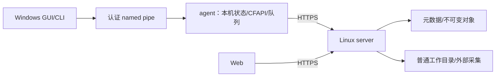

# vaultsyncd：产品与工程规格

本文仅保留当前有效的产品决定、行为约束和验收要求；实现状态见 [agent/progress.md](../agent/progress.md)，wire/schema 与具体接口见 [architecture/interfaces.md](architecture/interfaces.md)。

精简前全文：`git show c4bc6812b57bf71825912413835156b517000b6e:docs/design.md`。旧方案、迁移过程及逐卡证据由该固定版本、`agent/tasks/` 与运维文档追溯，不作为当前规则。后续变更直接更新有效规则，过程和验收记录留在任务/运维文档，不在正文叠加逐卡更新。

## 0. 文档使用约定

- **C**：用户确认的产品约束；**D**：可按实测调整的工程设计/参数；**V**：必须在目标平台验证的能力。C优先于D，用户最新明确决定优先；设计要求不代表已经通过验收。
- **P0**：首发必需；**P1**：后续范围，不进入首发依赖或门禁。改变产品范围、数据安全或兼容语义按§24处理；已确认决定不重复询问。
- 首发仅 **Windows 11 x64 客户端、Linux x64 服务端**。Windows 使用 CFAPI 原生占位；服务端使用本地 btrfs 完整普通文件，不使用 FUSE、占位符或按需回源。

### 0.1 术语

| 术语 | 含义 |
| --- | --- |
| Vault / Binding | 服务端管理目录 / 设备本地目录到某服务器 Vault 的映射 |
| Placeholder / hydration | 客户端元数据占位 / 下载固定版本并成为可读取的完整内容 |
| Dehydration / evict | 用户显式释放本地内容并保留目录项，不是服务器删除 |
| CAS | 按共同版本基线比较并提交；前提失效时重规划或保留冲突 |
| Tombstone | 已删除的同步事实，不等于不存在或暂时不可访问 |
| Reflink / 快照 | 独立 inode 的 CoW 克隆 / 固定一致性视图；不等于独立备份 |
| ADR | 有效工程决定及变更影响记录 |

## 1. 产品决策基线

### 1.1 已确认需求及实现落点

| 编号 | 有效要求 |
| --- | --- |
| C01 | 面向开发者与技术爱好者，自托管，配置和数据可导出。 |
| C02 | 服务器确认版本、命名空间与提交结果；客户端保存副本和待提交操作。 |
| C03 | Windows 提供 CFAPI 按需体验；Linux 客户端/FUSE 为 P1。 |
| C04 | 支持多个独立 Vault/Binding，服务端身份与本地路径分离。 |
| C05 | 删除是全局 Delete；缓存释放、排除和解绑不是删除。 |
| C06 | 冲突保留双方内容，生成稳定身份副本，不按 mtime 决胜。 |
| C07 | 历史和回收站保留30天；当前活跃版本不因年龄清理。 |
| C08 | Android 后续采用移动云盘体验，不承诺任意目录后台镜像。 |
| C09 | 每个 Binding 独立选择同步模式，见 C34。 |
| C10 | 首要对象为普通文档/个人文件；不承诺活动数据库或 VM 磁盘一致性。 |
| C11 | 首发一个 owner；保留未来多用户、共享目录及 owner/Vault 授权边界。 |
| C12 | 明确条件下小文件稳态通常1—3秒，量测口径见§20。 |
| C13 | Gitignore 风格排除，内置缓存/临时文件规则；排除不生成删除事件。 |
| C14 | 服务端仅 Linux。 |
| C15 | 服务端工作目录、状态、对象、历史、暂存与备份准备均禁止 FUSE/占位/回源。 |
| C16 | P0 为 Windows GUI/CLI/agent、Linux server/admin 与 Web；其他客户端后置。 |
| C17 | 完整下载内容一直保留，只有用户手动释放；禁止 LRU/定时/低盘自动驱逐。 |
| C18 | 离线读取未下载内容立即明确失败，不返回假空文件或假成功。 |
| C19 | 使用中/未确认本地内容受保护，无法安全替换时阻塞或保留冲突副本。 |
| C20 | GUI/CLI 提供状态、问题、手动下载/释放及当前§18管理能力。 |
| C21 | 严重故障通知并尝试恢复；普通断网静默退避重试。 |
| C22 | 首次同步合并，缺少基线不推导删除；同名不同内容保留两份。 |
| C23 | 稳定 EntryId 识别移动/重命名；占位移动不重新下载内容。 |
| C24 | 服务端外部修改自动采集并版本化；保证边界见 C33。 |
| C25 | 可管理多个现有服务器目录，保留原结构，内部状态另存。 |
| C26 | 禁止同步目录重叠，包括父子、别名和实际文件系统身份重叠。 |
| C27 | 账号密码登录，不强制审批、配对码或 MFA。 |
| C28 | 用户配置公网 HTTPS/反代，不内置穿透、中继或 UPnP。 |
| C29 | 安全传输；服务器文件普通可读写，不加入应用层加密/E2EE。 |
| C30 | 提供手动备份/恢复接口，不提供自动备份调度。 |

### 1.2 系统边界与技术约束

Linux 服务端只做普通文件 I/O、监视与扫描；客户端 FUSE 属于 P1。不能保证第三方应用在离线读取前不会启动，也不能承诺任意大小文件固定时间下载完成。SQLite 与文件系统不是跨资源原子事务，必须用持久意图和字节校验恢复。未保存的编辑器内存、未被观察到的外部瞬态写入不在持久化保证内。

## 2. 已冻结的产品选型

| 编号 | 有效决定 |
| --- | --- |
| C31 | P0 仅经服务器同步；P1 P2P 内容加速不改变服务器权威和持久化确认。 |
| C32 | Rust 共享核心/服务端，Tauri 2 Windows 壳，React/TypeScript 展示与 Web。 |
| C33 | 自动采集外部最终稳定变化并保全已采集版本；不保证未观察的瞬态覆盖，不强制外部程序协调写入。 |
| C34 | Windows 每目录 `full` 或 `on_demand`，均双向；不含单向上传/下载模式。 |
| C35 | Windows 11 x64 原生验收，Linux x64 服务端；NixOS主要开发/部署，Ubuntu 24.04 LTS x64兼容验证，见§21。 |
| C36 | 验收目标10万文件、1 TiB、单文件50 GiB、5台 Windows；不是产品硬上限。 |
| C37 | 接受额外接近一份当前数据及30天历史、暂存的空间代价；reflink 默认，受限路径完整复制，正确性不依赖共享 extent。 |
| C38 | P0 完整版本传输与分块断点续传；固定块/内容定义块增量后置。 |
| C39 | 服务端强制本机块设备 btrfs，可用实际后端合规的普通 bind mount；不支持 SMB/NFS/FUSE/占位/回源目录。 |

### 2.1 平台与交付边界

P0：Windows 11 x64 完整客户端与 Linux x64 服务端/admin/Web。统一便携发行只构建和发布 Windows x64 ZIP；Linux 服务端采用 Nix/NixOS。不考虑 ARM64。Windows 在 NixOS 锁定 devShell 交叉编译，前端也在宿主构建；Windows 客体仅原生运行验收，不默认安装完整编译工具链。

P1：Linux 客户端/FUSE、macOS File Provider、Android 云盘、多用户/共享和 P2P。Linux 服务端管理 CLI/Web、宿主核心测试不构成 Linux 同步客户端。

### 2.2 实现约束

所有服务端存储区域均须通过本地 btrfs/挂载身份准入。客户端经 SMB 修改 NAS 上普通文件属于外部采集场景，与服务端使用网络挂载作存储后端不同。首发规模不因平台范围收缩而降低；P1 只保留模块边界，不创建假实现、空适配器或未用依赖。

## 3. 首发范围与交付物

### 3.1 首发功能矩阵

| 能力 | Windows 客户端 | Linux 服务端 |
| --- | --- | --- |
| 双向同步 | full、CFAPI 按需、多目录/多服务器、离线编辑 | 权威提交、CAS、事件与版本 |
| 文件保护 | 首次合并、移动、冲突、使用保护、未上传数据救援 | 不可变对象、历史、回收站、崩溃恢复 |
| 用户入口 | GUI/CLI、Explorer、手动下载/释放、问题/活动记录 | Web 文件管理/只读预览、admin、健康/恢复/备份 |
| 外部变化 | 文件监视与补扫 | 普通工作目录采集、周期核对、挂载保护 |
| 认证 | 按服务器连接、账号密码、HTTPS | 单 owner、逐请求 Vault 授权 |

### 3.2 后续能力

§2.1 的 P1 能力不阻塞首发。首发不包含在线协同/内容保存、自动文本合并、E2EE、自动备份调度、集群、对象存储后端、自动穿透或块级增量。内部任务队列、结构化日志和恢复为 P0 必需。

## 4. 技术栈与总体架构

### 4.1 已确认技术栈与配套实现建议

Rust/Tokio/Axum/Serde、SQLite/SQLx migrations、Tauri 2、React/TypeScript；两端展示共用 Mantine 默认主题与 `packages/ui`。Windows 适配 CFAPI/WinRT，Linux 服务端普通 I/O/inotify/补扫；SHA-256 校验文件与块，`tracing` 记录结构化事件。依赖和工具链由根锁文件及 flake 固定，实际版本见环境文档。

### 4.2 运行进程

server 单 writer 管理多个 Vault；Windows 同用户一个 agent/本机状态库管理全部服务器与 Binding。GUI/CLI 仅经认证 IPC，Web 仅经服务端 API；admin 经受限管理 socket，不直接改在线 DB。Tauri Core/WebView 不代替独立 agent。关窗/退出/维护策略见§18.1、§19.3。

### 4.3 模块依赖与职责

`domain/planner` 纯事实与三方规划，不做 I/O；`protocol/local-ipc` 是 wire 边界；`client-store/server-store` 各自迁移与事务；`transfer` 校验/续传；Windows 适配器管理客户端文件/占位，Linux 适配器管理服务端存储/监视；`agent-core/server-core` 编排用例，应用入口组装适配器。UI 不决定冲突胜者、不操作在线 DB；服务端不依赖客户端占位适配器。

## 5. vaultsyncd 仓库组织与编码边界

### 5.1 推荐组织方式与命名

`apps/server` → `vaultsyncd-server`（产物 `vaultsyncd`）；`apps/server-admin` → `vaultsyncd-admin`；`apps/agent` → `vaultsyncd-agent`；`apps/cli` → `vaultsyncd-cli`；`apps/desktop` 为 Tauri/`@vaultsyncd/desktop`；`apps/web` 为 `@vaultsyncd/web`。Rust 公共库 `crates/<module>` / `vaultsyncd-<module>`，TS 公共包 `packages/<module>` / `@vaultsyncd/<module>`。

### 5.1.1 双工作区的职责与共同边界

单 monorepo、根 Cargo 和 pnpm 两个工作区；Tauri `src-tauri` 属于根 Cargo workspace。各只有一个根锁文件，不建顶层 rust/web 双项目。共同契约源为 `api/`；两工作区分别检查，协议变化必须验证全部 Rust/TS 消费者。

### 5.2 顶层目录

`apps` 进程/前端入口，`crates` Rust 核心/适配器，`packages` TS 展示/生成客户端，`api` 机器契约，`tests/fixtures` 可执行测试与确定性小样本，`docs` 长期规范/架构/运维，`agent` 计划/进度/短交接，`packaging/deploy` 产品组装与示例，`tools/xtask` 构建/生成/检查/发布编排。源码中不存秘密、运行 DB、用户文件、VM 或大日志。

### 5.3 应用层：apps

Rust 入口保持薄，负责配置、生命周期与依赖组装。desktop React 页面经 Tauri command 桥调用 agent；壳只持有必要窗口/托盘/IPC capability，不运行同步引擎。web 处理服务端认证/文件管理，不控制客户端磁盘。`assets/branding/` 是共用 SVG/ICO 源。

### 5.4 Rust 模块：crates

- `domain/planner/fs-common`：身份、不变量、三方规则、路径/名称/排除规则。
- `protocol/local-ipc/http-client`：远端与本机契约、认证 HTTP/事件/内容；`release-client` 独立公开发行查询，不依赖业务凭据或 DB。
- `transfer`：固定版本哈希、分块、续传与调度端口。
- `client-store/server-store`：各自 SQLite 与 migrations、基线/队列/幂等/版本/恢复记录。
- `platform-windows/platform-linux-server`：对应平台文件/IPC/监视；服务端无 FUSE。
- `agent-core/server-core`：应用服务、计划执行/提交、恢复/观测/GC 编排。

### 5.5 依赖方向与组装边界

核心不依赖 Tokio/HTTP/SQL/UI/平台 API；planner 仅依赖纯规则。wire 类型不依赖应用核心或适配器，不泄露内部绝对路径。agent-core 不依赖 server-core/store/Tauri，server-core 不依赖 agent-core/client-store/CFAPI。桌面壳与CLI不依赖 DB 写入或另写规划器；`packages/ui` 不依赖 Tauri/浏览器认证/IPC。应用以本地 newtype 实现端口，避免循环依赖及孤儿规则。

### 5.6 前端公共包与协议来源

`api/openapi.yaml`、`api/local-ipc.schema.json` 为唯一 wire 编辑源，`api/generation.toml` 固定生成配置；Rust/TS 生成物提交并重生成核对，不手改。domain 显式映射 DTO。`packages/api-client` 供 Web，`packages/local-ipc-types` 供 desktop，`packages/ui` 仅共享展示；两应用的 services 各自封装传输，不共享访问密钥。

### 5.7 Workspace 与构建边界

根 flake/devShell 固定工具链，使用 `--locked` / `--frozen-lockfile`。Rust 纯核心/服务端编译不要求 Node；产品组装时加入 Web 静态资源，生产无需 Node。Linux default-members 只选可移植核心，Windows 包显式目标交叉编译；交叉成功不能代替原生证据。

### 5.7.1 独立开发与联合发布

两工作区独立验证，统一产品版本与来源提交交付；协议/schema 独立版本。记录工具链、目标、产物 hash，禁止混用旧产物。发布仅 Windows x64 ZIP，来源收据/日志/校验表留本地，GitHub 仅上传该 ZIP；Linux 服务端 Nix/NixOS。原有实验室代码和长期证据保留，不构成新增发行目标。

### 5.8 测试与本地检查布局

`cargo xtask check` / `cargo xtask ci <job>` 为本地入口，不依赖 GitHub Actions 或托管 runner。`tests/contract` 验证契约，`server-integration` 验证 Linux 提交/恢复，`windows-integration` 验证 Windows/NTFS，`e2e/scenarios/faults/platform` 提供可执行联合场景、故障与原生入口；根 Rust 测试必须有 Cargo package/runner。

变更执行受影响包及消费者的类型/单测/构建；平台能力补相应原生验证，API/生成器变更补重生成与两端兼容检查，持久化变更补旧 fixture/迁移/恢复。打包部署补实际组装和升级运行；正式候选需同源联合验收。不以关闭测试、fake、Wine 或交叉成功代替原生能力，不因取消远端执行平台而降低门禁。

### 5.9 部署、安装与工程文档

`packaging/windows/zip` 维护 Windows 完整客户端资源，`deploy/reverse-proxy` 与示例配置维护服务端入口；历史 installer/portable/container 仅按既有实验室需要保留。目录索引见 `docs/architecture/repository.md`，接口见 `interfaces.md`，运维/限制/后续设计归对应 docs 子目录；任务及实际证据归 `agent/`。

### 5.10 源代码、构建产物与运行数据分离

项目源码、正式实例、开发实例、故障卷互相隔离。所有开发状态、缓存、下载、构建/部署证据、VM 与备份放 `/data/vaultsyncd-dev/`，按任务/run_id 或用途隔离；仓库内产物仅作忽略的入口/映射。不得整体清理开发根或长期原始证据。正式配置/状态与 Vault 路径由部署配置管理；Windows 状态位于 OS 定位的当前用户 LocalAppData，凭据在用户凭据库，程序目录不携带状态。用户同步目录与仓库/缓存/内部状态不重叠。

### 5.11 初始建仓顺序与后续平台

新包按实际功能加入工作区，不预建空crate/适配器。后续平台仅在独立需求与目标平台验证后交付。

### 5.12 编码任务与目录的对应关系

规划/冲突改 planner/domain；提交/外部采集/恢复改 server-core/store 与 Linux 端口；CFAPI/使用保护改 Windows 适配器与 agent-core；传输改 transfer/http-client；wire 改 api 并重生成；迁移改各自 store；页面改对应 app/features 与共享 UI。实现先读接口并验证受影响消费者，普通 module 优先于继续拆 crate。

## 6. 全系统不变量

以下 I 编号必须出现在关键测试或评审记录中。

1. **I01 服务端成功的含义**：只有完整内容可校验、持久化元数据已提交、工作目录发布已完成或外部同内容已确认，才返回 `committed`。异步处理中返回 `pending`，不能提前显示已同步。
2. **I02 本地修改保护**：未被服务器确认的本地数据、冲突数据、仍被写入的数据不可被释放缓存或远端替换清理。
3. **I03 身份稳定**：路径改变不改变 EntryId；删除后原路径新建是新 EntryId。
4. **I04 冲突不静默覆盖**：任何过期基线提交必须重新规划或保留副本；时间戳只用于展示与检测候选变化。
5. **I05 不完整内容不可见为完整版本**：分块或下载失败不能把半个文件标记为 hydrated/已同步。
6. **I06 重试幂等**：同一 `op_id` 与同一规范化请求只产生一个业务结果；同 ID 不同请求拒绝。
7. **I07 首次合并不推导删除**：缺少共同基线时，另一端不存在不代表用户执行删除。
8. **I08 故障不等于删除**：挂载丢失、权限拒绝、扫描中断、目录尚未枚举完均不能生成批量删除。
9. **I09 游标可恢复**：事件与逻辑状态提交一致；客户端仅在事件已持久化到本地工作队列后推进接收游标，另记已应用进度。
10. **I10 路径不可逃逸**：所有访问均在授权 Vault 内；拒绝路径穿越、符号链接跳转及竞争替换导致的越界。
11. **I11 完整缓存不自动驱逐**：允许清理可重建临时下载片段；不允许自动驱逐已完成下载文件、已下载旧内容或脏数据。
12. **I12 历史不可变**：已提交 VersionId 对应字节不再改变；恢复历史创建新当前版本，而非改写旧版本。
13. **I13 磁盘与 DB 可恢复**：任何步骤崩溃后均可判断重做、停止或保留冲突；不靠猜测“上次应该成功了”。
14. **I14 服务端变更被观察**：外部变更和客户端提交进入同一个版本及事件流程，避免两套规则。
15. **I15 权限每次检查**：所有元数据、版本、下载块、快照、恢复与备份接口验证当前账号对 Vault 的权限。

## 7. 核心数据模型

### 7.1 身份、版本与时间

`ServerId` 标识实例，恢复沿用身份但更换 `ServerEpoch`；`VaultId` 标识服务器目录，`BindingId` 标识设备本地映射，`EntryId` 标识文件/目录，移动不改身份，删除后原路径新建是新身份。`Revision` 由服务器递增；本地新条目临时 ID 在提交后映射。`VersionId` 对应不可变文件内容，目录无内容版本。`ContentHash` 为 SHA-256，不授予权限、不合并条目身份；对象按 Vault 隔离。

`VaultSeq` 是服务器分配的严格递增事务序号；`DeviceId/OpId` 是随机标识，不是认证凭据。长整数 wire 使用十进制字符串，边界检查 JavaScript 53位精度与 SQLite 有符号64位范围。时间存 UTC、按本地显示；保留期按服务器时间，mtime 不决定胜负。

### 7.2 服务端表

| 数据 | 必须保持的约束 |
| --- | --- |
| users/sessions/vaults | owner scope、令牌摘要/有效期/撤销；Vault 路径不重叠且卷/目录身份有效。 |
| entries/versions/objects | 活跃同父名称唯一、父子同 Vault、无目录环；版本只读且引用完整持久对象。modified_at 是服务端接受改动时刻，不是文件系统 mtime。 |
| changes/operations/fs_intents | VaultSeq 事务批次不可拆；幂等键与请求摘要稳定；磁盘与DB可恢复。操作紧凑结果保留到设备代际失效。 |
| uploads/upload_parts | 用户/Vault/会话/不可变快照绑定；块索引唯一，同索引同内容才幂等。 |
| conflicts/trash | 同 OpId 返回同一冲突身份，保存删除路径/子树清单及保留期。 |
| backup_leases/活动账本 | 快照引用阻止GC；活动事实与提交/认证来源一致，不补造历史。 |

原始名称保留；版本化 name_key/Windows 等价规则不能用简单 lowercase 代替，不自动重命名消除冲突。精确字段、迁移和 wire 以接口/schema 为准。

### 7.3 客户端表

本机保存按 ServerId 隔离的连接/凭据引用、Binding、共同 baseline、已收未应用的 remote 状态、本地指纹/generation/dirty/驻留、pending_ops、received_changes、固定版本传输位图、local_intents、通知及恢复记录。baseline、remote、local 必须分离；暂停/解绑控制与业务状态使用一致投影。解绑记录及未确认内容不得因退出活动列表而删除。

### 7.4 元数据约束

启用外键；写事务短小，不在事务中做网络或哈希。目录删除检查整个子树，移动检查环/目标冲突；文件与目录同名不能覆盖。迁移必须有旧 fixture、备份与失败恢复，失败后不开放同步写入。

## 8. 本地状态与可见状态

### 8.1 不使用一个枚举表达所有文件状态

状态正交（以下为概念示例，wire以schema为准）：`residency`（metadata_only/partial/materialized）、`dirty`（clean/dirty/snapshotting/awaiting_commit）、`remote_apply`（current/pending/blocked_by_local/conflicted）、任务（idle/queued/running/retry_wait/failed）、使用保护（idle/read_handles/write_handles/unknown）、可用性（online/offline/mount_failed/vault_unavailable）。partial 不代表完整离线可用；目录状态汇总子任务、冲突与失败。

### 8.2 界面投影优先级

严重失败/不可用 > 冲突 > 待上传修改 > 正在同步 > 已下载 > 仅云端，可并列显示多个事实。只有 baseline 与服务器确认版本一致且无待处理本地操作才是“已同步”；上传字节完成或 `pending` 不算，也不代表独立备份。

### 8.3 主要转换

| 触发 | 动作与完成条件 |
| --- | --- |
| 读取占位 | 固定 VersionId，完整校验并受控安装后才 materialized。 |
| 本地写入 | generation 增加并记 dirty；本地保存与远端 committed 分开确认。 |
| 上传确认 | 只有 committed 且当前 generation 未变才转 clean；上传期间新写入排后续操作，旧ACK不得清除。 |
| 远端变化 | 先核对使用保护/路径/generation；有本地改动则保全快照并规划双副本。 |
| 用户释放 | 验证远端版本仍可恢复、无写入并取得保护；平台释放成功才变 metadata_only。 |
| 取消 | 停止当前任务并保留可恢复状态，不撤销已经 committed 的远端操作。 |

### 8.4 客户端持久化与重启

clean 仅表示上次观察。重启先恢复 local_intents、核对身份/实际内容，再允许覆盖、删除、释放；未完成扫描/不能证明未变的文件为 unknown，禁止破坏性动作。发布顺序为暂存、校验、持久意图、受控替换、baseline；文件已换而DB未更新时按意图哈希辨认。上传快照至少保留到 committed 且本地基线落库；冲突ACK持久映射原条目与副本身份。

释放前确认完整本地内容对应仍可读的服务器版本或等价当前版本，再取得使用保护并复核 generation。服务器已不保留的旧内容不能直接丢弃；跨历史到期窗口的下载/恢复/释放使用短期内容租约或等价机制防GC。

## 9. 同步算法与事件协议

### 9.1 基本原则：三方比较

以共同基线 B、本地 L、远端 R 比较内容、位置、类型和删除事实：L=B/R变则安全应用远端；L变/R=B则带基线提交；双方变且结果相同则校验归并，否则按§10保留冲突；均未变不操作；无B走首次合并。

本地快照携带 generation，哈希前后核对文件身份、大小、时间与 generation，变化重排队。两次 stat 相同也不能证明任意外部写入下的原子快照。

### 9.2 首次同步已有内容

验证健康/重叠/可表示性，获取一致快照 `snapshot_id + epoch + high_water_seq`，保存本地导入清单并必要哈希。同路径同类型同内容绑定远端身份；仅本地存在则上传，仅远端存在则按模式占位/下载；同名不同内容/类型保留服务器主路径、本地另名冲突。目录按名称合并，文件—目录冲突不递归覆盖。后续事件从 high_water_seq 接续，上传仍做CAS。

首次合并可恢复且不推导删除；游标过期重建必须使用旧基线，不能当首次加入。

### 9.3 事件传输

HTTPS JSON 命令、持久 changes 拉取与 SSE 唤醒；SSE 不是唯一来源。changes 返回有序 VaultSeq/TxId 事务批次，目录事务不分页拆半；重复/丢失/乱序由拉取去重修复。元数据分页固定 snapshot_id，过期重启快照；内容固定 VersionId，不按当前路径取字节。

客户端同一DB事务持久化事件、remote_entries、应用任务与 received_cursor，落盘后另推进 applied_cursor/baseline。单文件失败不阻止其他事件接收，但不能越过相关依赖。

### 9.4 游标失效、离线太久和服务端恢复

事件保留期独立于30天历史；工程默认90天（D），过期明确 `CURSOR_EXPIRED`，不返回假空列表。重建保留旧baseline、队列与本地内容：远端已删而本地未改不重新上传；本地已改则进入恢复/冲突候选，不复活旧EntryId；来源不明进入待核对，禁止整目录自动上传或删除。

备份恢复更换epoch，旧epoch操作不自动重放；保全内容并重新快照，报告回退。同seq跨epoch不等价。幂等记录回收与设备代际失效绑定，不能让过期旧Delete重新成为新命令。

### 9.5 重命名识别

稳定文件身份/配对rename优先，哈希只辅助；同内容多文件不能凭哈希猜唯一移动。同Vault移动保持EntryId，目录移动不重传子内容。跨Vault为目标创建成功后源删除的可恢复任务，不是跨Vault原子rename；不确定时按独立新增/删除并保留历史。

## 10. 冲突、删除与目录规则

### 10.1 确定性冲突矩阵（D，落实 C06/C19）

已提交head默认保留主路径，迟到分支按服务器提交序处理，不比较设备时钟。

| 并发情况 | 规则 |
| --- | --- |
| 双方内容不同 | 保留head，本地快照创建新冲突EntryId并传播。 |
| 相同内容/位置 | 校验哈希与大小后归并。 |
| 移动与修改 | 已提交位置/内容为主，保留迟到内容及原意图位置，必要时冲突另名。 |
| 双方移到不同位置 | 已提交路径为主，迟到目标有稳定副本ID/目录冲突记录，不反复移动。 |
| 双方相同移动且内容相同 | 幂等归并。 |
| 删除与修改 | 删除先提交则修改另建恢复冲突；修改先提交则旧Delete不删除新内容。 |
| 删除与仅移动 | 不复活已删身份；保留可恢复内容/子树并报告冲突。 |
| 相同Revision重复删除 | 幂等成功，不再次清理。 |
| 新增同名不同内容 | 先提交保留名称，另一方冲突另名。 |
| 文件与目录同名 | 保留双方类型，不覆盖目录内容。 |
| 删除父目录时新增子项 | 子树前提失效，`SUBTREE_CHANGED`；重规划或保留冲突目录，不能吞新文件。 |
| 目标存在或祖先已删 | 不覆盖目标，重规划另名/恢复目录并说明原因。 |
| 重试同旧OpId | 返回原结果与同一副本ID，不重复创建。 |

自动组合移动与修改、文本/Office 内容合并不在P0；增加需另行设计并证明不丢独立编辑。

### 10.2 冲突名称

保留扩展名，名称含服务器时间、设备/Op短标识；碰撞扩展标识，按文件系统长度预算截断。幂等依据是OpId/ConflictId，不是名称。副本是普通同步条目；删除副本是全局删除，关闭提醒不删除内容。

### 10.3 删除与恢复

Delete 携带 Revision，目录还携带随任意子树变更更新的token。大目录通过冻结逻辑子树、持久清单及可恢复任务完成，最终原子公布逻辑批次；期间冲突写入明确busy。工作目录移除失败保持pending/failed，不能仅改DB后宣称完成。

历史从被替代时保留30天，删除内容从删除时至少保留30天，活跃当前版本不按年龄GC。恢复新建当前版本，原位置冲突则默认另名并返回实际位置。内容到期不等于可以遗忘旧设备基线/墓碑语义。

### 10.4 排除、取消绑定和模式切换

有效排除为内置默认清单在前、绑定附加文本在后；默认含Office `~$*` 临时/锁文件，不默认排除整个.git或所有隐藏文件。清空只移除附加规则，后置`!`可恢复参与，遵守Git排除父目录后子项重新包含的限制。支持注释、空行、`*`/`**`、根锚定/目录规则及“为什么被排除”查询。规则通过绑定配置管理，所有扫描/上传/下载/目录操作/full补齐使用同一版本化有效规则。

排除不删除两端内容，保留已跟踪状态、未确认快照和停放队列；停放任务不阻塞其他文件补齐，也不删队列冒充成功。重新包含先三方协调：远端未跟踪项按固定版本恢复（按需仅占位），目录父先子后；曾跟踪文件在排除期间被本地删除，保持围栏待显式恢复，不自动重下或推导远端删除。

解绑停止管理并保留本地/缓存/服务器数据，不发Delete；活动路径释放与完整占位安全交接见§16.1。full→on_demand保留所有下载内容；on_demand→full补齐未排除项，完成前不标完整离线可用。full下释放返回`MODE_REQUIRES_LOCAL_COPY`。

## 11. 服务端内容存储、提交与崩溃恢复

### 11.1 普通工作目录与不可变内容对象

已有工作目录保留普通文件供SSH/NAS访问，SQLite/对象/片段/意图/历史/备份清单位于同步根之外。每个确认当前版本必须已有不可变副本，不能等外部删除后再备份。优先btrfs reflink独立inode；禁止用可变工作文件的硬链接冒充不可变版本，对象不向外部开放写权限。

当前对象路径为 `state_dir/objects/<vault_id>/<aa>/<hash>`，暂存位于`objects/staging/`，登记路径必须归属该Vault；读取/重放/GC/备份恢复统一核验，不共用可被另一Vault回收的物理对象，不支持旧布局fallback。reflink不代表跨版本增量传输或去重，容量按C37最坏情况；首次采集前不声称已有历史保护。

### 11.2 一次内容修改的提交步骤

1. 校验认证、Vault、OpId、request_digest、会话及epoch；完成的同操作返回原结果。
2. 接收内部暂存，校验块与整文件SHA-256/长度并持久化，不写当前文件。
3. 固定校验只读对象并fsync；未引用对象仅可成为宽限期孤儿。
4. 持有Vault提交调度锁，复核Revision、父目录/名称/删除前提与现场指纹；现场变更先采集或`RECONCILE_REQUIRED`。
5. 持久fs_intent：expected_before、desired_after、前后内容引用与恢复路径；内部锁不约束任意外部程序。
6. 从对象reflink/校验复制到目标子卷暂存，刷盘后受控替换并保留旧内容引用；跨卷不假定一次rename，外部写入/使用冲突则停止并保留候选。
7. 同一DB事务完成entries、versions、changes、冲突、操作结果及相关活动事实；不能暴露半完成新逻辑视图。
8. committed后确认/SSE唤醒；失败或响应丢失按OpId查询，不重造操作。

移动/建目录/删除同样使用恢复意图。查询进行中条目返回旧确认视图或明确pending。

### 11.3 恢复矩阵

| 崩溃证据 | 恢复 |
| --- | --- |
| 片段未齐 | 校验后续传，不发布。 |
| 对象完成、无意图 | 未引用孤儿，宽限后GC。 |
| 意图完成、文件未变 | 满足expected_before才重做，否则协调。 |
| 文件已发布、DB未完成 | 校验desired_after后完成同操作；又被外部改动则保全双方并协调。 |
| DB committed、响应丢失 | 同OpId返回原结果，不造副本。 |
| 意图/工作目录无法解释 | `NEEDS_RECOVERY`，暂停破坏性写入，输出候选与报告。 |
| DB/对象损坏 | 停止相关写入并报告，不以重扫覆盖唯一元数据证据。 |

启动先恢复意图再开放写入/游标，只重放可证明的操作，不靠普通日志猜测。

### 11.4 Linux 服务端存储接口与准入检查

ServerStorage只处理普通存储准入、受限根句柄、安全读写/持久发布、历史和扫描，无客户端mount/placeholder/hydrate/evict能力。注册检查允许基目录/重叠与C39；内部DB/对象/暂存/备份准备同样准入；遍历拒绝嵌套子卷/子挂载；确认版本必须有完整可校验字节。

在实际进程mount namespace中结合已开句柄fstatfs、mountinfo与目录身份检查，启动/挂载变化重验，不能仅看路径或容器内目录。普通bind仅在实际后端合规时接受。已知占位/按需标记拒绝，但不能声称仅凭普通文件类型识别所有第三方stub，也不能把稀疏文件直接当占位。

配置拒绝用`UNSUPPORTED_STORAGE_BACKEND`/`SERVER_PLACEHOLDER_UNSUPPORTED`；运行变化用`VAULT_UNAVAILABLE`并保留原因，不自动转换、填充或清空目录。

### 11.5 btrfs 布局、能力与失败边界（D；落实 C39）

- 默认内部状态与Vault位于同一btrfs互不重叠目录/子卷；允许另一合规btrfs卷但记录复制成本。Vault内禁子挂载/嵌套子卷；二进制、源码、第三方备份最终目的地不受数据后端限制。
- FICLONE私有候选成功后仍验证长度/哈希、fsync文件并在发布后刷目录。仅跨卷/已分类能力不支持可回退校验复制；EIO/ENOSPC/权限错误必须失败、清理未发布目标并保留恢复内容。正常同卷CoW必须原生验证，不能用回退掩盖失败。
- 核验FSID、子卷ID、mount ID、目录身份；inode只在所属子卷内解释。卷/子卷替换或回滚暂停Vault，进入恢复/epoch流程，不推导删除。
- 数据CoW与校验必须开启；拒绝NOCOW（+C）、nodatacow/nodatasum，新增不合规文件不确认版本；SQLite亦保留CoW。压缩可选，不自动修改挂载参数或defrag。
- 快照/压缩/校验不替代SHA-256、DB事务、意图、fsync、CAS与GC引用；首发不依赖qgroup、自动去重或send/receive。监控数据/元数据余量，处理CoW ENOSPC；子卷不是独立故障域，删除对象未必立即释放extent。校验错误停止相关写入，无冗余不保证修复，仍需独立备份。

## 12. 服务器外部修改与一致性边界

### 12.1 自动采集流程

事件合并→挂载/身份检查→短暂稳定观察→安全打开并reflink私有候选→固定候选哈希/长度校验→ExternalProposal→同一提交/事件流程。前后身份变更重排队；跨卷按§11.5复制。FICLONE固定字节不证明应用保存结束或多文件事务。

rename以身份/配对事件为据，删除依赖已有不可变版本恢复；首次导入建立版本。未稳定显示等待写入，不传播部分片段。监视可丢失/合并/不递归，溢出立即补扫；不对未支持的网络后端沿用本地时延承诺。

### 12.2 无协调外部写入不能获得绝对原子保证（C33）

稳定窗口、两次stat及协作锁不能证明任意非协作写入已结束；短命文件、停服期间中间覆盖可能不可观察。承诺保全已确认版本、自动同步最终稳定变化，发现重叠写入保留候选并暂停覆盖；不承诺保留每次瞬态写入或消除所有检查后替换竞态。首发不强制外部程序协调，不增加服务端FUSE。

### 12.3 挂载丢失与异常批量删除

扫描先核对卷/根目录身份、权限与健康。卸载后空目录是不可用，不是全删。区分complete、permission_denied、io_error、mount_changed；仅完整健康扫描的缺失可成为删除候选，异常批量突变先保护并保存基线/身份/计数待复核。自身事件按OpId/身份/expected_after去重，不用固定时间窗口吞事件。

## 13. 传输、续传与调度

### 13.1 首发传输契约（C38；块大小等参数为 D）

完整版本、固定块续传，工程默认4MiB（D，可协商）。上传会话绑定不可变本地快照、总大小/总SHA-256，块含index/length/hash；同索引不同字节拒绝，不能混合generation。无跨版本块复用/增量专用GC。下载固定EntryId+VersionId/Range，从不可变对象提供；416/哈希错/对象缺失明确失败。零字节文件有合法哈希和版本。

### 13.2 下载与上传流程

下载：固定版本→空间检查→临时块→块/整文件校验→本地意图→受控安装→状态更新。上传：固定快照→会话/已收块查询→缺块→finalize校验→条目CAS→committed。续传重新鉴权并验证会话/快照/片段；上传期间再次保存形成后续generation，不改变原快照/OpId。持续校验失败升为重要故障。取消保留dirty/唯一数据，只清理可重建片段。

### 13.3 调度与重试

用户读取优先，元数据不被大文件阻塞；单文件依赖串行、跨文件有界并发。工程默认内容并发4、哈希2、网络退避1秒起/60秒封顶并加抖动；尊重Retry-After。401仅一次受控刷新，失败需登录；403不盲重试。满盘/权限错立即通知并可周期复查；重试不换OpId。本机暂停/恢复不等待服务器网络worker，解绑等长操作单独预算，见§15.5/§18.1。

## 14. 客户端平台适配器契约

### 14.1 能力抽象

客户端报告真实的按需读取/释放、使用保护、稳定身份、原子替换、范围读取、生命周期和名称能力，不假定跨平台相同。inspect/materialize/move/delete/evict/recover通过端口调用；请求含BindingId、EntryId、预期generation/VersionId/Revision、OpId与取消令牌，回执含实际身份/generation/阶段，条件不符`LOCAL_CHANGED`。

平台回调转换ReadDemand/WriteObserved/RenameObserved/UsageChanged/VaultUnavailable，通过有界队列和后台完成机制衔接，不能在主线程等待全网络请求。服务端不实现此客户端接口。

### 14.2 Windows：CFAPI

Windows 11 x64/NTFS使用CFAPI与WinRT注册Explorer同步根。FileIdentity含schema、Vault/Entry身份及版本提示，不含密码/令牌/服务器绝对路径。遵循系统占位/同步状态流程，不手改reparse point或截断伪造释放；实际满足条件才in-sync，系统标记不代替业务baseline。

完整文件校验后供给，OS可请求范围；取消、超时、重复回调及OS重试须原生验证，不暴露未校验片段。保留用户下载意图，不主动自动脱水；不能保证约束任意管理员/第三方工具。使用保护失败延迟应用，缺乏可观察锁仍保留旧基线/迟到写入冲突。不支持的卷明确拒绝按需，用户可显式选择受支持的full，不把注册失败当成功。Explorer显示本地目录末级名，持久内容寻址图标不依赖程序位置；恢复时原位刷新，不注销重建身份。

### 14.3 Linux 客户端：FUSE（P1，后续设计）

后续需独立验证；不在非空目录上挂载隐藏原文件，导入保留清单与校验前原件。持久缓存独立于挂载点，完整缓存离线可读、缺内容明确失败，本地fsync不代表远端确认。挂载失败不推导删除，退出保留缓存/DB及只读救援；部分写入、mmap/rename-over/unlink-open等语义在P1交付前专项验证。不引入P0 FUSE依赖。

### 14.4 文件使用保护的实际边界

普通目录无法统一判断任意应用是否正在编辑；系统锁只是证据，未保存内存不可备份。组合使用已知写句柄/系统保护、generation、固定快照、替换前复核、历史及迟到冲突；不安全则busy延后，不能为清队列强制覆盖。支持应用保存方式须实测，无法满足C19的用例明确记录限制并评审。

### 14.5 macOS 与 Android 扩展点（P1）

macOS后续用File Provider系统扩展，复用Rust协议/纯规则但不假设跨进程共享内存；Android按移动云盘及系统后台限制实现。平台“永久保留”与系统存储管理的边界均须重新验证。

## 15. API 与本机 IPC 契约

### 15.1 API 总则

远端HTTPS，除health/capabilities外均需认证与当前Vault授权；JSON snake_case，未知枚举不当默认成功。request_id贯穿请求，修改使用持久OpId，超时按操作查询结果。清单分页/载荷有界；文件名是数据，不拼shell。除受限Vault配置外仅传身份与相对名称，不接受任意服务器绝对路径。精确端点/字段以`api/openapi.yaml`为唯一编辑源。

### 15.2 核心端点

| 接口组 | 语义 |
| --- | --- |
| capabilities、auth login/refresh/logout | 显式协议/功能/限制协商、ServerId/epoch、限流/凭据轮换/撤销，不泄露目录路径。 |
| vaults、admin/vaults | 授权清单与允许基目录内注册，核对重叠、卷/目录身份和权限。 |
| Vault snapshots/entries、changes、events | 一致快照分页、有序不可拆事务、SSE唤醒，过旧游标明确拒绝。 |
| uploads/status/parts/finalize | 权限/容量/块位置校验、可恢复续传；finalize只生成内容引用，不修改head。 |
| operations及结果查询 | Put/Create/Move/Delete/Restore的CAS、幂等和pending/committed结果。 |
| entries/versions/content、trash、conflicts | 已删条目仍逐次授权，固定版本Range/校验、回收期限与副本关联，裸hash不授权。 |
| admin/backup-snapshots及manifest/对象读取 | 管理员一致性清单和受限导出，不是任意路径下载或自动调度。 |
| 客户端连接与活动查询 | 当前账号/Vault scope、稳定分页与发生时事实，见§18.1。 |

每端点必须定义请求/响应、状态码、认证、分页与最大载荷。

### 15.3 修改提交示例

修改请求关联OpId、epoch、条目/父目录、基线Revision/VersionId、固定上传引用和local_generation。创建另含expected_absent；移动含目标父/名称及源revision；目录Delete含subtree_token。generation只是ACK关联值，不证明客户端未再次写入。

committed结果返回最终VaultSeq、EntryId/Revision/VersionId、generation关联及可能的冲突身份映射。preserve_both可在committed中返回副本；无法自动解决的目录/前提冲突返回409，不能把所有冲突当HTTP成功。完整样本保存在`api/examples/`，不在此重复JSON。

### 15.4 错误契约

错误含稳定code、可理解message、retryable、request_id及必要Vault/details，不吞OS原因。

| 错误 | 处理 |
| --- | --- |
| 401 AUTH_EXPIRED / 403 ACCESS_DENIED | 刷新一次后登录 / 停止相关操作，保留内容。 |
| 409 BASE_MISMATCH、SUBTREE_CHANGED | 拉新事实并重规划。 |
| 409 OP_ID_REUSED / RECONCILE_REQUIRED | 同ID不同请求停止 / 等外部采集协调，不能强制覆盖。 |
| 410 CURSOR_EXPIRED、EPOCH_CHANGED | 保留旧基线与内容后重建。 |
| 410 VERSION_GONE | 明确旧版过期，不用同路径新内容冒充。 |
| 422 INVALID_NAME、UNSUPPORTED_ENTRY、HASH_MISMATCH | 局部问题或拒绝发布，重传/报告损坏，不拖垮整Vault。 |
| 422 UNSUPPORTED_STORAGE_BACKEND、SERVER_PLACEHOLDER_UNSUPPORTED | 拒绝配置，不回源/转换目录。 |
| 429 RATE_LIMITED | 尊重重试时间。 |
| 503 VAULT_UNAVAILABLE、NEEDS_RECOVERY | 暂停相关Vault并保留队列/原因。 |
| 507 INSUFFICIENT_STORAGE | 立即通知、保留dirty、低频复查。 |

本机还区分LOCAL_CHANGED、FILE_BUSY、MODE_REQUIRES_LOCAL_COPY、PLACEHOLDER_OFFLINE；P1挂载错误不能混入正常删除或假成功。

### 15.5 本机 IPC

GUI/CLI共用认证命令处理器：按ServerId连接管理、状态/Binding、暂停/恢复、下载/释放、问题重试、历史/回收/活动、解绑/恢复导出与维护。创建只管理用户选定目录，状态推送可由全量快照恢复；Web不控制客户端本地路径。

named pipe验证真实当前用户及对端，保持固定本机状态、单writer与schema/维护事务围栏。Pause/Resume本机控制不排在网络worker后；状态与paused/detached来自一致控制快照。解绑等长操作执行预算与恢复导出为30分钟，帧I/O仍5秒；普通StopAgent预算及失败保护见§18.1。具体命令/版本门禁以本机schema与接口文档为准。

## 16. 路径、文件系统与跨平台边界

### 16.1 路径安全与重叠

注册核对规范路径、父子分量、卷/目录身份及symlink/junction/bind别名；运行逐层以根句柄安全访问，canonicalize不消除后续TOCTOU。禁止字符串starts_with判父子（a不是abc的父）。拒绝`.`/`..`/NUL/分隔符混用/设备路径逃逸，默认不跟随未知重解析点。DB/缓存/备份暂存/上传区位于所有受管根之外；不同设备映射同Vault合法，同设备物理目录重叠不合法。

解绑先停止CFAPI并排空回调，再持久detached并释放活动预留；恢复记录不永久占用根。新Binding落库前核对旧注册/占位身份，仅完整已落盘内容可经身份/哈希校验无损转普通文件并注销旧注册。部分占位、外来身份或unknown扫描拒绝；保留旧内容/缓存/恢复记录，新旧状态隔离，不复用旧BindingId/缓存/发布日志，不重新执行旧恢复提交。新绑定不能与活动绑定重叠或嵌套旧根。

### 16.2 文件类型与跨平台处理边界（D）

支持普通文件/目录、空文件/空目录（仍有EntryId）；Unicode原名保留并先验证可表示性。Windows保留名/非法字符/尾点空格、大小写等价冲突和超长路径明确报错，不静默改名/覆盖。非UTF-8 Linux名不做有损转换；symlink/junction/未知reparse不跟随；FIFO/socket/设备不打开；多硬链接可变文件报问题，不承诺链接拓扑。

不承诺完整复制ACL、UID/GID、xattr/ADS，需检测额外流或明确限制；安全默认权限不被可执行位/mtime覆盖。稀疏文件只承诺逻辑内容，活动DB/VM只按静止普通文件处理。能力不足局部报错、保留源数据与可见原因，不能忽略未处理项显示全绿，也不把不支持对象当垃圾删除。

## 17. 身份认证与安全设计

### 17.1 单用户首发并保留未来授权边界

本机管理命令初始化owner，无内置默认密码/公开注册；每Vault有owner_id，所有访问走统一授权。密码仅要求非空且不超过1024字节，不强制长度/强度；Argon2id独立随机盐及已验证参数、登录限流、令牌摘要/到期/轮换/登出和改密撤销会话仍必需。DeviceId不是秘密或认证证明。

长期凭据不放前端localStorage，优先OS凭据库；headless凭据文件权限受限。未来成员权限不改变Vault/Entry身份，不增加未要求的设备审批/MFA。

### 17.2 Linux 服务端部署与 TLS 入口

Linux服务端采用Nix/NixOS部署；普通btrfs及受限身份要求不因容器/NAS包装而改变。应用直接TLS或同机HTTPS反代至受限本机socket；跨主机内部链路也加密。客户端验证证书链/主机名，可显式导入用户CA，不默认insecure或首次信任任意证书。代理头/地址/前缀显式配置；只信任已配置的本机loopback代理单个合法来源地址，不能信任远端自报转发头。地址变更重核ServerId。

服务端/Web更新验收后只自动更新dev `https://wlab.132140.xyz:15401`，用`tools/dev-server.sh`指定验收包并验证健康/身份/资源；不自动更新prod `https://vsyncd.132140.xyz`。生产部署须另有用户明确要求，既有rebuild授权不等于生产更新授权。dev与生产DB/Vault/ServerId隔离，配置与操作见运维文档。

### 17.3 客户端与内容边界

Tauri最小capability；文件名/内容/Markdown/HTML均为不可信数据，不当WebView脚本或系统命令。列表转义，预览按§18.1固定版本与类型/资源门禁；CSP不泛化unsafe-inline/eval。上传限制大小/并发/暂存寿命，校验授权/空间；备份解包防穿越。日志不含密码/令牌/内容，详细路径仅用于受控本地诊断。

## 18. 状态界面、通知与可观测性

### 18.1 最小界面

**Avoid unnecessary secondary labels and descriptions. Let the layout do the explaining.** 避免重复标题/说明与装饰状态，保留可访问名称、真实错误和操作影响提示。两端共用Mantine默认主题/AppShell（48px顶栏、240px响应式导航）、明暗切换与展示组件；通用图标使用Lucide，上传/下载保留可访问名称、键盘/提示及禁用条件。持续状态和风险确认不能被临时通知代替。

**品牌。** `assets/branding/logo.svg`为透明云朵双箭头，主体约99%占宽、viewBox=`35 45 1180 1180`；当前蓝色渐变`#76C7FF`/`#53B5F3`/`#359EE7`，Web顶栏36px、登录48px。favicon/登录/顶栏共用SVG，Windows EXE/窗口/托盘/Explorer共用其16/24/32/48/64/128/256 ICO；备用黑底SVG/ICO保留，重生方法见资源README。

**Windows主界面与连接。** 打开直接进入同步目录，复用同用户健康agent，否则启动同目录agent并等认证IPC就绪；启动失败明确显示。每ServerId一个本机会话/凭据，连接离线/登出不影响其他服务器。添加地址/可选CA后由无凭据capabilities发现完整只读ServerId，用户确认前后重新核对，取消不保存、迟到结果不恢复旧候选；已有绑定不迁往新ServerId。创建绑定先服务器、授权Vault、本地原生选目录、模式；列表就绪默认首个可用项，保留已有有效选择，空/错误真实呈现。

**启动恢复与绑定操作。** 主桌面首次取得完整状态后恢复全部未解绑的暂停绑定，包括以前手动暂停者；可重试IPC/管理错误有限重试，每次重核仍暂停未解绑。单项失败保留原因并继续其他项，不将恢复请求当同步完成；本次运行手动暂停不被轮询/导航覆盖，独立Explorer文件窗不恢复其他绑定。添加目录用对话框，取消不创建、成功关闭、失败保留输入，执行中禁重复/关闭。本地路径按BindingId经认证agent解析后以文件夹对象打开，不接受任意路径命令；服务器列HoverCard含地址/ServerId/VaultId/登录状态并支持键盘，不另列Vault。解绑须安全断开并持久确认后才从所有活动选择列表移除；恢复报告/内容/缓存/服务器文件保留。移除连接先解除活动绑定，再删除本机连接/登录资料/凭据并尽力撤销会话，撤销未确认需明确提示。

**Explorer与程序配置。** 同步根显示本地目录末级名与持久软件图标；活动绑定内单文件使用当前用户传统vaultsyncd级联菜单（Windows 11“显示更多选项”），含历史/下载/释放，无管理员或安装身份包要求。固定执行桌面程序、路径仅作数据，操作前经认证agent和无回源句柄重核Binding/Entry/物理身份；文件窗口关闭只退出该窗，解绑移除菜单范围，最后绑定解除可清理自家菜单，移动程序后主窗刷新菜单路径。主窗关闭默认留托盘，可配置完全退出；完全退出默认有序停止agent，也可仅退出UI。设置按本机用户保存。普通StopAgent排空、断开CFAPI、关闭DB，原地保全完整缓存/dirty/快照/队列和持久控制状态，不做全量导出；下次主窗按启动恢复规则处理。RPC最多60秒、确切对端进程15秒、桌面监督90秒；失败恢复主窗，仅回收自建RPC helper，不强杀agent、不伪报停机。显式维护/更新/卸载仍导出恢复内容。

**Web认证与可用性。** 统一登录页先核验会话，确认前不挂管理导航/页面；成功恢复原hash/目录深链，退出/改密/撤销或刷新后确认失效则收回界面。初始网络错误不当会话有效，已有会话临时断网不冒充凭据失效。登录/会话恢复后自动单次检查同源服务，未登录不检查、退出取消、路由不重复、不新增健康轮询；健康不显示徽标/成功通知，异常跨路由持久显示并可重试，成功清除，保留旧响应围栏。健康不代表同步完成。概览可选中完整ServerId；Vault路径按身份进入文件浏览器，容量为当前已提交未删除文件逻辑大小总和，同摘要逐文件计，不含历史/回收站/未提交，不是物理占用；缺统计显示未知。

**Web文件浏览器。** 授权Vault选择、左树右列表、相对地址/URL深链、历史导航、上级/刷新/筛选/属性；不重复页内标题。列表仅名称/大小/修改日期，目录优先；默认名称中文自然升序，支持三列升降序，未知值后置、同值按名称稳定。先筛选排序完整当前目录再分页，改排序回第一页，树不跟列表排序。文件后缀图标仅展示推断，未知/无后缀回退通用图标，不作类型或授权证明。行/树/空白右键及菜单键/Shift+F10/长按提供相应打开、属性、复制路径、复制/剪切/粘贴、重命名、删除、新建目录、文件下载/历史；Vault根只允许安全的打开/属性/复制路径/粘贴/新建目录，不改配置。

**Web写操作与下载。** 沿用认证上传、CAS操作与回收站，删除确认Revision/子树token，同名不覆盖，未知结果复用OpId核对。目录复制/多文件上传逐项提交，部分完成如实保留；同Vault剪切/重命名保持身份，跨Vault复制支持，跨Vault剪切明确拒绝。上传单文件64GiB、有界分片；浏览器固定版本复制单文件64MiB，超限拒绝。当前目录/祖先改名按身份更新URL/选择，操作期间新导航优先。新建目录可取消；文件下载固定点击版本、分段校验长度/SHA-256后按原名另存，空文件合法，失败/过期/取消不保存半文件或切换新版本；目录不打包下载。历史对话框按Vault/Entry授权分页，显示摘要/大小/保留期，关闭或切换上下文取消，不通过查询隐式写入。

**只读预览。** 文件点击/菜单在原页预览，保留属性/历史/原件下载；固定已提交VersionId、Vault授权、长度及完整SHA-256，失败不切新版本。读取前检查50MiB通用门禁；图片最多16Mi像素、边长8192，canvas最多8Mi像素。PDF校验签名后强制application/pdf Blob iframe，阅读/密码/损坏/资源行为由浏览器原生查看器负责，未启用可下载；CSP仅为其增加frame-src blob，object-src none。PNG/JPEG/GIF/WebP/BMP/AVIF仅静态canvas画面，不嵌入可执行HTML/SVG。

文本/代码读取前限2MiB，严格UTF-8或带BOM UTF-16；CodeMirror只读/按文件名加载语言，HTML/SVG显示源码。Markdown默认GFM并可切源码，限10000 AST节点/32代码块/128层，超限提示；跳过raw HTML，链接/图片降文字，不发起文档外请求。未知文件可尝试文本，非法编码/二进制明确下载，不在线保存。

Office（doc/docx/xls/xlsx/ppt/pptx/odt/ods/odp）默认ONLYOFFICE DocEditor只读，禁编辑/批注/审阅/填表/宏/插件，固定common snapshot，不接收保存。固定版本授权/hash及50MiB门禁，服务端持JWT，临时源限120秒/每实例最多2准入，可主动撤销且交付前重核权限；已取得的浏览器/上游副本无法远程收回。CSP只信任配置Document Server精确origin的API脚本/frame，API.js为部署受信任脚本；仅Office配置时精确许可SHA256(empty)兼容事件属性，不放宽任意inline/eval。旧PDF转换接口保留兼容，不再作为默认路径；排版/工作表由Document Server实现，不保证完全等同Office。

预览标题栏仅关闭叉与原件下载图标，保留可访问名称/提示。主动关闭立即abort读取/解析及迟到回写，但标题/正文/画布/Blob/Office会话保留到退出动画结束再释放；导航、Vault/认证变化、卸载立即清理，快速重开以代号围栏防旧回调误清，错误/取消可重试。

**连接与活动记录。** 服务端持久记录每次成功登录，刷新保持连接身份；标签不可信，客户端主机名/OS为声明属性，IP为首次登录服务端观测且刷新不改。未知历史字段显示未知，不用应用名/服务器名/IP代替主机名。有效会话五分钟内成功认证请求为“已连接”，否则“未连接”，另保留撤销/过期状态；约30秒活动写入节流、列表30秒刷新，错误不冒充断开，无心跳或同步完成承诺。来源仅受信任loopback代理可覆盖，不据IP授权。

两端同步/传输记录查询同一服务端授权账本，保存发生时时间、认证来源、路径、版本、范围与结果；声明DeviceId不冒充认证身份。上传ready、文件同步committed、下载served/failed分开，served不证明客户端接收/校验/落盘。建目录、移动/重命名、删除、历史恢复、回收站恢复为独立operation/committed，同业务提交事务记录、重试不重复，不补造旧事件或外部采集的虚构客户端来源。列表可见时每次读取后约2秒刷新当前页/筛选，隐藏暂停、聚焦立即读；保留旧表/详情，错误保留上次结果并在恢复后清除，手动刷新回第一页。服务器/Vault/Binding/筛选/认证切换或离页时旧响应不得回写。

**错误恢复与反馈。** 管理页加载失败优先重新挂载，按2/4/8/16/30秒退避，隐藏/离线暂停，重建失败懒加载缓存；持续旧模块失败才每标签五分钟最多一次整页恢复并保留hash/会话，sessionStorage不可用只局部重试，不自动重放写操作。一般操作反馈用Notification，成功/信息4秒消失，错误/警告可关闭；连接/恢复/备份完整性等持续状态仍原位。客户端显示构建版本，自动更新有独立原生真实下载字节/百分比与检查/校验/安装/重启阶段，下载完成不等于升级完成。

释放前说明本地内容将移除、远端保留、离线不可读；未提交/冲突/写入禁用且说明原因。执行器仍须复核，UI检查不代替使用保护。

### 18.2 通知策略（D）

普通断网静默重试且状态可见。满盘、权限失败、持续校验错、Vault身份变化、挂载失败及需处理冲突立即进入问题页，前台可用时系统通知；同原因/Vault去重，恢复更新状态。工程目标关键错误5秒内进状态页、30秒内完成可用通知；权限禁用也必须显示状态，用户主动读取失败即时说明。

### 18.3 日志与指标

结构化字段含timestamp/level/component/request_id/op_id/vault_id/binding_id/entry_id/phase/error_code/duration；导出先脱敏、有界。指标覆盖队列/dirty字节/最老待提交年龄、事件应用延迟、扫描/溢出、冲突/重试/校验错、暂存/历史占用及Vault不可用时长。可选Prometheus只默认内部或本机访问。

## 19. 备份、恢复、升级与垃圾回收

### 19.1 备份接口

手动`prepare → export manifest/objects → verify → release`，不内置定时或异地复制。

1. 屏障内暂停本服务新提交/历史GC，完成或安全隔离意图，选择各Vault确认seq；不假装暂停外部程序写入。
2. 用SQLite Online Backup或经验证一致机制导出DB，不直接复制活动.db而忽略WAL。清单含配置、schema/protocol、ServerId、Vault映射、条目/历史/回收站及全部必需对象，验证大小/hash。
3. 持久清单和backup lease后恢复提交/GC，导出期间持续保护引用；验证完成才标complete并release。失败/过期走持久恢复状态，不伪报完整。

准备使用无嵌套子卷的独立btrfs子卷，写入DB导出/清单/对象reflink副本（跨卷复制），校验刷盘后只读快照固定导出源。DB与逻辑seq同一屏障，租约先于恢复GC；只清理对应备份，不删共享对象。快照不能替代Online Backup、跨卷原子事务或独立故障域；第三方须独立导出并验证恢复。

保证已确认逻辑快照/历史，不含尚未采集的外部瞬态字节；额外捕获工作目录需协调外部写入或独立快照并标一致性等级。导出含敏感认证元数据，仅管理员可读，默认不导出可直接使用的refresh token，恢复后会话失效需重新登录；缺内容的元数据备份必须标不完整。

### 19.2 恢复接口

先validate清单/hash/兼容/空间/Vault新路径映射；默认空目标，不覆盖已有内容，已有目录合并走首次合并。离线停止写入，导入DB/对象、重建普通文件、整体校验，更换epoch后再开放服务；不在线回滚子卷，不绕过DB/对象整体恢复。确认全部对象完备才成功，客户端按§9.4处理epoch变化。

客户端ExportRecovery导出未上传内容、冲突候选、基线与可解释清单；异常agent/挂载也须有救援入口，不能只留一个无说明缓存目录。

### 19.3 升级和协议兼容

Windows完整客户端可置于任意本机普通目录直接运行desktop或Start；无ZIP专用EXE。普通启动不校验程序路径、来源/hash/版本、ZIP/installed清单或owner，不创建/重写owner；保留实际OS/WebView2条件、固定用户状态、单writer、真实用户IPC、schema/Vault及维护事务保护。同用户健康agent可跨目录复用，start/stop/health使用agent的user-session入口。手工移动/覆盖不备份或回滚；切换运行版本先安全停止旧agent，旧程序仍受schema围栏约束。清单完整性仅用于发布/显式更新。

托盘自动更新取精确项目公开GitHub最新正式Release的Windows x64 ZIP，不订阅预发布或降级；核验版本、仓库/附件、固定文件集合、长度及SHA-256。GUI下载/提取，候选agent执行离线维护：排空并导出未确认内容、持writer锁、备份程序与整套状态、替换、全部Binding暂停下真实IPC试运行验证、提交后恢复原暂停状态。提交前失败/中断保留恢复入口并恢复旧程序/状态；提交后不回滚可能已有新提交的状态。不更新服务端、不清Vault/缓存/凭据。旧v0.1.7更新器不接受新文件集合，首次新布局发行需明确一次性手工下载迁移，不恢复专用EXE兼容。

协议major不兼容明确拒绝，minor/新功能需兼容与capability协商；测试当前和前一受支持版本。schema在开放写入前迁移并先做可恢复一致备份，失败不部分启动；旧二进制拒写新库，回退恢复整套匹配备份，不要求所有迁移自动down。不因更新注销Vault、清库/清缓存或丢弃未确认内容；停止任务、保护内容后受控重启。历史安装/卸载维护须区分程序、完整内容和仅在线占位，不能把删除程序目录当安全停用。

### 19.4 GC 规则

从DB引用标记，保护当前版本、30天历史/回收站、未完成操作、上传/下载/备份租约；标记→宽限→再核引用→删除，与提交共享发布/引用协调，防检查后删除新引用。会话到期可清不完整上传；dirty永不自动过期，完整本地缓存遵守I11。满盘不能绕过保留期，暂停相关写入并通知、保留恢复数据。

## 20. 性能与容量验证目标

C12 的通常 1—3 秒目标和 C36 的正式验收规模已确认；其他资源、条件和阈值为 **D：工程测试建议**。所有数值均需实测，不代表已有测试结果或对所有硬件的 SLA。

| 项目 | 测试条件 | 建议目标/判定 |
| --- | --- | --- |
| 稳态小文件传播 | 两台 Windows 客户端与 Linux 服务端、局域网、RTT ≤ 10 ms、健康 SSD、≤ 1 MiB、无大队列 | 从稳定保存到服务器确认并在另一端可见，p95 ≤ 3 秒；分别记录检测/提交/应用耗时 |
| 离线打开未下载文件 | agent 已知网络不可用 | 1 秒内明确失败；未知网络故障按有限连接超时处理 |
| 离线已下载读取 | Windows agent 运行、缓存完整 | 不访问网络即可读取；测试内容与哈希一致 |
| 初始常规档 | 1 万文件、约 10 GiB、3 台 Windows 设备 | 不遗漏、不误删，扫描进度可见，资源有界 |
| 正式验收档 | 10 万文件、1 TiB 总数据、含 50 GiB 文件、5 台 Windows 设备（C36） | 分页/流式处理；无需把整目录或整文件读入内存；记录瓶颈 |
| 空闲资源 | 1 万条目已稳定 | agent 内存与空闲 CPU 记录基线；暂建议 RSS ≤ 200 MiB、平均 CPU ≤ 1%，不含 WebView |
| 大文件传输 | 50 GiB（C36）、限速网络、可重复断线 | 只重传缺失/损坏块，不靠重新从零传输“通过”测试 |
| 元数据移动 | 已提交 10 GiB 文件改名、另一端仅占位 | 文件内容传输字节为 0；允许小量控制消息 |
| 目录规模 | 大目录 rename/delete | 不制造无限任务；删除有可恢复进度和子树检查 |
| 关键错误可见性 | 注入服务端满盘/权限错误 | 状态与通知满足第 18 节建议时限 |

建议初始调参：事件防抖 200—500 ms、外部稳定检测 500—1000 ms、周期元数据补扫 60 s、后台内容复核分批轮转。事件溢出、重启或挂载变化立即触发补扫。稳定时间变长会影响 1—3 秒目标，需要用实测调整，不能同时写两个无法兼容的硬承诺。

仅用 mtime/size 扫描可能漏掉保留时间戳的内容改写；后台内容复核提供最终发现，但没有本地事件支持的环境不承诺 1—3 秒。吞吐、内存与 IO 指标必须附硬件、文件分布、配置和测试版本。

## 21. 验收测试与故障注入矩阵

### 21.1 分层验证

纯逻辑测试验证规划和不变量；集成测试验证真实 SQLite、临时文件系统及 HTTPS；P0 平台测试只验证 Windows CFAPI/应用保存行为与 Linux 服务端普通存储。Linux 客户端 FUSE 测试归 P1，不能成为首发门禁。模拟适配器通过不能标记 Windows 原生占位功能完成。

| 测试 ID | 场景与操作 | 必须验证 | 对应要求 |
| --- | --- | --- | --- |
| T01 | 初次绑定两边非空目录 | 独有文件保留、同内容归并、异内容有两份、无删除 | C22/I07 |
| T02 | 三台 Windows 客户端离线修改同一文件再接入 | 所有不同内容均可找到，副本数量不会因重试无限增长 | C06/I04/I06 |
| T03 | OpId 提交成功但响应丢失 | 查询/重试返回同结果和相同副本 ID | I01/I06 |
| T04 | 上传期间文件再次保存 | 旧 ACK 不把新 generation 标为 clean | I02 |
| T05 | 已下载文件离线编辑后恢复 | 内容不丢、按旧基线检测冲突 | C17/C19 |
| T06 | 离线打开未下载占位 | 明确错误，无假空文件/零数据，无永久阻塞 | C18/I05 |
| T07 | 用户释放尚未上传文件 | 操作被拒绝，唯一内容仍在 | C17/I02 |
| T08 | 已下载文件磁盘不足 | 不自动驱逐完整缓存，显示不足 | C17/I11 |
| T09 | 文件/目录 rename，另端仅占位 | EntryId 不变，无内容下载 | C23/I03 |
| T10 | 移动与内容修改并发 | 根据矩阵保留双方意图/内容，重复重连结果稳定 | C06 |
| T11 | 删除与修改并发 | 新修改保留，不静默清除；回收站可恢复 | C05/C07 |
| T12 | 删除目录同时新增子文件 | 子树 token 失效，不吞掉并发新增 | I04 |
| T13 | 回收站恢复时原路径已占用 | 另名恢复，不覆盖现有内容 | C07/I12 |
| T14 | SSE 丢失/重复/乱序 | 持久 changes 拉取修复，最终收敛 | I09 |
| T15 | 设备离线超过日志/历史保留期 | 重建不把旧清洁副本复活为新增，脏副本保留 | 第 9.4 节 |
| T16 | 恢复旧服务器备份 | epoch 改变，旧操作不盲目重放 | 第 19 节 |
| T17 | SSH 创建/修改/删除/rename | 稳定外部内容自动传播，已采集旧版本可恢复 | C24/I14 |
| T18 | 外部持续写入与远端写入重叠 | 暂停危险覆盖并报告；测试报告不夸大未捕获瞬态数据保证 | C33 |
| T19 | 根挂载卸载后露出空目录 | Vault unavailable，绝不批量删除远端 | I08 |
| T20 | 监视队列溢出、服务重启 | 自动补扫恢复，并区分权限失败与删除 | C24/I08 |
| T21 | 工作盘/状态盘分别在独立 btrfs 测试卷触发数据/元数据不足，含 reflink 后 CoW 分配失败 | committed 不被提前返回，本地脏内容保留 | I01/I02 |
| T22 | 下载断线、错块、混版本响应 | 不发布不完整内容；正确续传 | I05 |
| T23 | 对提交每个持久化边界强制终止进程 | 恢复得到旧/新已知版本或明确待恢复，不能出现无证据成功 | I13 |
| T24 | 在 GC 与提交/备份同时运行 | 所有活跃、保留期和租约引用对象仍存在 | C07/C30 |
| T25 | 路径穿越、符号链接换目标、目录别名重叠 | 拒绝越界访问；原外部文件未改动 | C26/I10 |
| T26 | 大小写/Unicode/保留名/长路径碰撞 | 明确问题，不静默覆盖另一条目 | 第 16 节 |
| T27 | 编辑器临时文件+rename-over 保存 | 识别正确内容和身份；不把默认忽略规则用于吞掉最终文件 | C13/C19 |
| T28 | Windows 应用打开、映射写入、原子保存、共享锁与受控替换 | 首发 Windows 语义符合声明，已保存内容不被覆盖；Linux/FUSE 扩展测试后置 | P0/V/第 14 节 |
| T29 | 后续 Linux 客户端非空目录导入中断、mount 失败 | 原文件仍可访问、导入可重试、空挂载不传播删除；不属于首发门禁 | P1/C03/I08 |
| T30 | full/on_demand 切换、排除变更、解除绑定 | 无隐式全局删除，无脏内容回收 | C09/C13/C17 |
| T31 | 令牌到期、跨 Vault 获取内容、恶意 WebView | 拒绝越权，日志不泄露凭据 | I15 |
| T32 | 完整备份恢复到空环境 | 配置、条目、历史、回收站和内容哈希一致 | C30 |
| T33 | schema 升级失败、旧程序回退启动 | 停止写入并可恢复，不破坏旧数据 | 第 19.3 节 |
| T34 | 1—3 秒基准与所选规模/大文件压力 | 按 C36 提供测量报告，资源有界，未误报已同步 | C12/C36 |
| T35 | 注册非 btrfs 根/内部目录、嵌套子卷或子挂载、NOCOW 文件；替换卷/子卷及 bind 别名 | 拒绝注册或暂停 Vault，返回存储类型错误，不读取占位内容、不生成删除 | C14/C15/C39 |
| T36 | 检查 Windows 客户端与 Linux x86_64 服务端构建、安装、运行条件 | 首发不交付 Linux 同步客户端；服务端无 FUSE/客户端占位依赖、不需 `/dev/fuse`；普通存储完成闭环 | C14/C15/C16/C35 |

除明确标为 P1 的 T29 外，本表其余 35 项为首发验收。T28 的 Linux/FUSE 专用扩展在后续阶段运行；T35 的 FUSE 拒绝测试由独立测试装置提供样本挂载，不要求产品实现 Linux 客户端，也不为服务端引入 FUSE 运行依赖。首发所有多客户端场景使用 Windows 客户端。

### 21.2 故障注入要求

btrfs 原生验收还须覆盖：克隆后改写/截断/删除源，候选字节保持；同卷跨子卷克隆与目标子卷内 rename；跨卷校验复制；只读备份快照准备/释放中断、GC 并发和完整恢复；错误不得误报 committed。对应卡的实际状态与证据见进度表。

注入点至少包含：内容 fsync 前后、fs_intent 落盘前后、目标文件替换前后、数据库 commit 前后、ACK 发送前后、客户端基线更新前后、GC 最后引用检查前后。

所有注入测试以字节和可恢复版本为判据，而不只比较 UI 颜色。使用可重复随机种子产生多设备 Create/Write/Move/Delete/Disconnect 序列，验证：无静默覆盖、无重复幂等结果、最终收敛及历史引用完整。先修复最小失败轨迹，再扩大随机次数。

## 22. 实施索引

执行顺序、依赖和真实验收状态统一在`agent/implementation-plan.md`、`agent/progress.md`、`agent/tasks/`，本文不维护完成进度。P1 P2P仅优化固定版本/hash的内容来源，仍需Vault授权和服务器持久确认，peer不可用回退服务器，不加入自动穿透/中继。

## 23. Agent 执行入口

根`AGENTS.md`规定上下文、隔离工作树、单卡、验证和提交；本文§6是完整数据不变量入口。按标题提取当前卡/相关设计/短交接，保护已有修改。目标平台证据缺失如实blocked，不用编译、模拟、空文件或假成功代替；不因文档精简缩减未完成卡门禁。

## 24. ADR 清单与规格变更规则

当前有效决定如下，实施/迁移经历及失效方案由文首固定Git版本追溯。

| ADR | 当前规则与规范入口 |
| --- | --- |
| ADR-001 | Rust/Tauri，Windows独立agent与Linux server，§4。 |
| ADR-002 | Linux客户端/FUSE为P1，§14.3。 |
| ADR-003 | 服务器权威，P2P仅后续内容加速，§2/§22。 |
| ADR-004 / ADR-012 | 本地btrfs、不可变独立inode、reflink/恢复协议/备份快照，§11/§19。 |
| ADR-005 | Revision/CAS/OpId/VaultSeq/epoch及长整数边界，§7/§9/§15。 |
| ADR-006 | 冲突保留双副本及移动/删除矩阵，§10。 |
| ADR-007 | 外部稳定采集和不可观察瞬态的边界，§12。 |
| ADR-008 | 完整版本与分块续传，增量后置，§13。 |
| ADR-009 / ADR-015 | Windows 11 x64、Linux x64，原生/兼容验证，不含ARM64，§2/§21。 |
| ADR-010 | 日志保留、旧设备重建与恢复epoch，§9.4。 |
| ADR-011 | 一致性备份和GC租约，§19。 |
| ADR-013 | NixOS宿主交叉编译、Windows原生验收，§2.1/§5.7。 |
| ADR-014 / ADR-027 | 便携发行仅Windows ZIP，来源记录留本地；Linux Nix/NixOS，§5.7.1。 |
| ADR-016 | 原生本地选目录；授权Vault显示末级名称、不泄露绝对路径，§18.1。 |
| ADR-018 / ADR-024 | 客户端/Web共用Mantine展示，传输和业务入口独立，§4/§5.6/§18.1。 |
| ADR-019 | Web文件管理与受限只读PDF/图片/文本/Office预览，§18.1。 |
| ADR-020 / ADR-021 / ADR-022 | 正式术语Vault、Vault隔离规范对象布局与格式围栏，§7/§11；冻结旧迁移/fixture不手改。 |
| ADR-023 / ADR-028 | 连接身份、首次登录IP与五分钟认证活动口径，§18.1。 |
| ADR-025 | 本地xtask/受控实验室，不依赖远端工作流，不降低原生/同源/容量门禁，§5.8/§21。 |
| ADR-026 | 公开正式发行自动更新、候选验证/维护备份/试运行/恢复，§19.3。 |
| ADR-029 | 服务端事实账本、两端授权读取、独立operation、不伪造历史/落盘，§18.1。 |
| ADR-031 | 密码非空且最多1024字节，散列/会话撤销保持，§17.1。 |
| ADR-032 | 任意目录普通启动，无归属/清单门禁，保留本机状态与维护保护，§19.3。 |
| ADR-033 | 单agent/状态库，按ServerId隔离连接/凭据/同步，§4/§18.1。 |
| ADR-034 | 解绑根安全交接、释放活动预留并保全恢复记录，§16.1。 |
| ADR-035（排除） | 内置默认+绑定附加，取消排除重协调，§10.4。 |
| ADR-035（程序配置）/ ADR-036 | 关窗托盘/可选停agent，普通停止与显式维护导出分离，§18.1/§19.3。 |

既有ADR-035引用按主题区分，不重写归档编号。普通启动的当前约束统一由ADR-032定义；已失效方案不参与当前规则解释。

改变C项或P0/P1范围，须向用户说明原决定、原因、影响与替代项；用户新决定优先。D项可工程细化，但涉及数据安全、兼容和用户体验的实质变化先更新决定及必要迁移/恢复/验证。已冻结选择不重复询问，新技术限制报告证据，不擅自降低目标。

## 25. 发布前核对清单

- 实际平台/能力与§2及实测一致，服务端普通btrfs且无客户端占位依赖，发行范围不混入P1/ARM64/已取消的便携目标。
- 全局删除、释放、排除、解绑边界清楚；首次合并、过期重建、备份恢复流程正确区分。
- 普通工作目录、DB、对象、历史和未确认内容纳入恢复；满盘/权限/监视/挂载/崩溃不假成功。
- 30天保留与空间/外部写入边界明确，不自动释放完整缓存，异常内容有救援入口。
- 逐接口授权与TLS验证有效，日志/导出不泄露凭据，未提供的能力不伪报成功。
- §21其余35项P0、同源候选与性能/多机/容量有实际证据；T29及FUSE专用扩展只在P1验收。不以压缩文档、取消执行平台或小样本代替正式门禁。
- 文案不把同步/同盘快照称为独立备份，不承诺任意大文件固定时延；无以TODO/空实现/跳过测试冒充完成。

## 26. 官方技术依据

平台API依据如下；它们不代替本项目原生、接口和故障验证，也不代表依赖当前最新版。

| 编号 | 官方资料 |
| --- | --- |
| R1 | [CFAPI Cloud Sync Engine](https://learn.microsoft.com/en-us/windows/win32/cfapi/build-a-cloud-file-sync-engine) |
| R2 | [Cloud Filter Functions](https://learn.microsoft.com/en-us/windows/win32/cfapi/cloud-files-functions) |
| R3 | [inotify](https://man7.org/linux/man-pages/man7/inotify.7.html) |
| R4 | [FUSE Overview](https://www.kernel.org/doc/html/latest/filesystems/fuse/fuse.html) |
| R5 | [fuse_operations](https://libfuse.github.io/doxygen/structfuse__operations.html) |
| R6 | [SQLite WAL](https://sqlite.org/wal.html) |
| R7 | [Tauri Capabilities](https://v2.tauri.app/security/capabilities/) |
| R8 | [Tauri Process Model](https://v2.tauri.app/concept/process-model/) |
| R9 | [Apple File Provider](https://developer.apple.com/documentation/fileprovider) |
| R10 | [gitignore](https://git-scm.com/docs/gitignore) |
| R11 | [SQLite Online Backup](https://sqlite.org/backup.html) |
| R12 | [RFC 9106 Argon2](https://www.rfc-editor.org/rfc/rfc9106.html) |
| R13 | [statfs/fstatfs](https://man7.org/linux/man-pages/man2/statfs.2.html) |
| R14 | [mountinfo](https://man7.org/linux/man-pages/man5/proc_pid_mountinfo.5.html) |
| R15 | [Cargo Workspaces](https://doc.rust-lang.org/cargo/reference/workspaces.html) |
| R16 | [Cargo Targets](https://doc.rust-lang.org/cargo/reference/cargo-targets.html) |
| R17 | [Tauri Project Structure](https://v2.tauri.app/start/project-structure/) |
| R18 | [pnpm Workspace Settings](https://pnpm.io/settings) |
| R19 | [FICLONE](https://www.man7.org/linux/man-pages/man2/FICLONE.2const.html) |
| R20 | [Btrfs Administration](https://btrfs.readthedocs.io/en/stable/Administration.html) |
| R21 | [Btrfs Subvolume](https://btrfs.readthedocs.io/en/stable/btrfs-subvolume.html) |

## 附录 A. 本稿建议默认值总表

C为固定产品约束，D为可配置/按实测调整的工程值；不得通过调参降低保留/数据安全要求。

| 参数 | 当前约束或工程默认 |
| --- | --- |
| 模式/平台/存储（C） | Windows full/on_demand双向；Linux服务端本地btrfs完整文件。 |
| 正式规模（C） | 10万文件、1TiB、50GiB单文件、5台Windows，非硬上限。 |
| 内容保留（C） | 活跃当前版本保留，本地完整内容只手动释放；历史/回收站30天，不因满盘缩短。 |
| 禁止自动行为（C） | 完整缓存驱逐、文本/Office冲突内容合并、自动备份调度。 |
| 事件保留（D） | 90天，过期保留基线重建。 |
| 传输/哈希（D） | 固定块4MiB、内容并发4、哈希并发2，用户读取优先。 |
| 观察/扫描（D） | 防抖200—500ms、稳定观察500—1000ms、补扫60s；溢出/重启/挂载变化立即补扫。 |
| 网络退避（D） | 1秒起、60秒封顶，加抖动，尊重Retry-After。 |
